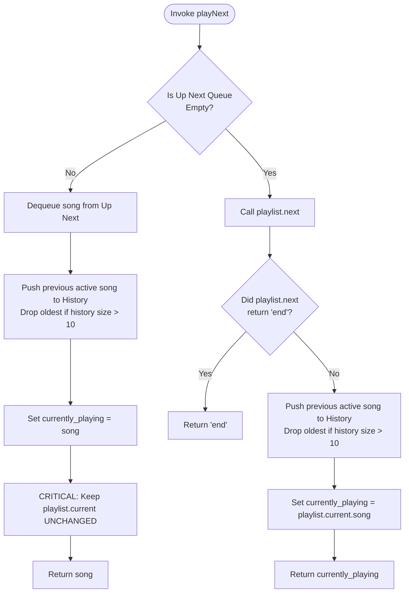
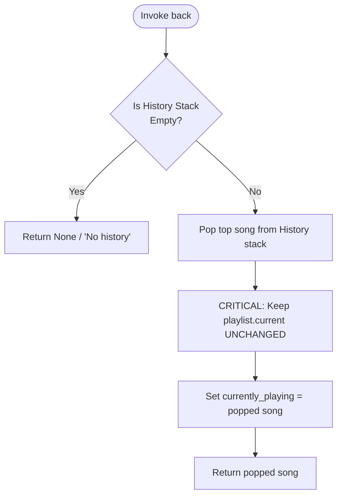

# Milestone 2: Up Next Queue & Playback History — Theoretical Foundations & Architecture

## 1. Executive Summary & Problem Formulation
In high-tier streaming services like **TuneWave**, user listening sessions are rarely purely linear. Listeners routinely:
1. Interject high-priority songs into an **Up Next queue** without disrupting their active playlist progression.
2. Revisit tracks they just experienced using a **back / history** mechanism.

### Formal Problem Rules & Requirements:
1. **Queue Priority Invariant:** Songs in the *Up Next* queue play strictly **before** the normal playlist continues.
2. **Cursor Decoupling Invariant:** Playing a song from *Up Next* or via `back()` from *history* **must not move the playlist position**.
3. **Bounded History Invariant:** The playback history retains at most the **last 10 songs** played. When the 11th song is recorded, the oldest song is dropped ($O(1)$ bottom eviction).
4. **History Replay & Eviction:** Calling `back()` replays the top song from the history stack and **removes it from history**, without altering the playlist cursor.
5. **Required Operations:**
   - `addToUpNext(songId)`
   - `playNext()`
   - `back()`

---

## 2. Theoretical Data Structure Selection

```
                                  +-----------------------+
                                  |   TuneWave Player     |
                                  +-----------------------+
                                              |
               +------------------------------+------------------------------+
               |                                                             |
               v                                                             v
    [ UP NEXT (FIFO Queue) ]                                     [ HISTORY (LIFO Bounded Stack) ]
    Enqueue tail, Dequeue head                                   Push top, Pop top, Max Size = 10
    
        [In] ---> [S5] [S4] ---> [Out]                               [Top (Most Recent)]
                   Queue (FIFO)                                              |
                                                                             v
                                                                        +---------+
                                                                        | Song S3 | (popped by back())
                                                                        +---------+
                                                                        | Song S2 |
                                                                        +---------+
                                                                        | Song S1 |
                                                                        +---------+
                                                                             |
                                                                      [Bottom (Oldest)]
                                                                      (evicted if > 10)
```

### A. Up Next Queue: FIFO (First-In, First-Out)
- **Semantics:** Songs queued by the user must play in the order of their submission.
- **Why Queue?** A FIFO queue naturally orders requests chronologically:
  $$\text{Enqueue}(x): \text{tail} \leftarrow x, \quad \text{Dequeue}(): \text{head} \rightarrow x$$
- **Complexity:** $O(1)$ amortized insertion and extraction via a circular buffer or doubly-linked list (`collections.deque`).

### B. History: Bounded LIFO Stack with Bottom Eviction
- **Semantics:** When a user invokes `back()`, they expect to rewind through their most recently played tracks in reverse chronological order:
  $$\text{Most Recent} \rightarrow \text{Second Most Recent} \rightarrow \dots$$
- **Why Bounded Stack?**
  - Standard stacks permit unbounded growth, leaking memory during prolonged sessions.
  - The requirement dictates that *history keeps the last 10 songs played and drops the oldest*.
  - A double-ended queue bounded to capacity $C = 10$ provides $O(1)$ LIFO push/pop at the right boundary while automatically dropping the oldest element at the left boundary in $O(1)$ when $|H| = 10$.

### C. Playlist Decoupling (Cursor Invariant)
A critical requirement in TuneWave is that:
$$\text{Playlist Position } \mathbf{P}_{\text{curr}} \text{ is invariant under UpNext and History playback.}$$
If a user is listening to Track 2 of an album, enqueues 3 independent singles into Up Next, and listens to them, the album must resume seamlessly at Track 3 once Up Next is exhausted.

---

## 3. Playback Controller & Arbitration Logic

### State Transition Diagram for `playNext()`


### State Transition Diagram for `back()`


---

## 4. Algorithmic Specifications

### 1. `addToUpNext(songId)`
- **Input:** Unique identifier `songId` (or `Song` object).
- **Steps:**
  1. Resolve `songId` to a `Song` instance via catalog or playlist lookup.
  2. If resolved, append to `self.up_next` queue:
     $$\text{up\_next.append}(\text{song})$$
  3. Return `True` (or `False` if song cannot be found).
- **Time Complexity:** $O(1)$.
- **Space Complexity:** $O(1)$ per queued item.

### 2. `playNext()`
- **Steps:**
  1. Check if `len(self.up_next) > 0`:
     - If true:
       - Dequeue `song = self.up_next.popleft()`.
       - Record current playing song to `history`:
         $$\text{if self.currently\_playing is not None: push\_history(self.currently\_playing)}$$
       - Set `self.currently_playing = song`.
       - **Do NOT advance `self.playlist.current`**.
       - Return `song`.
  2. If `self.up_next` is empty:
     - Advance playlist: `res = self.playlist.next()`.
     - If `res == "end"`:
       - Return `"end"`.
     - Else:
       - Record current playing song to `history`.
       - Set `self.currently_playing = res`.
       - Return `self.currently_playing`.
- **Time Complexity:** $O(1)$.
- **Space Complexity:** $O(1)$.

### 3. `back()`
- **Steps:**
  1. Check if `len(self.history) == 0`:
     - Return `None` (no previous song in history).
  2. Pop the most recent track:
     $$\text{song} = \text{self.history.pop()}$$
  3. Set `self.currently_playing = song`.
  4. **Do NOT advance or retreat `self.playlist.current`**.
  5. Return `song`.
- **Time Complexity:** $O(1)$.
- **Space Complexity:** $O(1)$.

### 4. Bounded History Invariant (`push_history`)
- **Capacity:** $K = 10$.
- **Mechanism:**
  - Let $H$ be a double-ended deque with `maxlen=10`.
  - When $H$ contains $[s_1, s_2, \dots, s_{10}]$ and $s_{11}$ is pushed:
    $$H \leftarrow [s_2, s_3, \dots, s_{10}, s_{11}]$$
  - The oldest item $s_1$ is discarded automatically in $O(1)$ time.

---

## 5. Formal Edge-Case Verification Matrix

| Scenario | State Before Operation | Operation | Expected State & Verification |
| :--- | :--- | :--- | :--- |
| **Empty Up Next & History** | `up_next=[]`, `hist=[]`, `curr=P1` | `playNext()` | Advances playlist to `P2`. `hist=[P1]`. `playlist.curr=P2`. |
| **Up Next Preemption** | `up_next=[U1, U2]`, `curr=P1` | `playNext()` | Plays `U1`. `hist=[P1]`. **`playlist.curr` remains `P1`**. |
| **Exhausting Up Next** | `up_next=[U2]`, `curr=P1` | `playNext()` $\times 2$ | 1st: plays `U2` (`curr=P1`). 2nd: plays `P2` (`curr=P2`). Seamless return to playlist! |
| **History Replay (`back()`)** | `hist=[P1, P2]`, `curr=P3` | `back()` | Plays `P2`. `hist=[P1]`. **`playlist.curr` remains `P3`**. |
| **Consecutive Back Calls** | `hist=[P1, P2]`, `curr=P3` | `back()`, then `back()` | 1st returns `P2` (`hist=[P1]`). 2nd returns `P1` (`hist=[]`). |
| **Back on Empty History** | `hist=[]` | `back()` | Returns `None` gracefully without crashing. |
| **History Capacity Overflow**| 12 songs played sequentially | 12 $\times$ `playNext()` | `len(hist) == 10`. Songs 1 and 2 dropped; songs 3 to 12 retained. |
| **Terminal Playlist with Up Next**| `curr=P_last`, `up_next=[U1]` | `playNext()` | Plays `U1` even though playlist is at the end. |

---

## 6. Algorithmic Complexity Summary

$$\begin{array}{|l|c|c|l|}
\hline
\textbf{Operation} & \textbf{Time Complexity} & \textbf{Space Complexity} & \textbf{Justification} \\
\hline
\text{addToUpNext} & O(1) & O(1) & \text{Amortized FIFO queue push at tail} \\
\text{playNext (from Up Next)} & O(1) & O(1) & \text{FIFO queue popleft } O(1) + \text{bounded history push } O(1) \\
\text{playNext (from Playlist)} & O(1) & O(1) & \text{DLL pointer dereference } O(1) + \text{history push } O(1) \\
\text{back} & O(1) & O(1) & \text{LIFO stack pop from right boundary in } O(1) \\
\text{History Eviction} & O(1) & O(1) & \text{Bounded ring buffer / deque capacity trim } O(1) \\
\hline
\end{array}$$

The combination of a FIFO queue, a bounded LIFO stack, and an isolated playlist pointer achieves strict adherence to all TuneWave playback specifications.
