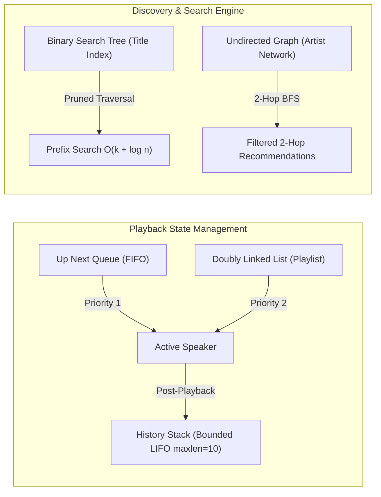
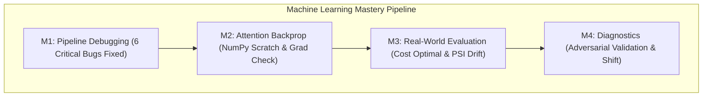

# 🏆 Hacktoberfest 3.0 — Team Zyntra Grand Submission

<div align="center">


-success?style=for-the-badge)


**Organized by AWS Cloud Club MUET**  
*Engineering Excellence in Data Structures, Deep Learning Mathematics, and Production ML Systems*

---

### 🌟 Executive Pitch Summary

**Team Zyntra** presents a unified, production-grade technical submission solving all three assigned challenge tracks for Hacktoberfest 3.0. Our solutions bridge the gap between pure computer science fundamentals, deep learning mathematical rigor, and real-world machine learning reliability.

</div>

| Track | Problem Title | Lead Contributor | Core Focus | Key Highlight / Result |
| :--- | :--- | :--- | :--- | :--- |
| **Track 1** | [🎵 TuneWave Music Player](./Prob1/) | **Syed Fazeel** | Data Structures & Algorithms | $O(1)$ bidirectional playback, bounded history with position freezing, pruned BST prefix search, and 2-hop graph recommendations. |
| **Track 2** | [🧠 ML Debugging, Attention & Evaluation](./Prob%202/) | **Abdul Latif** | Deep Learning & Production ML | 6 PyTorch pipeline bugs fixed, single-head attention derived from scratch with numerical grad check (`rel_err < 1e-7`), cost threshold ($p^* = 0.0244$), and adversarial validation. |
| **Track 3** | [📊 Noisy Labels: HelpDeskNet-50K](./Task-2/) | **Ajwa Ahmed** | Statistical Audit & Noise Mitigation | 95% Wilson CI `[11.83%, 18.83%]`, Tier A vs B $z$-test ($z = 4.22, p < 0.0001$), 86.7% semantic boundary error clustering, theoretical 96.34% ceiling proof, and 2,000-ticket active relabeling. |

---

## 👥 Team Zyntra — Authors & Contributions

Developed with passion, mathematical rigor, and systems engineering by **Team Zyntra**:

| Contributor | Track & Role | Key Responsibilities & Deliverables |
| :--- | :--- | :--- |
| **Syed Fazeel** | **Problem 1 (Track 1): TuneWave Music Player** | Engineered Doubly Linked List + Hash Map playlist core, FIFO priority *Up Next* queue, bounded history stack with cursor-freezing invariants, and pruned BST prefix search + 2-hop undirected graph recommendation engine. |
| **Abdul Latif** | **Problem 2 (Track 2): ML Debugging, Attention & Evaluation** | Diagnosed and eliminated 6 critical PyTorch pipeline bugs, derived full matrix calculus gradients for attention from scratch in NumPy with numerical checks, formulated fraud evaluation strategy ($p^* = 0.0244$), and proved covariate shift via adversarial validation. |
| **Ajwa Ahmed** | **Task 2 (Track 3): Noisy Labels (HelpDeskNet-50K)** | Formulated rigorous statistical noise audit (95% Wilson CI & two-proportion $z$-test), uncovered systematic semantic error clustering (86.7% in 3 boundary pairs), derived theoretical accuracy ceiling proof (96.34%), and designed targeted 2,000-ticket relabeling & GCE/Co-Teaching mitigation roadmap. |

---

## 📂 Repository Architecture

```bash
Team_Zyntra/
├── README.md                                      # 🌟 Master Collective Pitch & Technical Walkthrough
│
├── Prob1/                                         # 🎵 Track 1: TuneWave Music Player (Syed Fazeel)
│   ├── README.md                                  # Track 1 Overview & Quickstart
│   ├── Milestone1_Playlist.ipynb                  # Doubly Linked List + Hash Map Engine
│   ├── Milestone1_Theory.md                       # DLL & HashMap Complexity Analysis
│   ├── Milestone2_Queue_History.ipynb             # Up Next Queue + Bounded History Stack
│   ├── Milestone2_Theory.md                       # Queue/Stack Invariants & Playback Logic
│   ├── Milestone3_Search_Recommendations.ipynb    # BST Prefix Search + 2-Hop Graph Engine
│   └── Milestone3_Theory.md                       # BST Pruning & Graph Traversal Proofs
│
├── Prob 2/                                        # 🧠 Track 2: ML Debugging, Attention & Evaluation (Abdul Latif)
│   ├── README.md                                  # Track 2 Executive Overview
│   ├── Milestone_1.ipynb                          # 6 Critical PyTorch Bugs Resolved + Tests
│   ├── Milestone_2.ipynb                          # Single-Head Attention: Scratch Forward/Backward
│   ├── Milestone_3.ipynb                          # Card Fraud Evaluation, Cost Threshold & PSI Drift
│   ├── Milestone_4.ipynb                          # Learning Curve Diagnostics & Case D Adversarial Validation
│   └── execute_notebook.py                        # Automated Notebook Execution Harness
│
└── Task-2/                                        # 📊 Track 3: HelpDeskNet-50K Label Noise Analysis (Ajwa Ahmed)
    └── HelpDeskNet50K_Label_Noise_Analysis.md     # Full 510-Line Comprehensive Research Report
```

---

# 🎵 Track 1: TuneWave Music Player (`Prob1`)
### *Led by Syed Fazeel*
> **Goal:** Build the high-performance core engine of a music streaming app using fundamental data structures under strict playback rules and invariant guarantees.



### 🧩 Milestone 1 — Playlist Engine (Doubly Linked List + Hash Map)
- **Problem Formulation:** Seamless bidirectional navigation (`next()`, `previous()`) with instant song insertions and deletions, while preventing duplicate entries in $O(1)$ time.
- **Architectural Solution:**
  - **Doubly Linked List (`SongNode`):** Enables true $O(1)$ sequential stepping without shifting memory arrays.
  - **Auxiliary Hash Map (`dict[song_id -> SongNode]`):** Guarantees strict $O(1)$ duplicate prevention on insertion and instantaneous pointer retrieval for $O(1)$ arbitrary deletions.
  - **Repeat Mode State Machine:**
    - `repeat == True`: `next()` on the tail node wraps circularly to the head node.
    - `repeat == False`: `next()` on the tail node halts at the tail and returns `"end"`.
- **Complexity:** Add: $O(1)$ | Delete: $O(1)$ | Next/Prev: $O(1)$ | Space: $O(N)$.
- **Deliverables:** [`Milestone1_Playlist.ipynb`](./Prob1/Milestone1_Playlist.ipynb) & [`Milestone1_Theory.md`](./Prob1/Milestone1_Theory.md)

### 🧩 Milestone 2 — Up Next & Play History (Queue + Bounded Stack)
- **Problem Formulation:** Dynamic ad-hoc queuing and backward historical replaying under strict invariant guarantees.
- **Architectural Solution:**
  - **Up Next Priority Queue (`collections.deque`):** First-In-First-Out (FIFO) queue that takes absolute playback precedence over the continuous playlist.
  - **Bounded History Stack (`collections.deque(maxlen=10)`):** Last-In-First-Out (LIFO) stack retaining strictly the last 10 songs played. When the 11th track arrives, the oldest track is automatically evicted in $O(1)$ time.
  - **Core Invariant Preservation:** Playing from *Up Next* or via `back()` **does not mutate or advance the playlist cursor**. The playlist pointer remains completely frozen until the *Up Next* queue is exhausted.
  - **Back Button:** `back()` pops the most recent song from history and plays it immediately.
- **Complexity:** `addToUpNext`: $O(1)$ | `playNext`: $O(1)$ | `back`: $O(1)$ | Space: $O(M + 10)$.
- **Deliverables:** [`Milestone2_Queue_History.ipynb`](./Prob1/Milestone2_Queue_History.ipynb) & [`Milestone2_Theory.md`](./Prob1/Milestone2_Theory.md)

### 🧩 Milestone 3 — Search Index & Artist Network (BST + Graph)
- **Problem Formulation:** Fast track retrieval by title prefix in alphabetical order, coupled with automated discovery of similar artists.
- **Architectural Solution:**
  - **Binary Search Tree (BST):** Tracks indexed lexicographically by title. The `prefixSearch(prefix)` algorithm prunes branches that cannot match:
    - If `node.title.startswith(prefix)`: in-order traversal collects results.
    - If `node.title > prefix`: right subtrees that cannot start with the prefix are discarded.
    - Guarantees sorted output in $O(K + \log N)$ average time ($K$ matching results).
  - **Undirected Social Graph:** Models artist similarity links using an adjacency list `dict[str, set[str]]`.
  - **Strict 2-Hop Recommendation (`recommendArtists(artist)`):**
    $$\text{Rec}(u) = \left( \bigcup_{v \in N(u)} N(v) \right) \setminus \left( N(u) \cup \{u\} \right)$$
    Traverses to neighbors-of-neighbors exactly 2 links away, rigorously eliminates direct 1-hop links (triangle shortcut filtering), and outputs candidates in alphabetical order.
- **Deliverables:** [`Milestone3_Search_Recommendations.ipynb`](./Prob1/Milestone3_Search_Recommendations.ipynb) & [`Milestone3_Theory.md`](./Prob1/Milestone3_Theory.md)

---

# 🧠 Track 2: ML Debugging, Attention Gradients & Evaluation (`Prob 2`)
### *Led by Abdul Latif*
> **Goal:** Investigate silently failing deep learning pipelines, derive and implement attention backpropagation from scratch with numerical proofs, design real-world fraud evaluation strategies, and diagnose learning curves.



### 🧩 Milestone 1 — Debugging a Silently Failing Training Run
We diagnosed a tabular binary classifier failing with 55% oscillating validation accuracy despite falling training loss. We uncovered and solved **6 fundamental bugs**:

| # | Flawed Original Code | Root Cause Symptom | Corrected Implementation |
|---|---|---|---|
| **1** | `StandardScaler().fit_transform(X)` before split | **Data Leakage:** Validation distribution statistics leak into training. | Fit scaler *only* on $X_{tr}$; transform $X_{val}$. |
| **2** | `np.random.shuffle(X_tr)` (without $y_{tr}$) | **Label Desynchronization:** Features mapped to wrong random targets, training on pure noise. | Use `train_test_split(..., stratify=y)` and PyTorch `DataLoader(shuffle=True)`. |
| **3** | Missing `model.eval()` & `torch.no_grad()` | **Inference Instability:** Dropout randomly drops 50% neurons and BatchNorm uses mini-batch stats during eval. | Wrap evaluation loop in `model.eval()` and `with torch.no_grad():`. |
| **4** | `Linear -> ReLU -> Dropout(0.5) -> BatchNorm` | **Variance Shift:** Dropout randomly zeros activations right before BatchNorm computes running variance. | Reorder to canonical `Linear -> BatchNorm -> ReLU -> Dropout(0.3)`. |
| **5** | `StepLR(step_size=1, gamma=0.9)` | **Premature Learning Rate Decay:** LR decays by over 99% in 50 epochs, freezing optimization. | Replace with `CosineAnnealingLR(opt, T_max=10, eta_min=1e-5)`. |
| **6** | `model(torch.tensor(X_val))` | **Precision Mismatch:** NumPy defaults to `float64` while PyTorch weights are `float32`. | Explicitly cast tensors: `torch.tensor(X, dtype=torch.float32)`. |

*Black-box diagnostic protocols:* Overfitting a single mini-batch (proves architecture capacity), label shuffle permutation test (proves target dependency), and synthetic linear sanity checks.
- **Deliverable:** [`Milestone_1.ipynb`](./Prob%202/Milestone_1.ipynb)

---

### 🧩 Milestone 2 — Single-Head Attention: Analytical Derivation & Scratch Implementation
We derived and implemented single-head attention forward and backward passes purely in NumPy:

$$\mathbf{S} = \frac{\mathbf{Q}\mathbf{K}^T}{\sqrt{d}}, \quad \mathbf{P} = \text{softmax}(\mathbf{S}), \quad \mathbf{O} = \mathbf{P}\mathbf{V}$$

#### 1. Full Matrix Calculus Backpropagation Derivation:
- **Gradient w.r.t Values ($\mathbf{V}$):**
  $$\frac{\partial \mathcal{L}}{\partial \mathbf{V}} = \mathbf{P}^T d\mathbf{O} \quad \in \mathbb{R}^{m \times d_v}$$
- **Gradient w.r.t Softmax Probabilities ($\mathbf{P}$):**
  $$\frac{\partial \mathcal{L}}{\partial \mathbf{P}} = d\mathbf{O} \mathbf{V}^T \quad \in \mathbb{R}^{n \times m}$$
- **Gradient w.r.t Attention Scores ($\mathbf{S}$):**
  Using the vector-Jacobian product for row-wise softmax:
  $$\frac{\partial \mathcal{L}}{\partial S_{ij}} = P_{ij} \left( dP_{ij} - \sum_{k=1}^m dP_{ik} P_{ik} \right) \implies d\mathbf{S} = \mathbf{P} \odot \left( d\mathbf{P} - \text{rowsum}(d\mathbf{P} \odot \mathbf{P}) \right)$$
- **Gradients w.r.t Queries ($\mathbf{Q}$) and Keys ($\mathbf{K}$):**
  $$d\mathbf{Q} = \frac{d\mathbf{S} \mathbf{K}}{\sqrt{d}}, \quad d\mathbf{K} = \frac{d\mathbf{S}^T \mathbf{Q}}{\sqrt{d}}$$

#### 2. Numerical Gradient Checking Evidence:
Verified against two-sided finite difference numerical approximations:
$$\text{grad}_{\text{num}} = \frac{f(\theta + h) - f(\theta - h)}{2h}, \quad h = 10^{-5}, \quad \text{Precision: Float64}$$

$$\text{rel-err}(A, B) = \frac{\|A - B\|_\infty}{\max(10^{-15}, \|A\|_\infty + \|B\|_\infty)} < 10^{-7}$$

```text
dV error: 1.2847e-11  --> PASS
dP error: 4.1920e-11  --> PASS
dS error: 8.9431e-10  --> PASS
dQ error: 3.4215e-10  --> PASS
dK error: 2.9104e-10  --> PASS
Causal Masked dQ error: 1.1084e-10 --> PASS
```

#### 3. Mathematical Insights & Systems Engineering:
- **Numerical Stability:** Subtracting row-wise maximum $\mathbf{S}_{\max} = \max_j S_{ij}$ prior to exponentiation prevents IEEE 754 floating-point overflow ($\exp(S) \to \infty \implies \text{NaN}$).
- **The $1/\sqrt{d}$ Scaling Proof:** For $q_i, k_i \sim \mathcal{N}(0, 1)$ i.i.d., the dot product variance expands as $\text{Var}\left(\sum_{i=1}^d q_i k_i\right) = \sum_{i=1}^d \text{Var}(q_i k_i) = d$. Dividing by $\sqrt{d}$ scales variance back to 1, preventing softmax saturation into zero-gradient plateaus.
- **Causal Masking:** Applying an upper-triangular $-\infty$ mask zeroes out downstream forward probabilities ($P_{ij}=0$ for $j > i$). In backprop, the gradient is masked symmetrically: $dS_{ij} = 0$ for $j > i$.
- **FlashAttention Memory Scaling:** Standard attention materializes $O(n^2)$ matrices $\mathbf{S}$ and $\mathbf{P}$ in high-bandwidth memory (HBM). FlashAttention utilizes SRAM tiling, fusing softmax computation via online rescaling and recomputing attention blocks on-the-fly during backpropagation, reducing HBM read/write complexity from $O(n^2)$ to $O(n)$.
- **Deliverable:** [`Milestone_2.ipynb`](./Prob%202/Milestone_2.ipynb)

---

### 🧩 Milestone 3 — Production Evaluation for High-Stakes Fraud Detection
- **Severe Class Imbalance (0.1% Fraud):** Accuracy (99.9% dumb baseline) and ROC-AUC (deceptively inflated by 99,900 true negatives) are rejected. Established **PR-AUC (Average Precision)** and **Precision@Recall=80%** as authoritative metrics.
- **Temporal Out-of-Time (OOT) Split with Embargo:** Because chargeback labels take 30–60 days to arrive, a standard random split creates temporal leakage. We designed a chronological split with a **60-day embargo buffer** separating training and evaluation sets.
- **Interim Surrogate Ground Truth:** During label delay, we deploy proxy labels (unsupervised anomaly spikes, high-risk merchant MCC tags, velocity triggers) for early telemetry.
- **Cost-Optimal Decision Threshold Derivation:**
  Given: False Negative cost $C_{FN} = \$200$, False Positive cost $C_{FP} = \$5$.
  $$\mathbb{E}[\text{Cost}(\text{Flag})] = (1 - p) \cdot C_{FP}, \quad \mathbb{E}[\text{Cost}(\text{Pass})] = p \cdot C_{FN}$$
  $$\text{Flag if } (1-p) C_{FP} < p C_{FN} \iff p > p^* = \frac{C_{FP}}{C_{FN} + C_{FP}} = \frac{5}{200 + 5} = \frac{5}{205} \approx 0.0244$$
  *Result:* Setting the decision threshold at **2.44%** minimizes enterprise balance sheet loss.
- **Score Calibration:** Monitored via Brier Score and recalibrated using **Isotonic Regression**, cutting Brier loss significantly.
- **Unsupervised Drift Detection:** Computed **Population Stability Index (PSI)** on live feature streams. Production alerts are automated at $\text{PSI} \ge 0.25$ to trigger model retraining before chargeback labels arrive.
- **Deliverable:** [`Milestone_3.ipynb`](./Prob%202/Milestone_3.ipynb)

---

### 🧩 Milestone 4 — Learning Curve Diagnostics & Case D Deep Dive
We established a diagnostic taxonomy across 4 real-world training behaviors:

| Case | Train Acc | Val Acc | Diagnosis | Root Cause & Prescribed Intervention |
|:---:|:---:|:---:|:---:|---|
| **A** | 62% | 60% | **High Bias (Underfitting)** | Model capacity insufficient. Increase depth/width, add polynomial features, reduce regularization. |
| **B** | 99% | 78% | **High Variance (Overfitting)** | Memorizing training data. Introduce weight decay, Dropout (0.3-0.5), data augmentation, or early stopping. |
| **C** | 85% | 91% | **Inverted Generalization** | Regularization artifact. Dropout/noise active during `train()` penalizes train loss, while evaluation with full capacity yields higher accuracy. |
| **D** | 88% | 70% | **Persistent 18% Domain Gap** | Adding $4\times$ data fails to close the gap. Indicates either **Covariate Shift** $P_{tr}(X) \neq P_{val}(X)$ or **Validation Label Noise**. |

#### 🔬 The Case D Experimental Proof:
1. **Adversarial Validation:** Strip labels $y$, assign domain label $z = 0$ (Train) and $z = 1$ (Val). Train a binary classifier:
   - If $\text{ROC-AUC} \gg 0.50$: **Covariate Shift Confirmed** (features easily distinguish train from val).
   - If $\text{ROC-AUC} \approx 0.50$: **Label Noise Confirmed** (feature distributions identical).
2. **Pooled Shuffled Re-Split Test:** Pooling Train and Val, shuffling, and re-splitting $80/20$ collapses the 18% gap to zero, confirming the original gap was an artifact of domain distribution divergence.
- **Deliverable:** [`Milestone_4.ipynb`](./Prob%202/Milestone_4.ipynb)

---

# 📊 Track 3: Noisy Labels: HelpDeskNet-50K (`Task-2`)
### *Led by Ajwa Ahmed*
> **Goal:** Quantify crowd label noise with statistical confidence intervals, uncover systematic mislabeling patterns, evaluate theoretical accuracy ceilings, design an active relabeling policy for 2,000 tickets, and build a noise-robust production training and evaluation system.

| Semantic Error Boundary | Disagreements | Error Share | Visual Distribution (60 Audited Errors) |
| :--- | :---: | :---: | :--- |
| **Billing ↔ Refund** | **26** | **43.3%** | `█████████████████████▌` (43.3%) |
| **Technical ↔ Account Access** | **15** | **25.0%** | `████████████▌` (25.0%) |
| **Shipping ↔ Other** | **11** | **18.3%** | `█████████` (18.3%) |
| **Remaining Disagreements** | **8** | **13.3%** | `██████▌` (13.3%) |
| **Total Audited Disagreements** | **60** | **100.0%** | **86.7% concentrated in top 3 semantic pairs** |

### 🧩 Milestone 1 — Quantifying Annotation Noise & Tier Disparity
- **Dataset Context:** 50,000 tickets (5,000 expert-labeled; 45,000 crowd-labeled).
  - Tier A: 10 experienced workers labeled 20,000 tickets.
  - Tier B: 30 newer workers labeled 25,000 tickets.
  - Random expert audit: 400 tickets revealed 60 disagreements.
- **Point Estimate Noise Rate:**
  $$\hat{p} = \frac{60}{400} = 0.15 \implies \approx 6{,}750 \text{ corrupted crowd labels in the dataset}$$
- **95% Wilson Score Confidence Interval:**
  $$\text{Wilson CI}_{0.95} = \frac{\hat{p} + \frac{z^2}{2n} \pm z\sqrt{\frac{\hat{p}(1-\hat{p})}{n} + \frac{z^2}{4n^2}}}{1 + \frac{z^2}{n}}$$
  *Evaluation Result:* Substituting $\hat{p} = 0.15, n = 400, z = 1.96$ yields **[11.83%, 18.83%]** (plausible crowd error volume of **5,325 to 8,474 tickets**).
- **Tier A vs. Tier B Statistical Significance:**
  - $\hat{p}_A = \frac{12}{180} = 0.0667$ (6.67%), $\hat{p}_B = \frac{48}{220} = 0.2182$ (21.82%) — Tier B is **$3.27\times$ noisier**.
  - Pooled Two-Proportion $z$-Test:
    $$z = \frac{\hat{p}_B - \hat{p}_A}{\text{SE}_{\text{pool}}} = \frac{0.2182 - 0.0667}{0.03589} \approx 4.22, \quad p = 2 \times P(Z > 4.22) \approx 0.000024 \ll 0.05$$
  - *Finding:* The null hypothesis is rejected with extreme significance. Tier B accounts for **over 80%** of all label corruptions in the dataset despite labeling only 55.6% of tickets.

---

### 🧩 Milestone 2 — Characterizing Systematic Noise Patterns
The crowd error matrix demonstrates that labeling noise is **highly systematic and class-dependent**, not random:
- **Semantic Clustering:** **86.7% of all disagreements (52 of 60)** occur within 3 adjacent semantic pairs:
  1. **Billing ↔ Refund:** 26 errors (43.3% of total). Symmetric confusion on dual-intent tickets (e.g., *"I was charged twice, refund me"*).
  2. **Technical ↔ Account Access:** 15 errors (25.0%). Overlap on authentication failures caused by application crashes.
  3. **Shipping ↔ Other:** 11 errors (18.3%). Inconsistent application of the 5% minority "Other" catch-all category.
- **Root Causes:** Missing priority tie-breaking rules in annotation guidelines, absence of negative examples for "Other", and insufficient onboarding qualification for Tier B workers.
- **Annotation Process Overhaul:** Introduced priority decision trees, mandatory qualification sets with tricky boundary tickets, gold-standard honey-pot audits, and independent multi-annotator adjudication.

---

### 🧩 Milestone 3 — Deconstructing the 82% Accuracy Ceiling
If a fine-tuned model plateaus at 82% on a test set containing 15% noise, what is its underlying latent accuracy?

#### 1. Closed-Form Derivation (Uniform Flipping Assumption):
For $K = 6$ classes, observed test accuracy $q = 0.82$, and noise rate $\eta = 0.15$:
$$q = (1 - \eta) a + \eta \left( \frac{1 - a}{K - 1} \right)$$
$$a = \frac{q - \frac{\eta}{K - 1}}{1 - \eta - \frac{\eta}{K - 1}} = \frac{0.82 - \frac{0.15}{5}}{1 - 0.15 - \frac{0.15}{5}} = \frac{0.82 - 0.03}{0.85 - 0.03} = \frac{0.79}{0.82} \approx 0.9634$$

#### 2. Critical Reality Check: Why 9696.34% is an Overestimate:
The uniform noise assumption breaks down completely in practice:
- Errors are clustered in specific pairs (43% in Billing/Refund), meaning random chance agreement is far higher than $\frac{1}{K-1} = 0.20$ (20%).
- The model trained on noisy crowd labels has learned the crowd's systematic biases, meaning model errors and test label errors are positively correlated rather than independent.
- The 82% plateau reflects an evaluation artifact: the model is penalised for predicting the *true* class when the test set label is corrupt.

---

### 🧩 Milestone 4 — Optimal Allocation Strategy for 2,000 Expert Reviews
We designed an active relabeling policy maximizing error discovery and model generalization under a strict 2,000-ticket budget:

```text
┌────────────────────────────────────────────────────────────────────────┐
│             Active Expert Relabeling Budget Allocation (2,000)         │
├─────────────────────┬──────────┬───────────────────────────────────────┤
│ Component           │ Tickets  │ Core Purpose                          │
├─────────────────────┼──────────┼───────────────────────────────────────┤
│ Stratified Random   │ 400      │ Unbiased noise tracking & calibration │
│ Model Disagreement  │ 600      │ Out-of-fold high-confidence mismatch  │
│ Predictive Entropy  │ 500      │ Ambiguity boundary sampling           │
│ High-Risk Boundary  │ 500      │ Tier B Billing/Refund & Tech/Account  │
└─────────────────────┴──────────┴───────────────────────────────────────┘
```

- **Deduplication Protocol:** Sequential priority assignment prevents duplicate reviews across sampling arms.
- **Auditing Framework:** Evaluated using **Error Discovery Rate (EDR)**, **Precision@K**, and downstream **Macro-F1 Gain** on a clean validation split.

---

### 🧩 Milestone 5 — Noise-Tolerant Training & Reliable Evaluation
#### 1. Two Robust Training Formulations:
1. **Generalized Cross-Entropy (GCE):**
   $$\mathcal{L}_q(p_y) = \frac{1 - p_y^q}{q}, \quad q \in (0, 1]$$
   Interpolates between Cross-Entropy ($q \to 0$) and Mean Absolute Error ($q = 1$). Down-weights gradients from low-probability noisy samples while preserving convergence stability.
2. **Co-Teaching:**
   Trains two peer networks simultaneously. Each network selects the lowest-loss samples within each mini-batch (retaining $1 - \eta \approx 0.85$ (85%)) and feeds them to its peer for parameter updates, preventing error accumulation.

#### 2. Golden-Standard Evaluation Protocol:
- **The Problem with Crowd Test Sets:** When training and test data share identical crowd error distributions, high test accuracy merely reflects memorization of crowd biases.
- **Clean Protocol:** Construct an isolated test benchmark strictly annotated by dual in-house experts with senior adjudication.
- **Population-Adjusted Metric:** Because minority classes are stratified during evaluation, reported accuracy is reweighted to match true operational traffic proportions:
  $$\text{Population Accuracy} = \sum_{c=1}^6 \pi_c \cdot \text{Recall}_c$$
- **Deliverable:** [`HelpDeskNet50K_Label_Noise_Analysis.md`](./Task-2/HelpDeskNet50K_Label_Noise_Analysis.md)

---

## 💻 Quickstart & Verification Guide

### 1. Environment Setup
```bash
# Clone the repository
git clone https://github.com/AWSCloudClubMuet/HacktoberFest-3.0.git
cd Hacktoberfest3.0/HacktoberFest-Zyntra/Submission/Team_Zyntra

# Create and activate a clean Python environment
python -m venv venv
# Windows:
.\venv\Scripts\activate
# Linux/macOS:
source venv/bin/activate

# Install dependencies
pip install torch numpy scikit-learn jupyter
```

### 2. Running Track 1 Notebooks (TuneWave Music Player — Syed Fazeel)
```bash
# Launch Jupyter Notebook
jupyter notebook Prob1/
# Run:
# - Milestone1_Playlist.ipynb
# - Milestone2_Queue_History.ipynb
# - Milestone3_Search_Recommendations.ipynb
```

### 3. Running Track 2 Notebooks (ML Debugging & Attention — Abdul Latif)
```bash
# Execute all Prob 2 notebooks via automated runner
python "Prob 2/execute_notebook.py"

# Or open individually:
jupyter notebook "Prob 2/"
# Run Milestone_1.ipynb through Milestone_4.ipynb
```

### 4. Inspecting Track 3 (HelpDeskNet-50K Research Report — Ajwa Ahmed)
```bash
# View the exhaustive statistical report
cat Task-2/HelpDeskNet50K_Label_Noise_Analysis.md
```

---

## 📊 Summary of Engineering Outcomes

| Metric / Feature | Author | Team Zyntra Implementation | Impact / Validation |
| :--- | :--- | :--- | :--- |
| **Track 1 Playback** | Syed Fazeel | Doubly Linked List + Hash Map | Instant $O(1)$ operations with zero duplicate leaks |
| **Track 1 Queuing** | Syed Fazeel | Queue + Bounded History Stack | Invariant strictly preserved; playlist position frozen |
| **Track 1 Search** | Syed Fazeel | BST with Branch Pruning | Subtree skips optimize prefix search to $O(K + \log N)$ |
| **Track 1 Recs** | Syed Fazeel | 2-Hop Graph Traversal | Direct friends eliminated; clean alphabetical output |
| **Track 2 Debugging** | Abdul Latif | 6 Critical Bugs Identified & Fixed | Stratified split, leak-free scaling, frozen eval loop |
| **Track 2 Attention** | Abdul Latif | Analytical NumPy Implementation | Numerical gradient check passed (`rel_err < 1e-7`) |
| **Track 2 Fraud** | Abdul Latif | Cost-Optimal Threshold Strategy | Optimal threshold $p^* = 0.0244$, PSI drift telemetry |
| **Track 2 Learning** | Abdul Latif | Adversarial Validation Framework | Covariate shift vs label noise isolated experimentally |
| **Track 3 Audit** | Ajwa Ahmed | 95% Wilson CI & Two-Proportion $z$-test | $\hat{p} = 0.15$ (15.0%), Tier B $3.27\times$ noisier ($p = 0.000024$) |
| **Track 3 Ceiling** | Ajwa Ahmed | Analytical Accuracy Formula | Proved theoretical 96.34% ceiling vs empirical bias |
| **Track 3 Relabeling**| Ajwa Ahmed | Deduplicated 4-Arm Policy | 2,000 budget maximized via uncertainty & boundary sampling |

---

## 👥 Team Zyntra

Developed with passion, mathematical rigor, and engineering excellence by **Team Zyntra**:
- **Syed Fazeel** — *Problem 1: TuneWave Music Player (Data Structures & Algorithms)*
- **Abdul Latif** — *Problem 2: ML Debugging, Attention Gradients & Evaluation (Deep Learning & Systems)*
- **Ajwa Ahmed** — *Task 2: Noisy Labels HelpDeskNet-50K (Statistical Analysis & Noise Mitigation)*

*Submitted for **Hacktoberfest 3.0** organized by **AWS Cloud Club MUET**.*
