<p align="center">
  
</p>

<p align="center">
  
  
  
  
  
  
  
</p>

<h3 align="center">A trusted campus marketplace where students offer skills, request help, and build a reputation.</h3>

<p align="center">
  Paid gigs &middot; Skill swaps &middot; Free help &middot; Mutual reviews &middot; Full English / Urdu (RTL) support
</p>

<p align="center">
  <a href="#-quick-start">Quick start</a> &bull;
  <a href="#-features">Features</a> &bull;
  <a href="#-screenshots">Screenshots</a> &bull;
  <a href="#-how-it-works">How it works</a> &bull;
  <a href="#-testing">Testing</a> &bull;
  <a href="#-deployment">Deploy</a>
</p>

---

## 📖 Table of contents

- [About the project](#-about-the-project)
- [Features](#-features)
- [Screenshots](#-screenshots)
- [How it works](#-how-it-works)
- [Tech stack](#-tech-stack)
- [Project structure](#-project-structure)
- [Quick start](#-quick-start)
- [Demo accounts](#-demo-accounts)
- [Environment variables](#-environment-variables)
- [API reference](#-api-reference)
- [Testing](#-testing)
- [Security](#-security)
- [Deployment](#-deployment)
- [Troubleshooting](#-troubleshooting)
- [Moving to another laptop](#-moving-to-another-laptop)

---

## 🎯 About the project

**CampusGig** (also called *Campus Gig & SkillSwap Portal*) gives students a trusted, organised place to find collaborators, offer services, apply for work and review the outcome.

Any student can be a **Poster** or an **Applicant**, depending on the gig. A gig can be **Paid**, a **Skill Swap**, or **Free**. After the work is done, both people review each other and the profile rating updates automatically.

> Built as a hackathon project, following a written PRD, TRD, API contract and user-flow document.

---

## ✨ Features

| | Feature | What it does |
|---|---|---|
| 🔐 | **Real accounts** | Sign up with your own profile, log in, log out. Passwords are hashed and sessions use signed tokens. |
| 🧑‍🎓 | **Student profiles** | Name, major, semester, bio, skills, gigs posted, gigs completed, average rating and received reviews. |
| 📝 | **Create gigs** | *Offering* a skill or *Requesting* help, in four categories: Programming, Design, Writing, Tutoring. |
| 💸 | **Three payment types** | Paid (with a PKR budget), Skill Swap, or Free. The budget is only allowed on Paid gigs. |
| 🔎 | **Search and filters** | Keyword search, category, type, payment type and budget range, plus sort options. |
| 📨 | **Apply with a message** | One application per gig. Applying to your own gig, to a closed gig, or twice is blocked. |
| ✅ | **Owner tools** | Accept one applicant (others are rejected automatically), reject others, mark a gig complete, or cancel an Open gig. |
| ⭐ | **Mutual reviews** | After completion the owner and the accepted applicant each leave one rating and comment. |
| 🏅 | **Calculated reputation** | The average rating is always calculated from stored reviews, never edited by hand. |
| ⏳ | **Expired gigs** | An Open gig past its deadline shows as *Expired* (computed on read, never stored). |
| 🌍 | **English and Urdu** | One click switches the whole interface and flips the layout to right-to-left. The choice is remembered. |
| 🎭 | **Demo page** | Log in as any of the 12 seeded students with a single click. |
| 📱 | **Responsive** | Works on desktop and mobile, with loading skeletons, empty states and translated error messages. |

---

## 🖼️ Screenshots

<table>
  <tr>
    <td width="50%"><b>Home</b><br>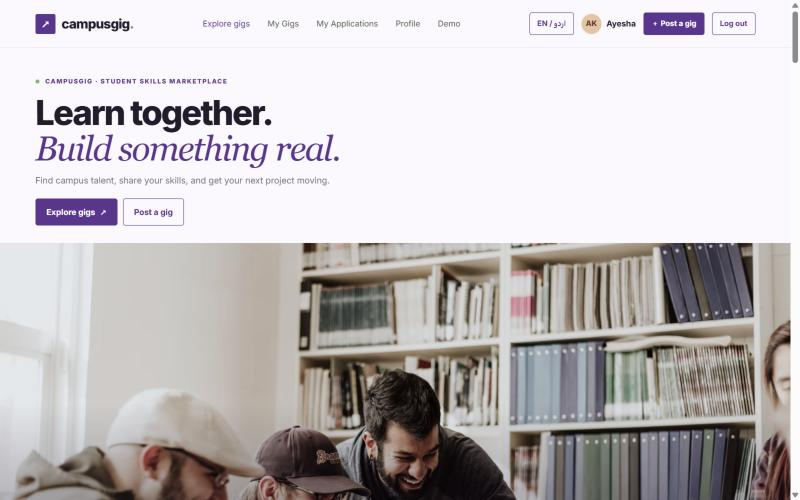</td>
    <td width="50%"><b>Browse, search and filters</b><br>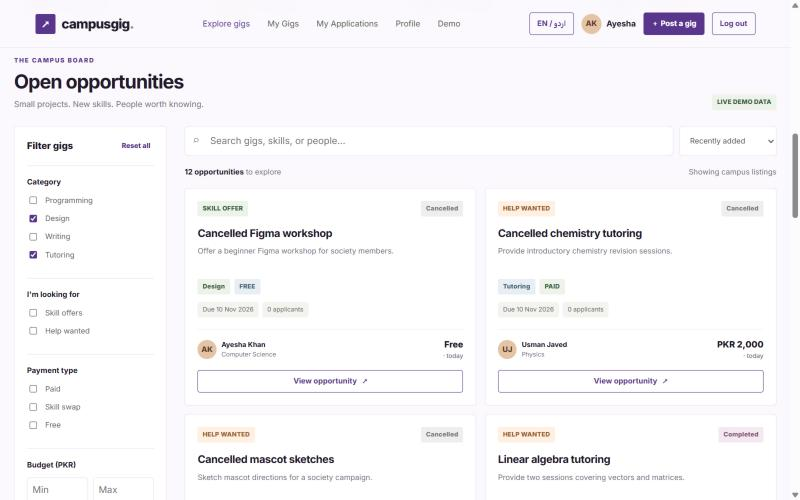</td>
  </tr>
  <tr>
    <td><b>Gig details and apply</b><br>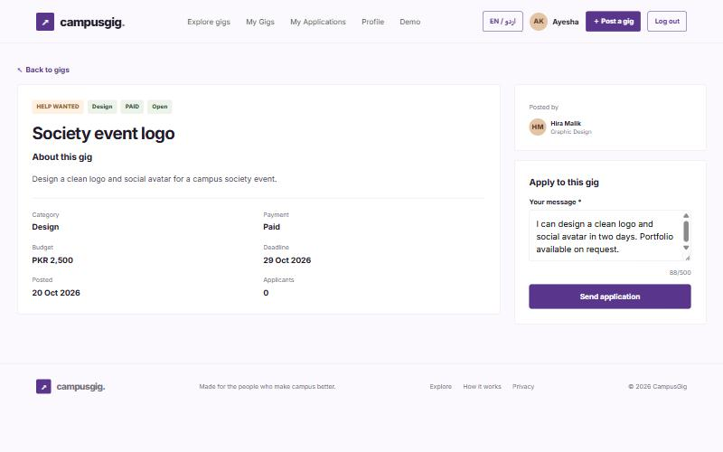</td>
    <td><b>My Gigs: applicants, accept or reject</b><br>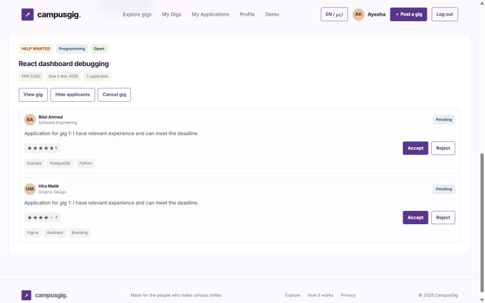</td>
  </tr>
  <tr>
    <td><b>Create a gig</b><br>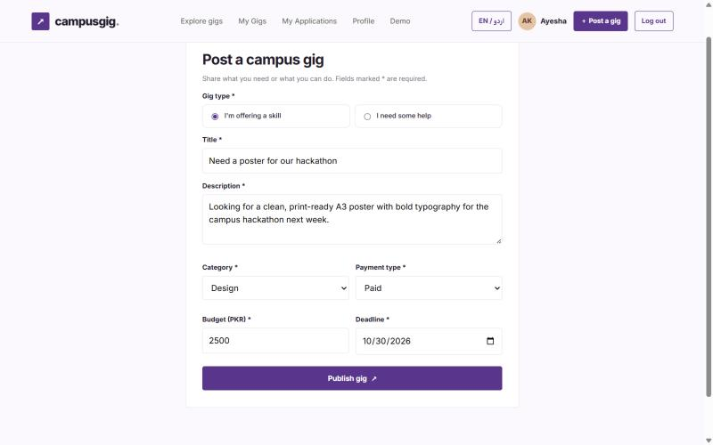</td>
    <td><b>Profile with stats and reviews</b><br>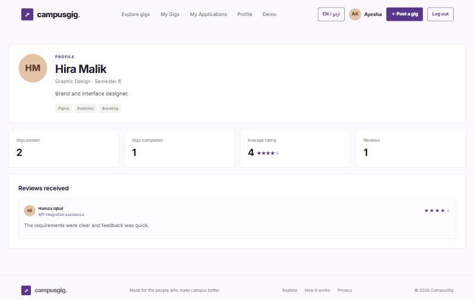</td>
  </tr>
  <tr>
    <td><b>Log in</b><br>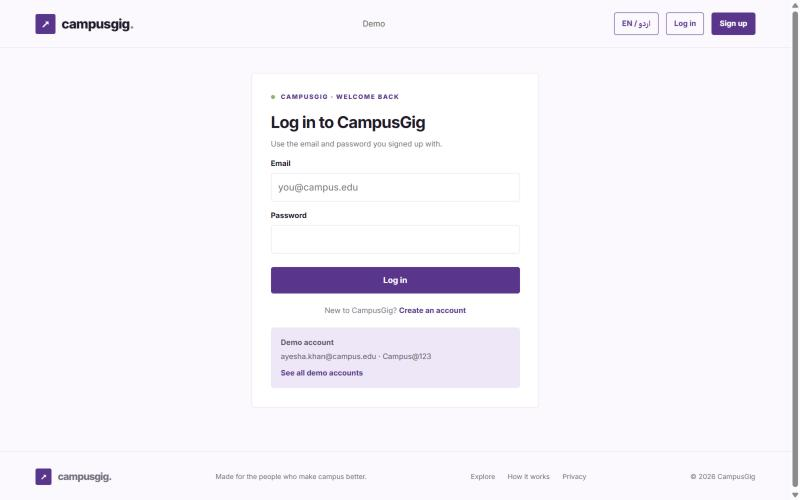</td>
    <td><b>Sign up</b><br>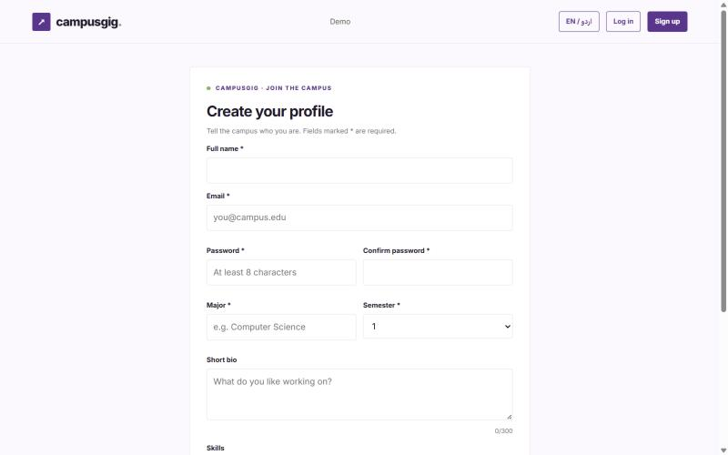</td>
  </tr>
  <tr>
    <td><b>Demo accounts</b><br>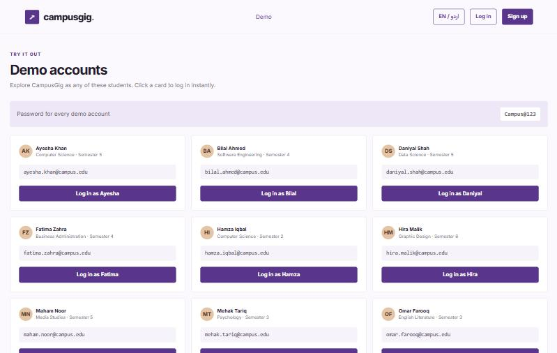</td>
    <td><b>Urdu (right-to-left)</b><br>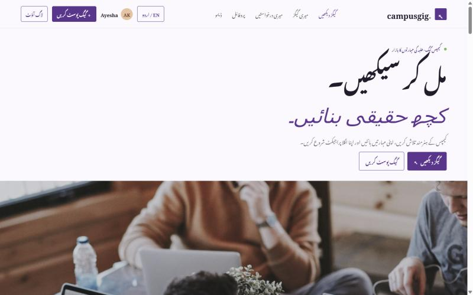</td>
  </tr>
</table>

<p align="center">
  <b>On mobile</b><br>
  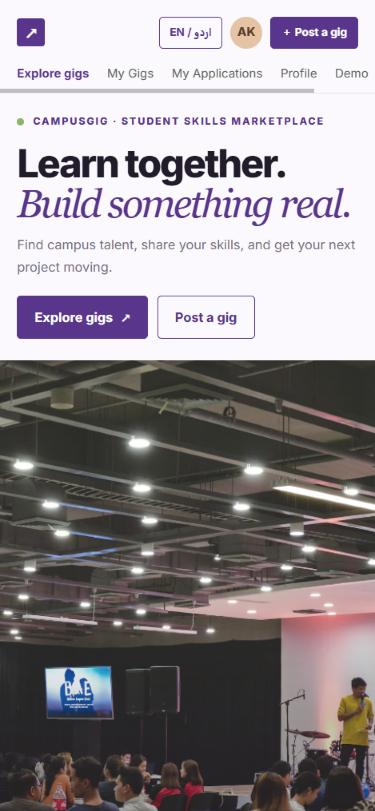
</p>

---

## 🔄 How it works

### The gig lifecycle

<p align="center">
  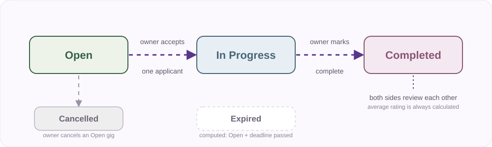
</p>

### The user journey

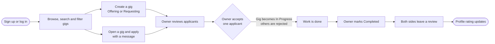

### System architecture

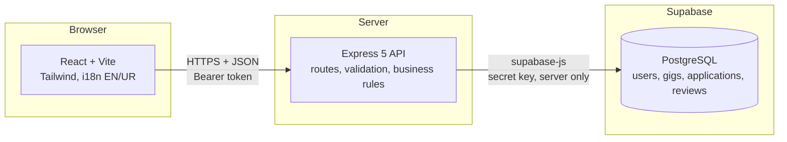

> The browser never talks to Supabase directly. Every rule lives in the Express API, so it is enforced in one place.

### Database

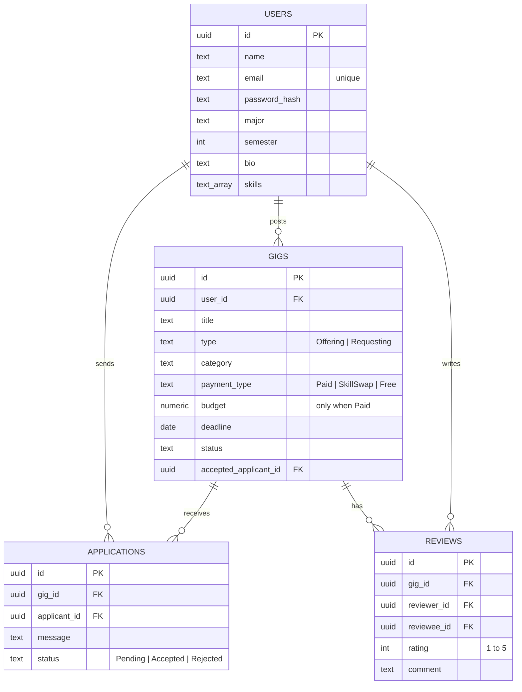

Accepting an applicant runs as **one atomic SQL function** (`accept_applicant`): the chosen application becomes *Accepted*, every other *Pending* one becomes *Rejected*, and the gig moves to *In Progress*, all in a single transaction.

---

## 🧰 Tech stack

| Layer | Technology |
|---|---|
| **Frontend** | React 18, Vite 5, React Router 6, Tailwind CSS 4, Axios |
| **Internationalisation** | i18next + react-i18next (English and Urdu, RTL, Noto Nastaliq Urdu font) |
| **Backend** | Node.js 20+, Express 5, zod 4 (validation), jose (JWT) |
| **Database** | Supabase (PostgreSQL) through `@supabase/supabase-js`, server side only |
| **Auth** | Email + password (scrypt hashing), signed JWT sessions |
| **Tests** | Node's built-in test runner (`node --test`) |

### Design

<p>
  
  
  
  
</p>

A minimal purple theme with 5px corners, Inter for English and Noto Nastaliq Urdu for Urdu, soft scroll-reveal animations and a hero image slider.

---

## 🗂️ Project structure

```text
campusgig/
├── client/                    # React app (Vite)
│   └── src/
│       ├── api/               # Axios instance, session storage, API functions
│       ├── components/        # Navbar, GigCard, Filters, ApplyForm, ReviewForm, ...
│       ├── context/           # User, language and toast providers
│       ├── hooks/             # useReveal (scroll animation)
│       ├── i18n/              # en.json, ur.json, RTL handling
│       ├── pages/             # Home, GigDetails, CreateGig, MyGigs, Profile, Login, ...
│       └── utils/             # formatters, constants, demo helpers
├── server/                    # Express API
│   ├── src/
│   │   ├── config/            # env + Supabase client
│   │   ├── controllers/       # thin request handlers
│   │   ├── services/          # business logic (accept applicant, ratings, auth, ...)
│   │   ├── routes/            # auth, users, gigs, applications, reviews
│   │   ├── schemas/           # zod validation
│   │   ├── middleware/        # currentUser (token), validate, errors
│   │   ├── domain/            # pure rules: expiry, transitions, rating
│   │   ├── lib/               # password hashing, tokens, rate limiter
│   │   └── db/                # schema.sql, seed.js, setDemoAccounts.js
│   └── test/                  # automated tests
├── database/
│   ├── 01_schema.sql          # full schema + accept_applicant function
│   └── 02_upgrade_add_auth.sql# only for databases created before login existed
└── docs/                      # banner, diagrams, screenshots
```

---

## 🚀 Quick start

> **You need:** [Node.js 20+](https://nodejs.org), [Git](https://git-scm.com) and a free [Supabase](https://supabase.com) account.

**1. Get the code**

```bash
git clone https://github.com/<your-username>/campusgig.git
cd campusgig
```

**2. Create the database**

1. In Supabase, create a new project and wait for it to finish setting up.
2. Open **SQL Editor → New query**, paste the whole of [`database/01_schema.sql`](database/01_schema.sql) and click **Run**.
   *This drops and recreates the four tables, so only run it on a fresh project.*
3. Open **Project Settings → API Keys** and copy the **Project URL** and the **secret key**.

**3. Configure and start the API**

```bash
cd server
cp .env.example .env        # on Windows: copy .env.example .env
```

Open `server/.env` and fill in your values (see [Environment variables](#-environment-variables)). Generate a login secret with:

```bash
node -e "console.log(require('crypto').randomBytes(32).toString('hex'))"
```

Then install, load the demo data and start:

```bash
npm install
npm run seed      # 12 users, 25 gigs, 25 applications, 8 reviews, with demo logins
npm run dev       # API on http://localhost:5000
```

**4. Start the website** (in a second terminal)

```bash
cd client
npm install
npm run dev       # site on http://localhost:5173
```

**5. Open it**

Go to **http://localhost:5173** and either create an account or use the **Demo** page to log in as a seeded student.

---

## 🎭 Demo accounts

Every demo account uses the password **`Campus@123`**. The **Demo** page in the navbar lists them all and logs you in with one click.

| Student | Email | Major | Sem |
|---|---|---|---|
| Ayesha Khan | `ayesha.khan@campus.edu` | Computer Science | 5 |
| Bilal Ahmed | `bilal.ahmed@campus.edu` | Software Engineering | 4 |
| Hira Malik | `hira.malik@campus.edu` | Graphic Design | 6 |
| Omar Farooq | `omar.farooq@campus.edu` | English Literature | 3 |
| Sara Ali | `sara.ali@campus.edu` | Mathematics | 7 |
| Hamza Iqbal | `hamza.iqbal@campus.edu` | Computer Science | 2 |
| Maham Noor | `maham.noor@campus.edu` | Media Studies | 5 |
| Zain Raza | `zain.raza@campus.edu` | Electrical Engineering | 6 |
| Fatima Zahra | `fatima.zahra@campus.edu` | Business Administration | 4 |
| Daniyal Shah | `daniyal.shah@campus.edu` | Data Science | 5 |
| Mehak Tariq | `mehak.tariq@campus.edu` | Psychology | 3 |
| Usman Javed | `usman.javed@campus.edu` | Physics | 8 |

The seed covers all four categories, both gig types, all payment types and every status: Open, In Progress, Completed, Cancelled, plus two Open gigs with past deadlines that show as Expired.

> Running `npm run seed` again resets the data. To only (re)set the demo logins without touching anything else, run `npm run seed:accounts`.

---

## 🔧 Environment variables

### `server/.env`

| Variable | Required | Example | Notes |
|---|---|---|---|
| `SUPABASE_URL` | yes | `https://abcd1234.supabase.co` | Your project URL |
| `SUPABASE_SECRET_KEY` | yes | `sb_secret_...` | Server only. Never put it in the client. (`SUPABASE_SERVICE_KEY` also works.) |
| `JWT_SECRET` | yes | 64 random hex characters | At least 32 characters. Signs login tokens. |
| `PORT` | no | `5000` | API port |
| `CLIENT_ORIGIN` | no | `http://localhost:5173` | Allowed website origin. Several can be separated by commas. |
| `APP_TIME_ZONE` | no | `Asia/Karachi` | Decides when a deadline counts as "today" |

### `client/.env` (optional)

| Variable | Default | Notes |
|---|---|---|
| `VITE_API_URL` | `http://localhost:5000` | Where the API lives |

> `.env` files are git-ignored. Only the `.env.example` files are committed.

---

## 📡 API reference

<details>
<summary><b>Click to expand all endpoints</b></summary>

<br>

Protected endpoints need the header `Authorization: Bearer <token>` (returned by login or signup).

| Method | Path | Auth | Purpose |
|---|---|---|---|
| `POST` | `/auth/signup` | public | Create an account and profile, returns a token |
| `POST` | `/auth/login` | public | Log in, returns a token |
| `GET` | `/auth/me` | token | The current user |
| `GET` | `/users` | public | List users (public fields only) |
| `GET` | `/users/:id` | public | Profile with calculated stats and received reviews |
| `GET` | `/gigs` | token | Browse. Filters: `q`, `category`, `type`, `payment_type`, `min_budget`, `max_budget`, `status`, `user_id` |
| `GET` | `/gigs/:id` | token | Gig details, plus your own application and review |
| `POST` | `/gigs` | token | Create a gig |
| `PATCH` | `/gigs/:id` | owner | Change status (`Completed` or `Cancelled`) |
| `GET` | `/gigs/:id/applications` | owner | Applicants of a gig |
| `POST` | `/applications` | token | Apply to a gig |
| `GET` | `/applications?applicant_id=me` | token | My applications |
| `PATCH` | `/applications/:id` | owner | Accept or reject an application |
| `POST` | `/reviews` | participant | Review the other person after completion |
| `GET` | `/reviews` | token | Reviews by `reviewee_id` or `gig_id` |

**Errors** always use one format, and the website translates them by `code`:

```json
{ "error": { "code": "DUPLICATE_APPLICATION", "message": "You have already applied to this gig." } }
```

| Code | HTTP | Meaning |
|---|---|---|
| `UNAUTHORIZED` | 401 | Missing, invalid or expired login |
| `INVALID_CREDENTIALS` | 401 | Wrong email or password |
| `EMAIL_TAKEN` | 409 | An account with this email exists |
| `TOO_MANY_ATTEMPTS` | 429 | Too many login or signup attempts |
| `VALIDATION_ERROR` | 400 | Invalid input (see `details.fields`) |
| `NOT_GIG_OWNER` | 403 | Only the gig owner can do this |
| `CANNOT_APPLY_OWN_GIG` | 403 | You cannot apply to your own gig |
| `NOT_GIG_PARTICIPANT` | 403 | Only the owner or accepted applicant can review |
| `GIG_NOT_FOUND`, `USER_NOT_FOUND`, `APPLICATION_NOT_FOUND` | 404 | Does not exist |
| `GIG_NOT_OPEN` | 409 | The gig is closed or expired |
| `DUPLICATE_APPLICATION` | 409 | Already applied |
| `APPLICATION_NOT_PENDING` | 409 | Already decided |
| `INVALID_TRANSITION` | 409 | That status change is not allowed |
| `GIG_NOT_COMPLETED` | 409 | You can only review a completed gig |
| `DUPLICATE_REVIEW` | 409 | You already reviewed this gig |

</details>

### Business rules the server enforces

| Rule | Behaviour |
|---|---|
| Applying to your own gig | Rejected (403) |
| Applying twice to the same gig | Rejected (409) |
| Applying to a gig that is not Open, or is Expired | Rejected (409) |
| Accepting, rejecting, or changing status | Gig owner only |
| Accepting an applicant | Gig becomes In Progress, other Pending applications become Rejected |
| Completing a gig | Only from In Progress |
| Cancelling a gig | Only from Open |
| Reviewing | Completed gigs only, owner and accepted applicant only, one review each |
| Average rating | Always calculated, never stored |
| Budget | Required and greater than 0 for Paid gigs, must be empty otherwise |

---

## 🧪 Testing

### Automated tests

```bash
cd server
npm test
```

**23 tests** run on Node's built-in test runner and need no database or internet:

| Area | What is checked |
|---|---|
| **Auth** | Password hashing and verification, token signing and tampering, signup and login validation, rate limiter |
| **Business rules** | Expired gigs, allowed status transitions, who gets reviewed, rating rounding |
| **Validation** | Paid gigs need a positive budget, Free and Skill Swap reject a budget, ratings 1 to 5 |
| **Seed data** | Required counts, all categories and statuses, exactly one accepted applicant per assigned gig, reviews only on completed gigs |
| **Database errors** | Plain SQL exceptions map to the right API error codes |

### Build check

```bash
cd client
npm run build
```

### Manual test checklist (end to end)

<details>
<summary><b>Click to expand the full checklist</b></summary>

<br>

Reset the data first with `cd server && npm run seed`. Use the **Demo** page to switch users.

| # | Flow | Steps | Expected result |
|---|---|---|---|
| 1 | **Sign up** | Open **Sign up**, fill the form, submit | You are logged in with your own profile |
| 2 | **Validation** | Submit sign up or create gig empty | Field-level error messages appear |
| 3 | **Log in / out** | Log out, then log in with a wrong password | "Incorrect email or password", then the right one works |
| 4 | **Create gigs** | As Ayesha, post an *Offering* (Free) and a *Requesting* (Paid) | Budget field only shows for Paid. Both appear as Open. |
| 5 | **Search and filter** | Search "logo", tick Design, set a budget range, then Reset | Results match each filter and the full list returns |
| 6 | **Apply** | As Sara, open "React dashboard debugging" and apply | Success message, status shows Pending, appears in My Applications |
| 7 | **Own gig / duplicate** | As Ayesha open her own gig. As Bilal open gig 1 again | No apply form for the owner. Bilal sees "You applied". |
| 8 | **Accept** | As Ayesha, My Gigs, view applicants, Accept Bilal | Bilal Accepted, the others Rejected, gig In Progress |
| 9 | **Closed gig** | As Omar open that gig | "This gig is closed to new applications" |
| 10 | **Complete** | As Ayesha click **Mark as Completed** | Status Completed. Open gigs have no Complete button. |
| 11 | **Review** | Ayesha then Bilal leave a rating and comment | "You reviewed this gig" and no second review is possible |
| 12 | **Reputation** | Open both profiles | New review listed, average and review count updated |
| 13 | **Expired** | Open "Expired Python script help" | Greyed out, no apply form |
| 14 | **Language** | Click **EN / اردو**, then refresh | Everything turns Urdu, layout flips right-to-left, choice is remembered |
| 15 | **Mobile** | Narrow the window to about 375px | Navbar fits and a link row appears |

**Rules the website hides, so try them against the API** (replace `TOKEN` with a token from `POST /auth/login`):

```bash
curl -s -X POST http://localhost:5000/applications \
  -H "Authorization: Bearer TOKEN" -H "Content-Type: application/json" \
  -d '{"gig_id":"10000000-0000-4000-8000-000000000001","message":"Applying to my own gig"}'
```

| Try | Expect |
|---|---|
| Apply to your own gig | `403 CANNOT_APPLY_OWN_GIG` |
| Apply twice | `409 DUPLICATE_APPLICATION` |
| Apply to an In Progress or Expired gig | `409 GIG_NOT_OPEN` |
| Accept or change status as a non-owner | `403 NOT_GIG_OWNER` |
| Complete a gig that is still Open | `409 INVALID_TRANSITION` |
| Review before completion | `409 GIG_NOT_COMPLETED` |
| Review as someone who is not a participant | `403 NOT_GIG_PARTICIPANT` |
| Review the same gig twice | `409 DUPLICATE_REVIEW` |
| Call any protected endpoint without a token | `401 UNAUTHORIZED` |

</details>

---

## 🔒 Security

- Passwords are hashed with **scrypt** and a random salt. They are never stored or logged in plain text.
- Logins return a **signed JWT** that expires after 7 days. The old "pick a user" header is no longer accepted.
- Repeated failed logins are **rate limited** per email and device.
- The secret Supabase key and `JWT_SECRET` live only on the server. **Row Level Security** is on, so the public key cannot read the tables.
- Public user endpoints return **public fields only**, never emails or password hashes.
- All input is validated on the server (zod), whatever the website checks first.

> The **Demo** page and the demo box on the login page exist to show the project off. Remove them before a real launch.

---

## ☁️ Deployment

<details>
<summary><b>Render (API) + Vercel (website)</b></summary>

<br>

**1. API on Render**

- New **Web Service** from your GitHub repo
- Root directory: `server`
- Build command: `npm install`
- Start command: `npm start`
- Environment variables: `SUPABASE_URL`, `SUPABASE_SECRET_KEY`, `JWT_SECRET`, `APP_TIME_ZONE`, and `CLIENT_ORIGIN` (set later)
- Pick the Render **region closest to your Supabase project**. It makes the API much faster.

**2. Website on Vercel**

- Import the same repo, root directory: `client`, framework: **Vite**
- Environment variable: `VITE_API_URL` = your Render URL (no trailing slash)
- `client/vercel.json` already makes page refreshes work.

**3. Connect them**

On Render set `CLIENT_ORIGIN` to your Vercel URL (for example `https://campusgig.vercel.app`) and redeploy.

Render's free plan sleeps when idle, so the very first request can take about 30 seconds.

</details>

---

## 🩺 Troubleshooting

<details>
<summary><b>Common problems and fixes</b></summary>

<br>

| Problem | Fix |
|---|---|
| `Missing environment variables: JWT_SECRET` | Add a `JWT_SECRET` of at least 32 characters to `server/.env` |
| `column users.email does not exist` | Your database is older than login. Run [`database/02_upgrade_add_auth.sql`](database/02_upgrade_add_auth.sql), then `npm run seed:accounts` |
| Demo login says "Incorrect email or password" | Run `npm run seed:accounts` in `server` |
| `EADDRINUSE: port 5000 already in use` | Another copy of the API is running. Close it, or change `PORT` |
| The site opens but shows network errors | Start the API first, and check `VITE_API_URL` |
| Browser says "blocked by CORS" | `CLIENT_ORIGIN` must exactly match the site address, with no trailing slash |
| Pages load slowly | Supabase is far from you or from the API. Use a Supabase project and a Render region that are close together |
| Logged out unexpectedly | The token expired (7 days) or the user was reset by `npm run seed`. Log in again |

</details>

---

## 💻 Moving to another laptop

1. Install **Node.js 20+** and **Git**.
2. Clone your repository.
3. Create `server/.env` from `server/.env.example`. Secrets are **not** stored in Git, so copy your `SUPABASE_URL`, `SUPABASE_SECRET_KEY` and `JWT_SECRET` from the old laptop or your password manager.
4. Run `npm install` in both `server` and `client`.
5. Start the API (`npm run dev` in `server`) and the website (`npm run dev` in `client`).

The database lives in Supabase, so there is nothing to export. If you keep the same Supabase project, all your data is already there.

---

<p align="center">
  
</p>
