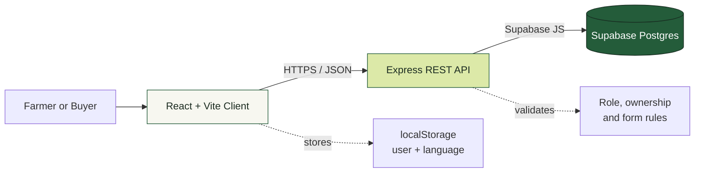
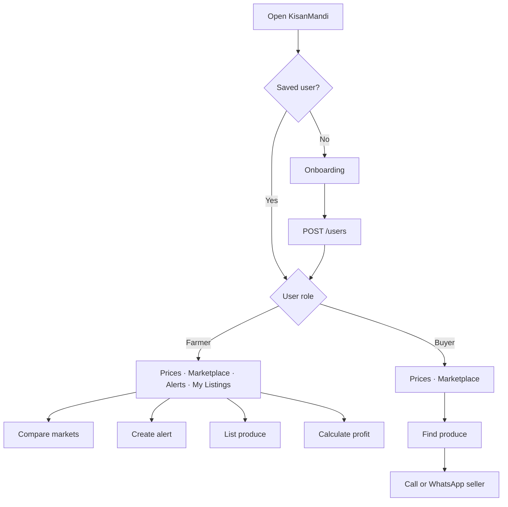

<div align="center">
  

  <br />

  **A bilingual, mobile-first crop price and produce marketplace for farmers and buyers in Sindh.**

  <br />

  [](https://react.dev/)
  [](https://expressjs.com/)
  [](https://supabase.com/)
  [](#english-and-urdu)

  [Features](#features) · [Quick Start](#quick-start) · [Architecture](#architecture) · [Testing](#testing-guide) · [API](#api-overview) · [Deployment](#deployment)
</div>

---

## What is KisanMandi?

Farmers often sell crops without knowing the latest wholesale market price. KisanMandi makes that information simple and useful.

With KisanMandi, users can:

- See today’s crop prices in different mandis.
- Compare markets and find the best place to sell.
- View a 14-day price trend.
- Create price alerts.
- List produce for direct sale.
- Contact sellers by phone or WhatsApp.
- Estimate revenue, cost, profit, and profit margin.
- Use the complete application in English or Urdu.

> Prices and user information included in the seed data are fictional and intended for demonstration only.

## Product preview

```text
┌─────────────────────────────────────────────────────────────┐
│  KisanMandi                    Market Prices   Marketplace   │
├─────────────────────────────────────────────────────────────┤
│                                                             │
│  Know your price.                ┌──────────────────────┐    │
│  Grow with confidence.           │ Wheat · Hyderabad    │    │
│                                  │ Rs 4,250      ↗ 2.4% │    │
│  Clear mandi prices and direct   └──────────────────────┘    │
│  connections for better trade.                              │
│                                                             │
├─────────────────────────────────────────────────────────────┤
│  Crop        Today          Change            Action        │
│  Wheat       Rs 4,250       ↗ 2.4%            Details       │
│  Rice        Rs 5,800       ↗ 1.2%            Details       │
└─────────────────────────────────────────────────────────────┘
```

The interface uses a calm agricultural theme:

| Token | Colour | Use |
|---|---|---|
| Deep green | `#245C3A` | Primary buttons and brand |
| Field green | `#39734B` | Positive prices and highlights |
| Harvest lime | `#DCE9A8` | Active and featured states |
| Paper | `#F7F7F0` | Main background |
| Ink | `#1C2C21` | Main text |

## Features

### For everyone

- Phone-based onboarding without passwords
- Latest prices for eight crops and three markets
- Crop search and category filters
- Daily price increase or decrease
- 14-day price chart with minimum, maximum, and average
- Market comparison ranked from highest to lowest price
- Marketplace search, filters, and sorting
- Listing details with Call and WhatsApp actions
- English and Urdu with full RTL layout
- Responsive desktop and mobile interface

### For farmers

- Create, edit, pause, activate, and delete price alerts
- Triggered-alert badge based on the newest market price
- Create and edit produce listings
- Mark listings as Sold
- Delete owned listings
- Profit calculator with a `−20%` to `+20%` what-if slider

### For buyers

- Browse current crop prices
- Compare markets
- Search active produce listings
- Contact farmers directly
- Farmer-only pages and actions remain inaccessible

## Roles and permissions

| Capability | Farmer | Buyer | API access |
|---|:---:|:---:|:---:|
| View prices and trends | ✅ | ✅ | Public |
| Browse marketplace | ✅ | ✅ | Public |
| View listing details | ✅ | ✅ | Public |
| Use profit calculator | ✅ | ❌ | Client tool |
| Manage own listings | ✅ | ❌ | Protected |
| Manage price alerts | ✅ | ❌ | Protected |
| Edit another farmer’s data | ❌ | ❌ | `403 Forbidden` |

## Architecture



### Important security rule

The React application talks only to Express. It never connects directly to Supabase.

```text
Browser  ──✅──>  Express API  ──✅──>  Supabase
Browser  ──❌───────────────────────>  Supabase secret key
```

The Supabase secret key must stay inside `server/.env` or the backend hosting provider’s secret settings.

## Technology stack

| Layer | Technology |
|---|---|
| Frontend | React, Vite, React Router |
| Styling | Tailwind CSS and project theme CSS |
| Requests | Axios |
| Charts | Recharts |
| Translation | react-i18next |
| Backend | Node.js and Express |
| Database | Supabase PostgreSQL |
| Local persistence | Browser localStorage |
| Suggested hosting | Vercel + Render + Supabase |

## Project structure

```text
kisanmandi/
├── client/
│   ├── src/
│   │   ├── api/             # Axios API modules
│   │   ├── components/      # Shared interface components
│   │   ├── context/         # Saved user context
│   │   ├── hooks/           # Pull-to-refresh behavior
│   │   ├── locales/         # English and Urdu text
│   │   ├── pages/           # Application screens
│   │   ├── styles/          # KisanMandi visual theme
│   │   └── utils/           # Price and formatting helpers
│   ├── .env.example
│   └── vercel.json
├── server/
│   ├── src/
│   │   ├── config/          # Supabase client
│   │   ├── middleware/      # Authentication and errors
│   │   ├── routes/          # REST endpoints
│   │   └── utils/           # Validation and data helpers
│   ├── seed/seed.js
│   ├── sql/schema.sql
│   ├── sql/seed.sql
│   └── .env.example
├── docs/
│   └── kisanmandi-banner.svg
└── render.yaml
```

## Quick start

### Requirements

- Node.js 20 or newer
- npm
- A Supabase project
- Git, if cloning from GitHub

### 1. Download the project

```bash
git clone https://github.com/YOUR_USERNAME/YOUR_REPOSITORY.git
cd YOUR_REPOSITORY
```

You can also copy the complete project folder to another laptop.

### 2. Create the database

Open the Supabase SQL Editor and run these files in order:

```text
server/sql/schema.sql
server/sql/seed.sql
```

Expected seed data:

| Data | Count |
|---|---:|
| Crops | 8 |
| Markets | 3 |
| Price records | 336 |
| Users | 6 |
| Listings | 12 |
| Alerts | 5 |

### 3. Configure and start the backend

Create `server/.env` from `server/.env.example`:

```env
PORT=5000
SUPABASE_URL=https://your-project.supabase.co
SUPABASE_SECRET_KEY=your-backend-secret-key
CLIENT_ORIGIN=http://localhost:5173
```

> Never commit `server/.env`. Never place `SUPABASE_SECRET_KEY` in the frontend.

```bash
cd server
npm install
npm run dev
```

Health check:

```text
http://localhost:5000/api/health
```

Expected response:

```json
{
  "data": {
    "status": "ok"
  }
}
```

### 4. Configure and start the frontend

Create `client/.env` from `client/.env.example`:

```env
VITE_API_URL=http://localhost:5000/api
```

Open a second terminal:

```bash
cd client
npm install
npm run dev
```

Open the URL printed by Vite, normally `http://localhost:5173`.

## Demo accounts

No password is required. A user is identified by phone number.

| Name | Phone | Role | District |
|---|---|---|---|
| Ali Raza | `03001234567` | Farmer | Hyderabad |
| Fatima Bibi | `03111234567` | Farmer | Sukkur |
| Ghulam Mustafa | `03221234567` | Farmer | Mirpurkhas |
| Sana Ahmed | `03331234567` | Farmer | Hyderabad |
| Bilal Traders | `03441234567` | Buyer | Karachi |
| Mehran Foods | `03551234567` | Buyer | Sukkur |

To switch roles during testing, clear `kisanmandi_user` from browser local storage or use a private browser window.

## User journeys



## API overview

Development base URL: `http://localhost:5000/api`

Protected endpoints require:

```http
x-user-id: USER_ID
```

| Method | Endpoint | Access | Purpose |
|---|---|---|---|
| `POST` | `/users` | Public | Create user or log in by phone |
| `GET` | `/users/:id` | Public | Get one user |
| `GET` | `/crops` | Public | List crops |
| `GET` | `/markets` | Public | List markets |
| `GET` | `/prices` | Public | Get price history |
| `GET` | `/prices/latest` | Public | Get today and yesterday prices |
| `GET` | `/prices/compare` | Public | Compare all markets |
| `GET` | `/listings` | Public | Browse and filter listings |
| `GET` | `/listings/:id` | Public | View listing details |
| `POST` | `/listings` | Farmer | Create a listing |
| `PUT` | `/listings/:id` | Owner | Edit a listing |
| `PATCH` | `/listings/:id/sold` | Owner | Mark listing as Sold |
| `DELETE` | `/listings/:id` | Owner | Delete a listing |
| `GET` | `/alerts` | Farmer | List own alerts |
| `POST` | `/alerts` | Farmer | Create an alert |
| `PUT` | `/alerts/:id` | Owner | Edit an alert |
| `PATCH` | `/alerts/:id/toggle` | Owner | Activate or pause an alert |
| `DELETE` | `/alerts/:id` | Owner | Delete an alert |

### Response format

```json
{
  "data": {}
}
```

```json
{
  "error": {
    "code": "VALIDATION_ERROR",
    "message": "Please fix the highlighted fields",
    "fields": {
      "quantity": "Must be greater than 0"
    }
  }
}
```

## Business formulas

### Daily price change

```text
Change = Today − Yesterday
Percentage = Change ÷ Yesterday × 100
```

### Marketplace price label

```text
Difference = (Asking price − Market average) ÷ Market average

Within ±5%  → At market
Below −5%   → Below market
Above +5%   → Above market
```

### Profit calculator

```text
Adjusted price = Current price × (1 + slider percentage ÷ 100)
Revenue        = Quantity × Adjusted price
Total cost     = Quantity × Cost per unit
Profit         = Revenue − Total cost
Margin         = Profit ÷ Revenue × 100
```

## English and Urdu

- Every screen supports English and Urdu.
- Urdu uses right-to-left page direction.
- Crop and market names come from the API in both languages.
- The selected language is saved in local storage.
- Numbers remain in Western digits for simple reading.

## Testing guide

### Farmer flow

- [ ] Onboard with `03001234567` as a Farmer.
- [ ] Confirm four navigation tabs appear.
- [ ] Change the selected market.
- [ ] Search and filter crops.
- [ ] Refresh prices.
- [ ] Open a crop and verify its 14-day chart.
- [ ] Confirm the highest-priced market appears first.
- [ ] Create an Above and a Below alert.
- [ ] Toggle, edit, and delete an alert.
- [ ] Create, edit, sell, and delete a produce listing.
- [ ] Test profit at `−20%`, `0%`, and `+20%`.

### Buyer flow

- [ ] Clear local storage or use a private window.
- [ ] Onboard with `03441234567` as a Buyer.
- [ ] Confirm only Prices and Marketplace tabs appear.
- [ ] Browse and filter listings.
- [ ] Open Call and WhatsApp actions.
- [ ] Confirm farmer-only routes redirect to Prices.

### Validation and security

- [ ] Invalid Pakistani phone numbers are rejected.
- [ ] Quantity and price must be greater than zero.
- [ ] Listing dates cannot be in the past.
- [ ] Missing `x-user-id` returns `401`.
- [ ] Buyer mutations return `403`.
- [ ] Editing another farmer’s data returns `403`.
- [ ] Missing records return `404`.
- [ ] Sold listings remain in My Listings but leave Marketplace.

### Responsive and translation checks

- [ ] Test at 375 px, 768 px, 1366 px, and 1920 px widths.
- [ ] Test every screen in Urdu RTL mode.
- [ ] Refresh and confirm the selected language remains saved.
- [ ] Stop the API and confirm readable error states appear.

## Deployment

### Backend on Render

The root `render.yaml` is ready for the Express API. Add these secret environment variables in Render:

```env
SUPABASE_URL=https://your-project.supabase.co
SUPABASE_SECRET_KEY=your-backend-secret-key
CLIENT_ORIGIN=https://your-frontend-domain.vercel.app
```

### Frontend on Vercel

Deploy the `client/` directory and add:

```env
VITE_API_URL=https://your-render-api.onrender.com/api
```

The included `client/vercel.json` allows React Router pages to open directly.

### Deployment checklist

- [ ] Supabase schema and seed SQL completed
- [ ] Backend health endpoint responds
- [ ] Render environment variables saved
- [ ] Vercel API URL points to Render
- [ ] Render `CLIENT_ORIGIN` matches Vercel
- [ ] Farmer and Buyer production flows tested
- [ ] No secret keys exist in frontend code or Git history

## Move to another laptop

Copy or clone the repository, but do not copy generated dependencies or secrets.

Do copy:

```text
client/
server/
docs/
README.md
render.yaml
```

Do not copy:

```text
node_modules/
dist/
server/.env
client/.env
```

On the new laptop:

1. Install Node.js 20 or newer.
2. Copy the project or clone it from GitHub.
3. Create both `.env` files.
4. Run `npm install` in `server/` and `client/`.
5. Run the backend and frontend in separate terminals.

## Troubleshooting

| Problem | Check |
|---|---|
| Frontend shows API errors | Confirm the backend is running and `VITE_API_URL` ends with `/api` |
| Backend will not start | Check `SUPABASE_URL` and `SUPABASE_SECRET_KEY` |
| Database returns empty arrays | Run both SQL files in order |
| Browser reports CORS error | Set `CLIENT_ORIGIN` to the exact frontend origin |
| Buyer sees an old Farmer session | Clear `kisanmandi_user` from local storage |
| Urdu layout is not RTL | Clear the saved language and switch again |
| Direct Vercel URL gives 404 | Confirm `client/vercel.json` is deployed |

## Security notes

- Never commit `.env` files.
- Never expose the Supabase secret key to React.
- Treat `x-user-id` identity as demo-only authentication.
- Use real authentication before using real farmer or production data.
- Keep all seeded names, phone numbers, and prices fictional.

## Future improvements

- Real OTP authentication
- Live government or mandi price feeds
- Push notifications for triggered alerts
- Produce image uploads
- In-app buyer and seller chat
- Payment or escrow support
- Admin moderation dashboard
- Offline-first support for low-connectivity areas

## License

Add the license that matches your intended use before publishing. MIT is a common choice for open-source hackathon projects.

---

<div align="center">
  <strong>Made for growers. Built for fairer trade.</strong>
  <br />
  <sub>KisanMandi · Crop prices, clearer decisions</sub>
</div>