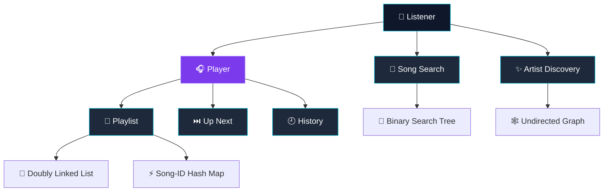
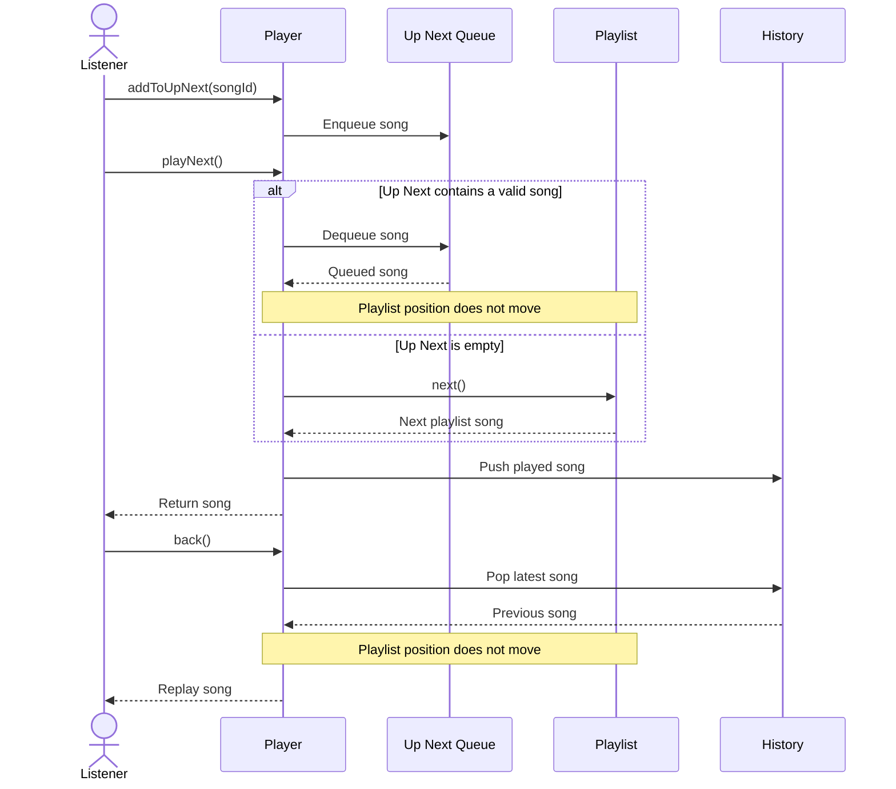

<div align="center">


[](https://git.io/typing-svg)


### A music-player core built from foundational data structures

Playlist navigation, priority playback, recent history, title search, and artist discovery—all implemented in pure Python.

</div>

---

## Table of Contents

- [Overview](#overview)
- [Features](#features)
- [Architecture](#architecture)
- [Data Structures](#data-structures)
- [Milestones](#milestones)
- [Playback Flow](#playback-flow)
- [Project Structure](#project-structure)
- [Getting Started](#getting-started)
- [Running TuneWave](#running-tunewave)
- [Running Tests](#running-tests)
- [Test Coverage](#test-coverage)
- [Usage Examples](#usage-examples)
- [Complexity](#complexity)
- [Design Decisions](#design-decisions)
- [AI Usage Disclosure](#ai-usage-disclosure)

---

## Overview

**TuneWave** is the core of a music-streaming player built to demonstrate practical applications of six fundamental data structures.

It supports:

- Ordered playlist navigation
- Constant-time song lookup
- Duplicate-song prevention
- Priority playback through an Up Next queue
- Recent playback history
- Exact and prefix-based title search
- Related-artist recommendations

The project focuses on the internal logic of a music player rather than a graphical interface.

---

## Features

| Feature | Description |
|---|---|
| 🎵 Playlist | Add, remove, and navigate songs |
| 🔁 Repeat | Wrap from the final song to the first |
| ⏭️ Up Next | Play queued songs before continuing the playlist |
| 🕘 History | Retain the ten most recently played songs |
| 🔙 Back | Replay and remove the latest history entry |
| 🔎 Song Search | Find songs by their exact title |
| ✨ Prefix Search | Return matching titles alphabetically |
| 👥 Artist Discovery | Recommend artists exactly two links away |

---

## Architecture



---

## Data Structures

| Component | Data structure | Purpose |
|---|---|---|
| Playlist order | Doubly linked list | Constant-time forward and backward movement |
| Song lookup | Hash map (`dict`) | Fast lookup and duplicate-ID prevention |
| Up Next | Queue (`deque`) | First-in, first-out priority playback |
| History | Stack (`deque`) | Last-in, first-out replay behavior |
| Song search | Binary search tree | Exact lookup and ordered prefix search |
| Artist relations | Undirected graph | Two-link artist recommendations |

---

## Milestones

### Milestone 1 — Playlist

The playlist combines a **doubly linked list** with a **hash map**.

#### Supported operations

```python
addSong(song)
removeSong(songId)
next()
previous()
toggleRepeat()
```

#### Verified behavior

- A song ID can appear only once.
- Songs can be found without scanning the playlist.
- Users can navigate forward and backward.
- Removing a song repairs both neighboring links.
- Removing the current song selects a valid replacement.
- With repeat enabled, the last song wraps to the first.
- With repeat disabled, `next()` returns `"end"` and remains on the last song.

---

### Milestone 2 — Up Next and History

Playback uses a **queue** for Up Next and a **stack** for history.

#### Supported operations

```python
addToUpNext(songId)
playNext()
back()
```

#### Verified behavior

- Up Next songs play before playlist songs.
- Up Next follows FIFO ordering.
- Queue playback does not move the playlist position.
- Playlist playback resumes after the queue becomes empty.
- History stores only the ten most recent songs.
- The oldest history entry is dropped automatically.
- `back()` returns and removes the latest history entry.
- History playback does not move the playlist position.
- Removed queued songs are skipped safely.

---

### Milestone 3 — Search and Related Artists

Song search uses a **binary search tree**, while artist relationships use an **undirected graph**.

#### Supported operations

```python
addSong(title, songId)
findSong(title)
prefixSearch(prefix)
addRelation(artistA, artistB)
recommendArtists(artist)
```

#### Verified behavior

- Exact-title search returns the corresponding song ID.
- Search is case-insensitive.
- Duplicate titles are rejected.
- Prefix results are returned alphabetically.
- Prefix search skips irrelevant BST branches.
- Artist relationships work in both directions.
- Recommendations are exactly two links away.
- Directly related artists are excluded.
- The starting artist is excluded.
- Results are sorted and deduplicated.

---

## Playback Flow



---

## Project Structure

```text
tunewave/
│
├── main.py
├── README.md
├── requirements.txt
├── .gitignore
│
├── src/
│   ├── __init__.py
│   ├── playlist.py
│   ├── queue_history.py
│   └── search_graph.py
│
└── tests/
    ├── __init__.py
    ├── test_playlist.py
    ├── test_queue_history.py
    └── test_search_graph.py
```

### File responsibilities

| File | Responsibility |
|---|---|
| `main.py` | Runnable demonstration of all milestones |
| `src/playlist.py` | Song, linked-list node, and playlist logic |
| `src/queue_history.py` | Up Next queue and playback history |
| `src/search_graph.py` | BST search and artist graph |
| `tests/test_playlist.py` | Playlist and repeat tests |
| `tests/test_queue_history.py` | Queue and history tests |
| `tests/test_search_graph.py` | BST and graph tests |

---

## Getting Started

### Requirements

- Python 3.10 or newer
- `pip`
- Git, if cloning from GitHub
- VS Code with the Microsoft Python extension, recommended

### Clone the project

```bash
git clone YOUR_GITHUB_REPOSITORY_URL
cd tunewave
```

Replace `YOUR_GITHUB_REPOSITORY_URL` with your actual GitHub repository URL.

### Create a virtual environment

#### Windows PowerShell

```powershell
py -m venv .venv
.\.venv\Scripts\Activate.ps1
```

If PowerShell blocks activation:

```powershell
Set-ExecutionPolicy -Scope Process -ExecutionPolicy Bypass
.\.venv\Scripts\Activate.ps1
```

#### macOS or Linux

```bash
python3 -m venv .venv
source .venv/bin/activate
```

### Install dependencies

```bash
python -m pip install -r requirements.txt
```

### Select the interpreter in VS Code

1. Press `Ctrl+Shift+P`.
2. Choose **Python: Select Interpreter**.
3. Select the Python interpreter inside `.venv`.

---

## Running TuneWave

Run the complete demonstration:

```bash
python main.py
```

Expected output:

```text
=== Milestone 1: Playlist ===
Current: Apple
Next: Application
Previous: Apple
Repeat enabled: True
Previous with repeat (wraps): Apricot
Removed Banana: True

=== Milestone 2: Up Next and History ===
From Up Next: Application
From playlist: Apple
Back from history: Apple

=== Milestone 3: Search and Related Artists ===
Find 'banana': 3
Prefix 'ap': ['Apple', 'Application', 'Apricot']
Recommendations for Artist A: ['Artist C', 'Artist D']
```

---

## Running Tests

Run the complete test suite:

```bash
python -m pytest -v
```

Expected result:

```text
44 passed
```

### Test individual milestones

Playlist:

```bash
python -m pytest tests/test_playlist.py -v
```

Up Next and history:

```bash
python -m pytest tests/test_queue_history.py -v
```

Search and artist graph:

```bash
python -m pytest tests/test_search_graph.py -v
```

### Test a single rule

```bash
python -m pytest tests/test_queue_history.py::test_up_next_does_not_move_playlist_position -v
```

---

## Test Coverage

| Test module | Area | Tests | Result |
|---|---|---:|---:|
| `test_playlist.py` | Linked list, hash map, navigation and repeat | 15 | ✅ Passed |
| `test_queue_history.py` | Queue, history and playback rules | 11 | ✅ Passed |
| `test_search_graph.py` | BST search and artist graph | 18 | ✅ Passed |
| **Total** | **All milestones** | **44** | **✅ Passed** |

### Important tested edge cases

- Empty playlist navigation
- Duplicate song IDs
- Missing song removal
- Removing the only song
- Removing the head, tail, middle, or current song
- Repeat enabled and disabled
- Unknown Up Next song IDs
- Songs removed after being queued
- History exceeding ten entries
- Empty history
- Missing song titles
- Empty search prefixes
- Uppercase and lowercase searches
- Duplicate graph paths
- Self-relations
- Unknown artists
- Direct and three-link artist exclusions

---

## Usage Examples

### Create a playlist

```python
from src.playlist import Playlist, Song

playlist = Playlist()

playlist.addSong(Song(1, "Blinding Lights", "The Weeknd"))
playlist.addSong(Song(2, "Levitating", "Dua Lipa"))
playlist.addSong(Song(3, "Stay", "The Kid LAROI"))

print(playlist.current.song.title)
print(playlist.next().title)
print(playlist.previous().title)
```

### Use Up Next

```python
from src.queue_history import Player

player = Player(playlist)

player.addToUpNext(3)

song = player.playNext()
print(song.title)

previous_song = player.back()
print(previous_song.title)
```

### Search for songs

```python
from src.search_graph import SongTree

tree = SongTree()

tree.addSong("Apple", 1)
tree.addSong("Application", 2)
tree.addSong("Apricot", 3)
tree.addSong("Banana", 4)

print(tree.findSong("banana"))
print(tree.prefixSearch("ap"))
```

Output:

```text
4
['Apple', 'Application', 'Apricot']
```

### Recommend related artists

```python
from src.search_graph import ArtistGraph

graph = ArtistGraph()

graph.addRelation("Artist A", "Artist B")
graph.addRelation("Artist B", "Artist C")
graph.addRelation("Artist B", "Artist D")

print(graph.recommendArtists("Artist A"))
```

Output:

```text
['Artist C', 'Artist D']
```

---

## Complexity

Let:

- `n` be the number of songs or artists
- `h` be the BST height
- `k` be the number of prefix matches

| Operation | Time complexity |
|---|---:|
| Playlist `addSong` | O(1) |
| Playlist `removeSong` | O(1) |
| Song lookup by ID | O(1) |
| `next` / `previous` | O(1) |
| Toggle repeat | O(1) |
| Add to Up Next | O(1) |
| Play queued song | O(1) |
| History push/pop | O(1) |
| BST insertion | O(h) |
| Exact-title search | O(h) |
| Prefix search | O(h + k), O(n) worst case |
| Artist recommendations | Proportional to direct-neighbor degrees |

> The BST is intentionally implemented directly for educational purposes and is not self-balancing.

---

## Design Decisions

- The first song added becomes the current playlist song.
- Song IDs must be unique within a playlist.
- Titles are compared case-insensitively using `casefold()`.
- Duplicate BST titles are rejected because one title key maps to one song ID.
- Removing the current song selects the next song when possible.
- If there is no next song, removal selects the previous song.
- `previous()` returns `"start"` at the beginning when repeat is disabled.
- `next()` returns `"end"` at the end when repeat is disabled.
- Queue and history playback do not change the playlist position.
- `back()` removes the returned song from history.
- Self-relations between artists are ignored.
- Repeated artist relationships are automatically deduplicated.

---

