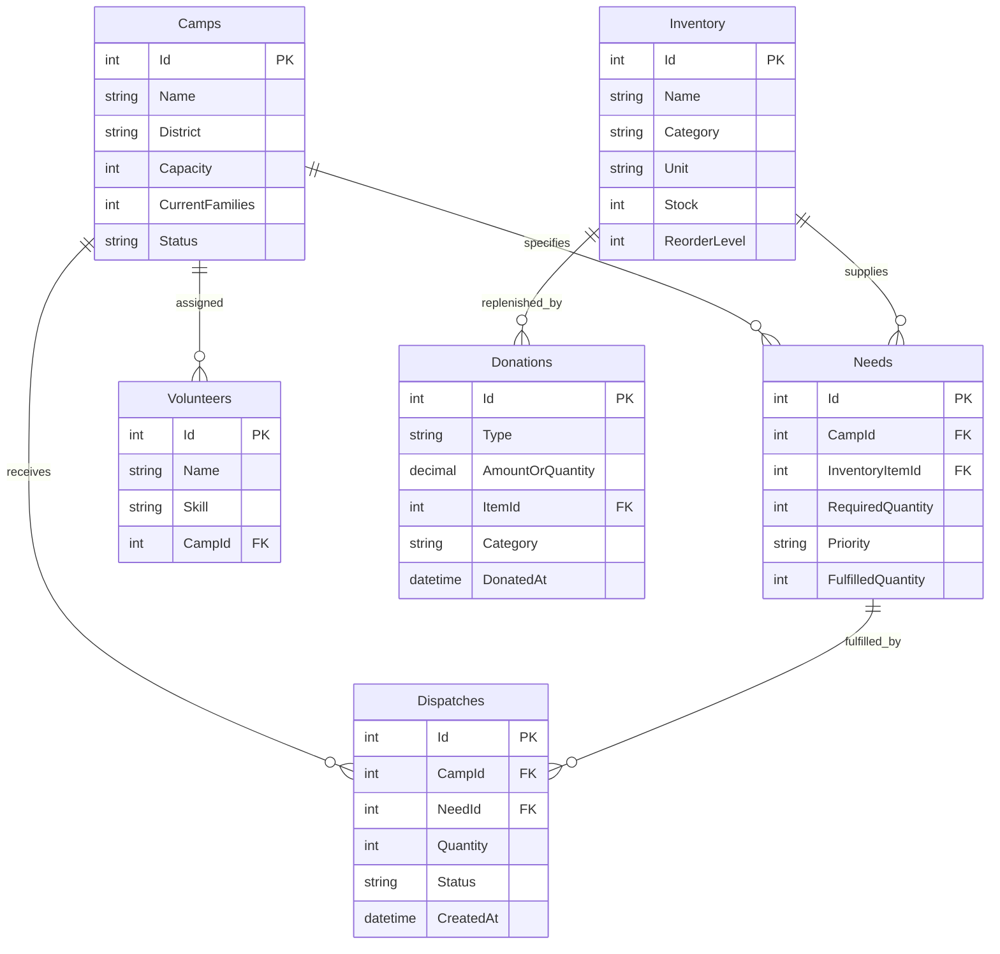

# 🌊 ReliefHub: Flood Relief Coordination Dashboard

**Hackathon Project Submission — Team Triple-Threats (Task 3)**

A centralized flood relief coordination platform designed to help emergency response teams manage relief camps, warehouse inventory, essential supplies, dispatches, donations, and volunteer deployment across Sindh, Pakistan.

## 📌 Project Overview

During severe flooding, relief organizations face challenges such as uneven aid distribution, duplicate deliveries, limited warehouse supplies, and shortages at remote relief camps. ReliefHub provides a centralized dashboard to coordinate resources, track aid distribution, and identify the most urgent needs.

### Key Features

- **Relief Camp Management:** Register, update, search, filter, and manage camps across Sindh districts.
- **Camp Capacity Tracking:** Automatically identify camps that have reached their capacity.
- **Needs Assessment:** Record required supplies, quantities, and priority levels for each camp.
- **Warehouse Inventory:** Monitor stock levels, item categories, units, and reorder thresholds.
- **Smart Dispatch Allocation:** Prevent over-dispatching by validating available stock and outstanding demand.
- **Dispatch Lifecycle Management:** Track dispatches from Pending to In Transit, Delivered, or Cancelled.
- **Donation Management:** Record cash and in-kind contributions, including inventory replenishment.
- **Volunteer Deployment:** Manage volunteers by skill and assign them to eligible relief camps.
- **Critical Gaps Board:** Highlight high-priority needs with less than 40% fulfilment.
- **Interactive Dashboard:** Display key performance indicators and category-wise fulfilment charts.

## 💻 Technology Stack

| Component | Technology |
|---|---|
| Backend | ASP.NET Core MVC (.NET 8) |
| Programming language | C# |
| Database | Microsoft SQL Server |
| ORM | Entity Framework Core 8 |
| Frontend | Razor Views, HTML, CSS, JavaScript |
| UI styling | Tailwind CSS |
| Data visualization | Chart.js |
| API | ASP.NET Core REST API |
| Version control | Git and GitHub |

## 🏗️ System Architecture

ReliefHub separates the user interface, application logic, API endpoints, and database operations.

1. **Frontend:** Provides dashboards and management pages for camps, inventory, needs, dispatches, donations, and volunteers.
2. **Backend:** Handles business rules, input validation, stock allocation, dispatch state transitions, fulfilment calculations, and volunteer assignment.
3. **Database:** Stores camp records, inventory, needs, dispatches, donations, and volunteer information in SQL Server.
4. **REST API:** Exposes endpoints for retrieving and modifying relief coordination data.
5. **Dashboard Analytics:** Calculates operational indicators and presents category-wise fulfilment statistics to support relief planning.

## 📍 Hackathon Milestones

### Milestone 1 — Camp Management & Registry

- Create, edit, view, and manage relief camps.
- Store camp name, district, capacity, and current number of families.
- Automatically mark a camp as Full when current families reach or exceed capacity.
- Search camps by name and district.
- Filter camps by Active, Full, and Closed status.

### Milestone 2 — Camp Needs & Warehouse Inventory

- Record each camp's required items, target quantities, and priority levels.
- Associate camp needs with specific warehouse inventory items.
- Calculate fulfilment percentage using fulfilled and required quantities.
- Track inventory by Food, Water & Sanitation, Medicine, and Shelter categories.
- Monitor item units and stock quantities.
- Flag items that reach or fall below their reorder thresholds.

### Milestone 3 — Dispatches & Stock Allocation Workflow

- Create dispatches for specific camp needs.
- Reserve inventory when a dispatch is created.
- Prevent dispatch quantities from exceeding available stock.
- Prevent allocations from exceeding remaining unreserved demand.
- Support the dispatch lifecycle:

  `Pending → In Transit → Delivered`

- Allow undelivered dispatches to be cancelled.
- Increase need fulfilment when a dispatch is delivered.
- Restore reserved stock when an eligible dispatch is cancelled.

### Milestone 4 — Donations & Volunteer Deployment

- Record cash and in-kind donations.
- Track monetary contributions and donated supplies.
- Restock the corresponding inventory when an in-kind donation is recorded.
- Register volunteers and their specialist skills.
- Support Medical, Logistics, Cooking, Driving, and Counselling skills.
- Filter volunteers by skill.
- Prevent assigning volunteers to Closed camps.
- Enforce the rule that a volunteer cannot be assigned to multiple camps simultaneously.

### Milestone 5 — Dashboard & Critical Gaps

- Display the number of active camps.
- Calculate total families sheltered.
- Show overall fulfilment percentage.
- Display the number of low-stock inventory items.
- Track deployed volunteers.
- Visualize fulfilment percentages across supply categories using Chart.js.
- Identify high-priority needs below 40% fulfilment.
- Sort critical gaps by the severity of the shortage.
- Provide shortcuts for initiating dispatches against urgent needs.

### Milestone 6 — REST API & Seed Data

The project includes sample records to demonstrate the main relief coordination workflows.

| Entity | Seeded records |
|---|---:|
| Relief camps | 8 |
| Inventory items | 12 |
| Camp needs | 20 |
| Dispatches | 10 |
| Donations | 10 |
| Volunteers | 15 |

The seeded dataset covers four Sindh districts: Dadu, Sukkur, Larkana, and Khairpur. It includes Active, Full, and Closed camps; low-stock supplies; critical needs; dispatches in different states; cash and in-kind donations; and volunteers with diverse skills.

The sample cash donations total **PKR 1,075,000**.

## 🔌 REST API Endpoints

### Relief Camps

| Method | Endpoint | Purpose |
|---|---|---|
| GET | `/api/camps` | Retrieve relief camps |
| POST | `/api/camps` | Register a new camp |

### Inventory

| Method | Endpoint | Purpose |
|---|---|---|
| GET | `/api/inventory` | Retrieve warehouse inventory |

### Camp Needs

| Method | Endpoint | Purpose |
|---|---|---|
| GET | `/api/needs` | Retrieve camp requirements |
| POST | `/api/needs` | Create a camp need |

### Dispatches

| Method | Endpoint | Purpose |
|---|---|---|
| GET | `/api/dispatches` | Retrieve dispatch records |
| POST | `/api/dispatches` | Create a dispatch |

### Donations

| Method | Endpoint | Purpose |
|---|---|---|
| GET | `/api/donations` | Retrieve donation records |

### Volunteers

| Method | Endpoint | Purpose |
|---|---|---|
| GET | `/api/volunteers` | Retrieve volunteer records |

*Note: These endpoints reflect the supplied project specification. Confirm the actual controller routes and supported operations against the final code before submission. If update, cancellation, or assignment endpoints have been implemented, document those routes as well.*

## 🗃️ Database Design

The database consists of six primary entities:

- **Camps:** Stores camp details, district, capacity, current families, and operational status.
- **Inventory:** Tracks warehouse items, categories, available stock, units, and reorder levels.
- **Needs:** Records item requirements, priority levels, and fulfilment for each camp.
- **Dispatches:** Tracks allocated supplies and delivery status.
- **Donations:** Stores cash and in-kind contributions.
- **Volunteers:** Stores volunteer information, skills, and camp assignments.

### Entity Relationships



## 📊 Key Business Rules

### Need Fulfilment

Fulfilment percentage is calculated as:

\[
\text{Fulfilment \%} =
\frac{\text{Fulfilled Quantity}}{\text{Required Quantity}}
\times 100
\]

### Critical Gaps

A need appears on the Critical Gaps Board when:

- Its priority is High.
- Its fulfilment percentage is below 40%.

### Dispatch Allocation

Dispatch quantities must respect both available warehouse stock and outstanding demand.

\[
\text{Remaining Demand} =
\text{Required Quantity}
-\text{Fulfilled Quantity}
-\text{Other Reserved Quantities}
\]

The dispatch quantity must not exceed either available stock or remaining unreserved demand.

### Inventory Replenishment

In-kind donations increase the stock of the corresponding inventory item. Cash donations contribute to the total monetary donation amount.

## 🚀 How to Run the Project

### Prerequisites

- Visual Studio 2022 or a compatible .NET development environment.
- .NET 8 SDK.
- SQL Server LocalDB, SQL Server Express, or another supported SQL Server instance.
- Git.
- Entity Framework Core tools, if database migrations need to be applied.

### Setup Instructions

1. Clone the repository:

   ```bash
   git clone <repository-url>
   ```

2. Open the solution in Visual Studio.

3. Configure the SQL Server connection string in `appsettings.json`.

4. Restore NuGet packages:

   ```bash
   dotnet restore
   ```

5. Apply database migrations if the project uses EF Core migrations:

   ```bash
   dotnet ef database update
   ```

6. Start the application:

   ```bash
   dotnet run
   ```

7. Open the local URL displayed in the terminal.

*Ensure that the database exists or can be created, the connection string is correct, and the required migrations and seed data are configured before running the application.*

## 🎯 Project Goals

- Improve coordination between relief camps and aid organizations.
- Make supply distribution more transparent.
- Reduce over-allocation and duplicate resource commitments.
- Identify underserved camps and prioritize critical shortages.
- Track donations and warehouse replenishment.
- Coordinate volunteers according to their skills and camp requirements.
- Demonstrate full-stack development, REST API design, database management, and business-rule validation.

## 🔮 Future Enhancements

- Interactive map showing relief camps and warehouse locations.
- Role-based access for administrators, warehouse managers, and relief coordinators.
- Real-time notifications for critical shortages and low-stock alerts.
- Advanced reporting and downloadable PDF or Excel reports.
- Geographical analysis of underserved districts.
- Audit logs for dispatches, inventory changes, and donations.
- Integration with SMS notifications for emergency updates.

## 🏁 Conclusion

ReliefHub provides a centralized approach to flood relief coordination by combining camp management, inventory tracking, need fulfilment, dispatch allocation, donation management, and volunteer deployment. Its focus on critical shortages and controlled resource allocation aims to help relief teams make better-informed decisions during emergencies.

**Developed by Team Triple-Threats — Hackathon Task 3**
