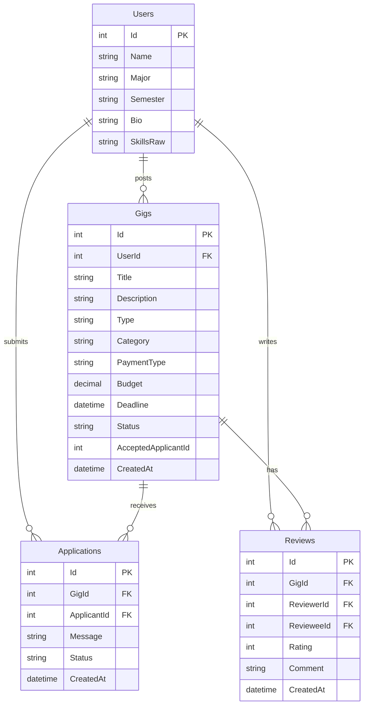

# 🎓 Campus Gig & SkillSwap Portal

**Hackathon Project Submission — Triple Threats (Task 1)**

A campus-focused marketplace where students can offer skills, request help, collaborate on short-term gigs, exchange services, and build trust through peer reviews.

## 📌 Project Overview

Students often need help with programming, graphic design, writing, and tutoring but lack a trusted campus platform to connect with other students. Campus Gig & SkillSwap Portal provides a shared marketplace where students can post opportunities, apply to gigs, exchange skills, offer free help, or work for payment.

### Key Features

- **Role-flexible participation:** Students can act as both gig owners and applicants.
- **Multiple compensation options:** Paid, Skill Swap, and Free.
- **Gig discovery:** Search and filter gigs by category, type, payment method, budget, and status.
- **Application management:** Submit applications and track their status.
- **Controlled assignment workflow:** Accept one applicant, reject remaining pending applications, and manage gig progress.
- **Mutual reviews:** Allow both participants to rate each other after a gig is completed.
- **Student reputation:** Display average ratings and completed gig information.
- **Responsive interface:** A student-friendly interface designed for different screen sizes.
- **REST API:** Endpoints for gigs, applications, and reviews.

## 💻 Technology Stack

| Component | Technology |
|---|---|
| Backend | ASP.NET Core MVC (.NET 8) |
| Programming language | C# |
| Database | Microsoft SQL Server |
| ORM | Entity Framework Core 8 |
| Frontend | Razor Views, HTML, CSS, JavaScript |
| UI styling | Tailwind CSS |
| API | ASP.NET Core REST API |
| Version control | Git and GitHub |

## 🏗️ System Architecture

The project uses a layered approach to separate the user interface, application logic, and data storage.

1. **Frontend:** Provides pages for browsing gigs, creating posts, applying, managing applications, and viewing profiles.
2. **Backend:** Implements application rules, validation, gig workflows, application handling, and reviews.
3. **Database:** Stores student profiles, gigs, applications, and reviews in SQL Server.
4. **REST API:** Exposes endpoints for retrieving and modifying application data.

## 📍 Hackathon Milestones

### Milestone 1 — Profiles & Gig Creation

- Student profiles with name, major, semester, bio, and skills.
- Students can post gigs and apply to other students' gigs.
- Support for Offering and Requesting gig types.
- Categories: Programming, Design, Writing, and Tutoring.
- Payment options: Paid, Skill Swap, and Free.
- Validation for paid budgets and deadlines.

### Milestone 2 — Discovery & Applications

- Keyword search across gig titles and descriptions.
- Filters for category, type, payment method, budget, and status.
- Application submission with a message.
- Prevention of applications to one's own gig.
- Prevention of duplicate applications.
- Expired-gig handling and personal application tracking.

### Milestone 3 — Applicant Selection & Status

- Gig owners manage applications for their own gigs.
- Accept one applicant and reject other pending applications.
- Transition accepted gigs to In Progress.
- Prevent new applications after assignment.
- Support the workflow Open → In Progress → Completed.
- Allow cancellation where permitted.

### Milestone 4 — Mutual Reviews & Reputation

- Both the gig owner and accepted applicant can review each other after completion.
- Ratings from 1 to 5 stars with written feedback.
- One review per reviewer per gig.
- Calculate average profile ratings from saved reviews.

### Milestone 5 — API & Seed Data

The project includes seeded records to demonstrate the main workflows.

| Entity | Seeded records |
|---|---:|
| Students | 14 |
| Gigs | 28 |
| Applications | 24 |
| Reviews | 10 |

The sample data covers multiple academic majors, gig categories, payment options, application statuses, and gig statuses.

## 🔌 REST API Endpoints

### Gigs

| Method | Endpoint | Purpose |
|---|---|---|
| GET | `/api/gigs` | Retrieve and filter gigs |
| GET | `/api/gigs/{id}` | Retrieve a specific gig |
| POST | `/api/gigs` | Create a gig |
| PATCH | `/api/gigs/{id}` | Update permitted gig fields or status |

Example query:

`GET /api/gigs?category=Programming&type=Offering&q=website&payment_type=Paid&status=Open`

### Applications

| Method | Endpoint | Purpose |
|---|---|---|
| GET | `/api/applications?gigId=1` | Retrieve applications for a gig |
| GET | `/api/applications?applicantId=2` | Retrieve applications by an applicant |
| POST | `/api/applications` | Submit an application |
| PATCH | `/api/applications/{id}` | Update an application status |

### Reviews

| Method | Endpoint | Purpose |
|---|---|---|
| GET | `/api/reviews?gigId=1` | Retrieve reviews for a gig |
| GET | `/api/reviews?userId=2` | Retrieve reviews associated with a user |
| POST | `/api/reviews` | Submit a review |

*Note: Endpoint availability and supported query parameters should be verified against the final implementation before submission.*

## 🗃️ Database Design

The database contains four primary entities:

- **Users:** Student profiles and skills.
- **Gigs:** Gig descriptions, categories, compensation, deadlines, and status.
- **Applications:** Applicant messages and application statuses.
- **Reviews:** Ratings and comments exchanged after completed gigs.

### Entity Relationships



## 👥 Team Contributions

### Muhammad Khatri — Backend Development

- Designed and implemented the backend using ASP.NET Core MVC and C#.
- Developed application logic and REST API endpoints.
- Worked on database models, Entity Framework Core, and SQL Server integration.
- Implemented gig management, application workflows, validation, and review functionality.

### Manal — Frontend Development

- Developed the frontend and user interface.
- Worked on Razor Views, page layouts, and styling.
- Focused on presenting gigs, forms, dashboards, and application workflows.

### Khushi — Testing & Quality Assurance

- Tested application workflows and features.
- Checked form validation, gig creation, applications, and status transitions.
- Helped identify issues and verify expected behavior.

## 🚀 How to Run the Project

### Prerequisites

- Visual Studio 2022 or a compatible .NET development environment.
- .NET 8 SDK.
- SQL Server LocalDB, SQL Server Express, or another supported SQL Server instance.
- Git.

### Setup Instructions

1. Clone the repository:

   ```bash
   git clone <repository-url>
   ```

2. Open the solution in Visual Studio.

3. Configure the SQL Server connection string in `appsettings.json`.

4. Restore NuGet packages:

   ```bash
   dotnet restore
   ```

5. Apply database migrations, if required:

   ```bash
   dotnet ef database update
   ```

6. Run the application:

   ```bash
   dotnet run
   ```

7. Open the local URL displayed in the terminal.

*Ensure the Entity Framework Core tools are installed and that the project's database configuration and migrations are ready before running the database update command.*

## 🎯 Project Goals

- Make campus collaboration easier.
- Encourage peer-to-peer learning and skill exchange.
- Help students gain practical experience.
- Build trust through completed gigs and mutual reviews.
- Demonstrate full-stack development, API integration, database design, and software testing.

## 🔮 Future Enhancements

- Student authentication and campus email verification.
- Real-time notifications for applications and status changes.
- Advanced reputation metrics and review moderation.
- Messaging between gig owners and applicants.
- Improved accessibility and mobile experience.

## 🏁 Conclusion

Campus Gig & SkillSwap Portal demonstrates how a campus marketplace can connect students who need help with students who have the skills to provide it. By combining gig discovery, controlled assignment workflows, and mutual reviews, the platform encourages collaboration, practical learning, and a stronger student community.

**Developed by Team Triple Threats**

- Backend: Muhammad Khatri
- Frontend: Manal
- Testing: Khushi
