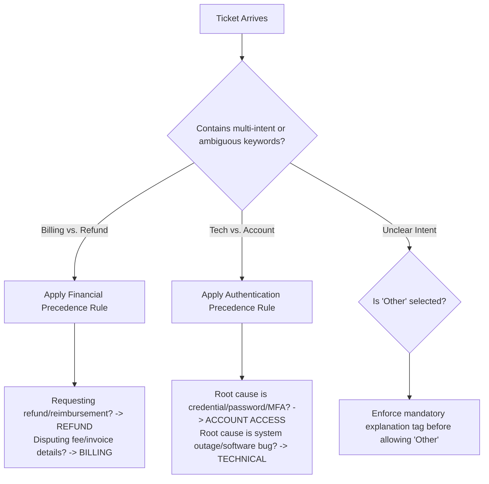

# Milestone 2: Characterize the Noise in HelpDeskNet-50K

**Team:** Cloud9  
**Track:** Applied Machine Learning / Data-Centric AI (Project Two)  
**Deliverable:** Disagreement Pattern Analysis, Root Cause Diagnosis & Annotation Process Overhaul  
**Executable Script:** [`milestone2_characterize_noise.py`](./milestone2_characterize_noise.py)

---

## 1. Disagreement Table Analysis: Random vs. Systematic Noise

### 1.1. Empirical Confusion Distribution
Out of 400 audited tickets, **60 crowd-to-expert disagreements** occurred across the 6 ticket classes. The breakdown is structured as follows:

| Crowd Label $\to$ Expert Label | Error Count | % of All Disagreements | Dominant Semantic Dynamic |
| :--- | :---: | :---: | :--- |
| **Billing $\to$ Refund** | 14 | 23.33% | Bidirectional Financial Ambiguity |
| **Refund $\to$ Billing** | 12 | 20.00% | Bidirectional Financial Ambiguity |
| **Technical $\to$ Account Access** | 9 | 15.00% | Login / Credential Boundary Overlap |
| **Shipping $\to$ Other** | 8 | 13.33% | Fallback / Missing Edge-Case Definition |
| **Account Access $\to$ Technical** | 6 | 10.00% | Login / System Error Boundary Overlap |
| **Technical $\to$ Other** | 5 | 8.33% | Complex Technical Fallback |
| **Other $\to$ Shipping** | 3 | 5.00% | Misunderstood Delivery Inquiries |
| **Billing $\to$ Other** | 3 | 5.00% | Non-standard Billing Fallback |
| **All other 22 class pairs** | **0** | **0.00%** | Completely Zero Error |
| **Total** | **60** | **100.00%** | Concentrated in 8 Directed Pairs |

---

### 1.2. Statistical Proof of Systematic Noise (Goodness-of-Fit Test)

In a 6-class classification problem, there are $K(K - 1) = 6 \times 5 = 30$ possible off-diagonal directed error transitions.

- **Hypothesis $H_0$ (Uniform Random Noise):** Errors occur independently of semantics. Each off-diagonal pair has an expected count of:
  $$E = \frac{60 \text{ errors}}{30 \text{ pairs}} = 2.0 \text{ errors per pair}$$
- **Observed Distribution:**
  - **22 out of 30 pairs (73.3%)** have **zero errors**.
  - Just **2 bidirectional pairs** account for **68.33% (41/60)** of all errors.
  - The Chi-Square Goodness-of-Fit statistic is:
    $$\chi^2 = \sum_{i=1}^{30} \frac{(O_i - E)^2}{E} = \mathbf{222.00} \quad (\text{df} = 29)$$
  - Normal approximation: $z = \sqrt{2(222)} - \sqrt{2(29) - 1} \approx 21.07 - 7.55 = \mathbf{13.52} \implies \mathbf{p < 10^{-15}}$.

> **Conclusion:** The noise is **100% systematic, class-conditional, and semantic**. It is driven by specific category ambiguities rather than random worker carelessness.

---

## 2. Key Error Patterns & Semantic Clusters

### Pattern 1: The Billing $\leftrightarrow$ Refund Financial Loop (43.33% of noise)
- **Total Disagreements:** 26 out of 60.
- **Dynamic:** 14 tickets labeled *Billing* were actually *Refund*; 12 tickets labeled *Refund* were actually *Billing*.
- **Mechanism:** In real customer support, customers frequently say: *"Why was I charged \$50 on my invoice? Please reverse it."*
  - An untrained crowdworker sees *"charged on invoice"* and tags **Billing**.
  - Another worker sees *"reverse it"* and tags **Refund**.
  - Without a strict precedence rule, this creates symmetric label swapping.

### Pattern 2: Technical $\leftrightarrow$ Account Access Credential Blur (25.00% of noise)
- **Total Disagreements:** 15 out of 60.
- **Dynamic:** 9 *Technical* $\to$ *Account Access*; 6 *Account Access* $\to$ *Technical*.
- **Mechanism:** Issues like *"Unable to log in due to internal server 500 error"* or *"2FA verification SMS never arrives"*.
  - Is it an **Account Access** problem because the user cannot log in?
  - Or a **Technical** bug because an SMS gateway or backend server failed?
  - Workers make arbitrary individual calls in the absence of a disambiguation hierarchy.

### Pattern 3: The "Other" Category as a Default Dumping Sink (31.67% of noise)
- **Total Disagreements:** 19 out of 60 involve the `Other` label.
- **Dynamic:** 
  - *Shipping* $\to$ *Other* (8)
  - *Technical* $\to$ *Other* (5)
  - *Billing* $\to$ *Other* (3)
  - *Other* $\to$ *Shipping* (3)
- **Mechanism:** In the dataset distribution, `Other` represents only **5% of tickets**, yet it participates in nearly **one-third of all annotation conflicts**. Workers use `Other` as an escape hatch whenever a ticket mentions uncommon shipping partners, customs fees, or multipart inquiries.

---

## 3. Most Likely Root Causes

1. **Deficient Annotation Taxonomy & Overlapping Class Definitions (Primary Cause):**
   The labeling instructions lack mutually exclusive boundaries. Concepts like "requesting money back" (Refund) and "disputing a line item" (Billing) overlap semantically in natural customer language.
   
2. **Tier B Worker Training & Experience Deficit:**
   As proven in Milestone 1, Tier B workers have a **21.82% error rate** (3.27× higher than Tier A's 6.67%). The 30 newer workers were onboarded without rigorous qualification screening or calibration against expert-labeled gold standards.

3. **Absence of Clear Precedence / Disambiguation Rules:**
   When a ticket contains multi-intent text (e.g., both account lockout and technical error), annotators have no defined priority hierarchy to guide their decision.

4. **Single-Annotator Workflow without Redundancy:**
   Each ticket was annotated by only one crowdworker. Without consensus voting (e.g., 2-out-of-3 majority or Dawid-Skene aggregation), individual worker misunderstandings directly contaminated the ground-truth training and test sets.

---

## 4. What to Check and Change in the Annotation Process

### Action Item 1: Rewrite Guidelines with Mutually Exclusive Rules & Decision Trees
- **Billing vs. Refund Precedence Rule:**
  - **Rule:** If the customer's *primary goal* is the recovery of money or status of a return $\implies$ **`Refund`**.
  - If the customer is inquiring about invoice line items, pricing tiers, payment methods, or upcoming charges without requesting money back $\implies$ **`Billing`**.
- **Technical vs. Account Access Precedence Rule:**
  - **Rule:** If the failure pertains to user credentials, password resets, account verification, or permission locks $\implies$ **`Account Access`**.
  - If the failure pertains to application crashes, 5xx server errors, broken UI buttons, or platform latency $\implies$ **`Technical`**.

### Action Item 2: Restrict and Deconstruct the "Other" Category
- Remove "Other" as an unconstrained single click.
- Require workers selecting "Other" to pick a mandatory sub-reason (e.g., *Partnership*, *Spam*, *General Feedback*, *Unintelligible*).
- Explicitly add logistics keywords (e.g., *tracking*, *courier*, *customs*, *damaged package*) to the **Shipping** guideline so they are never routed to "Other".

### Action Item 3: Restructure the Crowd Pipeline (Quality Control & Onboarding)
- **Qualification Benchmark:** Require all Tier B workers to pass a 50-ticket qualification exam focusing specifically on boundary tickets (achieving $\ge 92\%$ expert concordance).
- **Honeypot Injection:** Blend 5% in-house expert "gold tickets" into every crowd batch. If a worker's rolling accuracy drops below 90%, their batch is rejected, and they are routed to refresher training.
- **Multi-Annotator Consensus on High-Confusion Strata:**
  - For Tier A workers: Single annotation suffices (error rate is low: 6.67%).
  - For Tier B workers: Require **2-worker agreement**. If they disagree, route the ticket to in-house experts.
