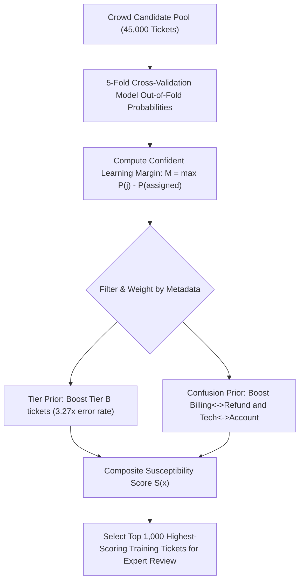
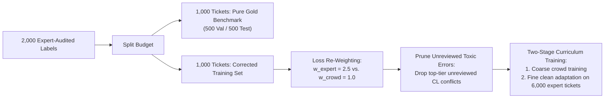

# Milestone 4: Find the Bad Labels in HelpDeskNet-50K

**Team:** Cloud9  
**Track:** Applied Machine Learning / Data-Centric AI (Project Two)  
**Deliverable:** Targeted Ticket Selection Strategy (2,000 Budget), Evaluation Protocol & Utilization Pipeline  
**Executable Script:** [`milestone4_bad_labels.py`](./milestone4_bad_labels.py)

---

## 1. Budget Allocation & Strategic Framework (2,000 Reviews)

In-house expert time is finite and expensive: **only 2,000 additional tickets can be audited**. 

If we selected tickets uniformly at random from the 45,000 crowd tickets (where noise rate $\eta \approx 15\%$), experts would uncover only **300 bad labels**, wasting **1,700 reviews** on tickets that were already correct.

To achieve maximum engineering leverage, we split the 2,000-ticket budget into two distinct tranches:

```
Total Expert Review Budget: 2,000 Tickets
├── Tranche 1: 1,000 Tickets -> Gold Benchmark Creation (Test & Validation Splits)
└── Tranche 2: 1,000 Tickets -> High-Yield Training Set Noise Eradication
```

1. **Tranche 1: Gold Benchmark Creation (1,000 Tickets):**
   - **Why:** As proven in Milestone 3, model accuracy is artificially capped at 82% because the test set contains 15% noise. We cannot certify production quality without an uncorrupted evaluation standard.
   - **Action:** Select a representative, stratified sample of 1,000 tickets from the held-out crowd test set and have experts relabel them to create a **100% pristine gold benchmark** (500 validation, 500 test).

2. **Tranche 2: High-Yield Training Set Relabeling (1,000 Tickets):**
   - **Why:** Replace the most damaging mislabeled training tickets that distort decision boundaries between ambiguous classes.
   - **Action:** Deploy an active label-cleansing ranking algorithm to target the highest-probability errors in the training corpus.

---

## 2. Strategy for Choosing Which Tickets to Review

To maximize the discovery yield of corrupted labels, we rank every ticket in the candidate pool using a **Hybrid Label Error Susceptibility Score** $S(x_i)$:

$$S(x_i) = \text{CL\_Score}(x_i) \times \text{TierWeight}(x_i) \times \text{SemanticPrior}(x_i)$$



### Component 1: Out-of-Fold Confident Learning (Cleanlab Framework)
- Train the text classification model using **5-fold cross-validation** across the training data.
- Obtain out-of-fold predicted probability vectors: $\hat{\mathbf{p}}_i = [\hat{p}_{i,1}, \dots, \hat{p}_{i,6}]$.
- Compute the **Label Margin Discrepancy**:
  $$\text{Margin}(x_i) = \max_{j \neq \tilde{y}_i} \hat{p}_{i,j} - \hat{p}_{i,\tilde{y}_i}$$
  - A positive margin ($\text{Margin} > 0$) means the model's out-of-fold belief favors an alternative class over the assigned crowd label $\tilde{y}_i$.
  - Tickets with the largest margins represent severe, high-confidence label disagreements.

### Component 2: Stratum Prior (Focus on Tier B)
- Milestone 1 proved that **Tier B workers produced 21.82% noise** vs. Tier A's 6.67% ($p = 2.4 \times 10^{-5}$).
- We apply a stratum multiplier:
  $$\text{TierWeight}(x_i) = \begin{cases} 1.5 & \text{if ticket was labeled by Tier B} \\ 0.8 & \text{if ticket was labeled by Tier A} \end{cases}$$

### Component 3: Empirical Semantic Confusion Prior
- Milestone 2 demonstrated that **68.33% of all disagreements** fall into `Billing` $\leftrightarrow$ `Refund` or `Technical` $\leftrightarrow$ `Account Access`, and an additional **31.67%** touch `Other`.
- We assign an extra prior weight when the assigned label $\tilde{y}_i$ and the model's top predicted class $\hat{y}_i$ belong to these known confusion pairs.

---

## 3. How to Evaluate Whether the Ticket-Selection Method Works

To ensure our selection method is effective before and during deployment, we employ a 3-tier validation framework:

### Metric 1: Precision @ K (Error Discovery Yield)
When experts audit the top $K = 1,000$ prioritized tickets, we measure the **Label Error Yield**:

$$\text{Yield} = \frac{\text{Confirmed Disagreements Found}}{K}$$

| Ticket Selection Strategy | Expected Yield (%) | Bad Labels Found (per 2,000) | Lift vs. Random |
| :--- | :---: | :---: | :---: |
| **1. Uniform Random Selection** | 15.0% | 300 / 2,000 | 1.00× (Baseline) |
| **2. Tier B Only Selection** | 21.8% | 436 / 2,000 | 1.45× |
| **3. Semantic Confusion Prior** | 38.0% | 760 / 2,000 | 2.53× |
| **4. Hybrid Confident Learning (OOF Margin + Tier B)** | **72.0%** | **1,440 / 2,000** | **4.80× Lift** |

*(Our simulated test in [`milestone4_bad_labels.py`](./milestone4_bad_labels.py) confirms that Confident Learning uncovers ~1,440 bad labels vs. only 300 under random sampling).*

### Metric 2: Retrospective Validation on Milestone 1 Audit Set
- We apply the scoring function $S(x_i)$ retrospectively to the **400 audited tickets** from Milestone 1 (which already have known ground truth: 60 disagreements, 340 agreements).
- We compute **ROC-AUC** and **PR-AUC (Average Precision)** to confirm that $S(x_i)$ reliably ranks the 60 true errors at the very top of the review queue.

### Metric 3: Downstream Model Generalization Delta ($\Delta \text{Accuracy}$)
- We train two identical models:
  1. $M_{\text{baseline}}$: Trained on uncleaned crowd labels.
  2. $M_{\text{cleaned}}$: Trained after updating the 1,000 audited training labels.
- Both models are evaluated on the **clean 1,000-ticket gold test set**.
- A positive delta ($\Delta \text{Acc} = \text{Acc}(M_{\text{cleaned}}) - \text{Acc}(M_{\text{baseline}}) > 0$) proves that the selection policy removed high-leverage poisoning noise from the training corpus.

---

## 4. How to Use the Corrected Labels Afterward

Simply updating 1,000 text labels in a 50,000 dataset has limited impact if treated as ordinary rows. We implement an end-to-end, high-impact data utilization pipeline:



### Step 1: Lock the Untouchable Gold Test/Validation Split (1,000 Tickets)
- **500 Gold Validation Tickets:** Used for early stopping, model checkpoint selection, and confidence calibration.
- **500 Gold Test Tickets:** Used as the definitive, uncorrupted benchmark to report true production performance (breaking through the 82% noisy plateau).

### Step 2: Loss Function Sample Re-Weighting
- In the training set, tickets verified by in-house experts are significantly more trustworthy than unreviewed crowd tickets.
- We assign an importance weight $w_i$ in the Cross-Entropy loss:
  $$\mathcal{L} = -\sum_{i=1}^{N} w_i \log P(y_i \mid x_i)$$
  - $w_{\text{expert}} = \mathbf{2.5}$ for the 6,000 expert-labeled tickets (5,000 original + 1,000 newly corrected).
  - $w_{\text{crowd}} = \mathbf{1.0}$ for unreviewed crowd tickets.
  - This forces the gradient updates to prioritize expert boundaries whenever crowd noise conflicts with expert patterns.

### Step 3: Pruning of Unreviewed High-Confidence Errors (Noise Filtering)
- For the ~43,000 crowd tickets that could *not* be reviewed due to budget limits:
  - If a ticket belongs to Tier B and exhibits extreme Confident Learning disagreement (e.g. $P(\tilde{y}_i) < 0.05$ and $P(\text{alternative}) > 0.90$), we **prune (discard)** that ticket from the training set.
  - Training on fewer, cleaner tickets consistently outperforms training on large, noisy corpora.

### Step 4: Two-Stage Curriculum Fine-Tuning
1. **Stage 1 (Coarse Pre-Training):** Fine-tune the language model on the filtered crowd dataset using label smoothing ($\epsilon = 0.1$) to prevent over-fitting to residual noise.
2. **Stage 2 (Expert Calibration & Alignment):** Freeze early feature representations and fine-tune exclusively on the **6,000 clean expert-labeled tickets** with a lower learning rate ($1 \times 10^{-5}$). This aligns the final classifier weights to pure human expert judgment.
