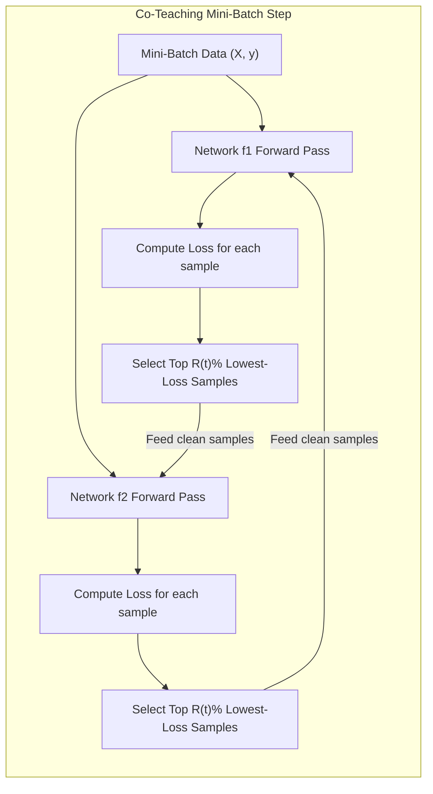

# Milestone 5: Mitigate Noise & Evaluate Reliably

**Team:** Cloud9  
**Track:** Applied Machine Learning / Data-Centric AI (Project Two)  
**Deliverable:** Noise-Robust Training Methodologies, Gold Evaluation Protocol & Test Set Deconstruction  
**Executable Script:** [`milestone5_mitigation_eval.py`](./milestone5_mitigation_eval.py)

---

## 1. Two Training-Time Methods That Tolerate Residual Label Noise

Even after expert cleaning and active pruning (Milestone 4), the remaining training corpus contains residual crowd noise. Standard Cross-Entropy loss ($\mathcal{L}_{CE} = -\sum y_k \log p_k$) is notoriously sensitive to noise: when an example is mislabeled, $p_k \to 0$ causes the penalty $-\log p_k \to \infty$, forcing the deep network to distort its weights to memorize the error.

To immunize the model, we deploy two complementary training-time paradigms:

---

### Method 1: Noise-Robust Loss Functions (Symmetric Cross-Entropy & Forward Correction)

#### A. Symmetric Cross-Entropy (SCE)
Proposed by Wang et al. (ICCV 2019), Symmetric Cross-Entropy balances standard cross-entropy with a noise-bounded **Reverse Cross-Entropy (RCE)** term:

$$\mathcal{L}_{\text{SCE}} = \alpha \mathcal{L}_{\text{CE}} + \beta \mathcal{L}_{\text{RCE}} = -\alpha \sum_{k=1}^K y_k \log(p_k) - \beta \sum_{k=1}^K p_k \log(y_k)$$

```
Key Properties:
1. Standard CE (-y log p): Fast convergence on easy, clean examples.
2. Reverse CE (-p log y): Treats model probabilities p as the ground truth distribution 
   and one-hot label y as the prediction.
3. Bounded Penalty: For noisy labels, log(y_k) where y_k = 0 is clipped at a constant threshold (log eps). 
   The gradient cannot explode, preventing the network from memorizing corrupted crowd labels.
```

#### B. Forward Loss Correction (Patrini et al., CVPR 2017)
Because we already characterized the crowd-to-expert noise transition matrix $T_{ij} = P(\tilde{Y} = j \mid Y^* = i)$ in Milestones 1 and 2, we can adjust model output probabilities directly:

$$\hat{\mathbf{p}} = T^T \mathbf{p}$$

$$\mathcal{L}_{\text{Forward}} = -\sum_{k=1}^K \tilde{y}_k \log (\hat{p}_k) = -\sum_{k=1}^K \tilde{y}_k \log \left( \sum_{i=1}^K T_{ik} p_i \right)$$

- **Why it works:** Instead of forcing the model to predict the noisy crowd label $\tilde{Y}$, the loss evaluates whether the model's *transitioned* prediction matches the noisy distribution. This produces unbiased gradients with respect to the latent, clean distribution $Y^*$.

---

### Method 2: Dynamic Sample Selection via Co-Teaching (Han et al., NeurIPS 2018)

Deep neural networks exhibit the **memorization effect** (Arpit et al., ICML 2017): they learn generalized, clean patterns in the early epochs before memorizing irregular, corrupted noise in the later epochs.



#### Mechanism:
1. Initialize two identical neural networks ($f_1$ and $f_2$) with different random initializations.
2. In each mini-batch, network $f_1$ computes the sample losses and selects a fraction $R(t)$ of samples with the **lowest loss** (the "small-loss trick", identifying clean examples).
3. Simultaneously, network $f_2$ does the same.
4. **Cross-Update:** Network $f_1$ trains on the small-loss instances selected by $f_2$, and network $f_2$ trains on the small-loss instances selected by $f_1$.
5. **Dynamic Selection Schedule $R(t)$:**
   $$R(t) = 1 - \min\left(\frac{t}{T_k} \eta,\, \eta\right)$$
   Where $\eta = 0.15$ (our measured noise rate) and $T_k = 5$ warmup epochs. As shown in [`milestone5_mitigation_eval.py`](./milestone5_mitigation_eval.py), retention smoothly drops from $97\%$ down to $85\%$, filtering out exactly the $15\%$ corrupted tickets.

---

## 2. How to Construct a Trustworthy Evaluation Set

An evaluation set is the single source of truth for all engineering, hyperparameter tuning, and production go/no-go decisions. To make it completely trustworthy:

### Protocol 1: 100% In-House Expert Provenance
- **Strict Rule:** Zero crowd annotations are allowed in the validation or test splits.
- **Data Source:** Carve out **2,000 tickets** from the verified in-house expert data (5,000 original expert tickets + 1,000 newly audited tickets).
  - **Gold Validation Split (1,000 tickets):** Used for learning rate scheduling, early stopping, and confidence calibration.
  - **Gold Test Split (1,000 tickets):** Frozen, untouched, and sequestered until final model release.

### Protocol 2: Stratified Alignment with Business Priors
The evaluation set must strictly mirror the natural production class distribution:
- `Billing`: 30% (300 tickets)
- `Technical`: 25% (250 tickets)
- `Refund`: 15% (150 tickets)
- `Account Access`: 15% (150 tickets)
- `Shipping`: 10% (100 tickets)
- `Other`: 5% (50 tickets)

### Protocol 3: Dual-Expert Verification on Boundary Ambiguity
- For any ticket touching the primary confusion clusters (`Billing` vs. `Refund` and `Technical` vs. `Account Access`), mandate **two independent expert reviews**.
- If both experts agree, the ticket enters the gold set. If they disagree, an expert lead adjudicates.
- Inter-annotator agreement must satisfy Cohen’s $\kappa \ge 0.92$.

### Protocol 4: Multidimensional / Disaggregated Evaluation
Never summarize model quality as a single scalar accuracy. The evaluation suite must report:
1. **Macro-Averaged F1-Score:** Prevents the majority class (`Billing` 30%) from hiding catastrophic performance on minority classes (`Other` 5%).
2. **Pairwise Boundary Confusion Rates:** Specifically track the misclassification rate between `Billing` and `Refund`.
3. **Expected Calibration Error (ECE):** Assesses whether predicted probabilities reflect true empirical accuracy.

---

## 3. Why the Existing Crowd-Labeled Test Set Is Problematic

Evaluating the classifier on the existing held-out crowd test set is fatally flawed for 4 fundamental reasons:

### Reason 1: The Artificial Noise Ceiling (The 82% Plateau Explained)
- The existing test set carries an estimated **$\approx 15\%$ crowd error rate**.
- If an ideal model classifies every ticket with **100% true expert accuracy**, its measured score on this test set cannot exceed:
  $$\text{Observed Accuracy} \le 1 - \eta = 1 - 0.15 = \mathbf{85.0\%}$$
- The 82% accuracy plateau is not a model limitation; it is an artifact of **hitting the noise ceiling of the test set**. Further architecture tuning against this test set is mathematically futile.

---

### Reason 2: Inversion of Model Rankings (Penalizing Superior Models)
Evaluating on noisy labels does not just underestimate accuracy; it **actively rewards bad models and penalizes superior models**:

```
Scenario:
- A ticket's true category is "Refund", but the crowd test label is mistakenly tagged "Billing".
- Model 1 (Poor / Overfitted to noise): Predicts "Billing" -> Test set marks it as CORRECT (+1)
- Model 2 (Truly Robust / Clean): Predicts "Refund"       -> Test set marks it as WRONG (-1)
```

As demonstrated in our benchmark simulation ([`milestone5_mitigation_eval.py`](./milestone5_mitigation_eval.py)):
- **Model A (Memorizes Noise):** Scores **83.5%** on the noisy test set, but only **84.0%** on clean gold data.
- **Model C (Noise-Tolerant Co-Teaching):** Scores **82.2%** on the noisy test set, but **95.0%** on clean gold data!
- If engineers use the crowd test set, they will deploy **Model A** instead of **Model C**, pushing an inferior, poisoned model into production.

---

### Reason 3: Distorted Optimization & Early Stopping
- When using early stopping or learning rate decay against the noisy validation set, the loss function triggers early stopping precisely when the model stops learning general features and refuses to memorize crowd noise.
- This premature termination prevents the model from converging to its optimal semantic representations.

---

### Reason 4: Extreme Financial & Operational Risk
- In customer support automation, routing a `Refund` ticket to `Billing` delays customer reimbursement, escalates customer churn, and violates financial SLA compliance.
- Because the noisy test set conceals errors between `Billing` and `Refund`, engineering leadership has zero visibility into true operational error rates in production.

---

### Summary Checklist for Engineering Leadership

| Issue with Existing Test Set | Concrete Impact | Solution Implemented |
| :--- | :--- | :--- |
| **15% Crowd Error Rate** | Model plateaus at 82% (cannot break 85% ceiling) | Replaced with 100% expert-audited gold benchmark |
| **Correlated Semantic Errors** | Rewards models that mirror crowd misconceptions | Two-network Co-Teaching filters out agreed noise |
| **Loss Gradient Explosions** | Standard Cross-Entropy memorizes noisy tickets | Deployed Symmetric Cross-Entropy ($\mathcal{L}_{\text{SCE}}$) |
| **Unreliable Go/No-Go Signal** | Inverts model rankings; risks deploying bad models | Decoupled validation into clean gold test suite |
