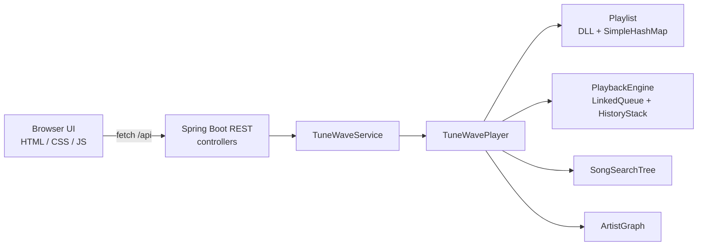

# TuneWave Music Player

PhantomX · Problem 1. A DSA-first music player: playlist, Up Next, history, title search, and artist recommendations are implemented with custom data structures, then exposed through a Spring Boot REST API and a browser UI.

The original assignment is a **playback engine**, not a streaming product. The expected deliverable is a working TuneWave core whose operations map one-to-one onto the required structures (doubly linked list, hash map, queue, stack, BST, graph), plus a way to demonstrate those operations. This repository keeps that core as the source of truth and adds a thin web layer around it.

---

## 1. Project overview

**Problem.** A music player has to support ordered playback, occasional “play this next” jumps, a short rewind history, title lookup, prefix search, and “artists you might also like” — without faking those behaviors with a database or stock Java collections for the core structures.

**What TuneWave is.** An in-memory player whose playlist is a doubly linked list, whose song-id lookup is a hash map, whose Up Next is a FIFO queue, whose history is a bounded stack, whose catalog is a title BST, and whose related-artists feature is an undirected graph.

**Deliverable.** A Java implementation of those operations, tests that lock the rules, and a demo UI that calls the real engine over HTTP so a reviewer can see next/previous, queue, history, search, and two-hop recommendations without using the console.

The original issue is the source of truth for *what* must exist. The code in this repository is the source of truth for *how* it exists.

---

## 2. Requirements → implementation

### Milestone 1 — Playlist (doubly linked list + hash map)

| Requirement | Implementation |
|---|---|
| Doubly linked list | `Playlist` nodes with `prev` / `next`, plus `head`, `tail`, and `current` |
| Hash map `song ID → node` | Custom `SimpleHashMap` field `index`; add/remove/contains use the map, not a list scan |
| `addSong` | Appends at the tail; first song becomes `current` |
| `removeSong` | Map lookup, unlink neighbors, repair `current` if the removed node was current |
| `next` / `previous` | Walk `current.next` / `current.prev` |
| Repeat ON | `next()` from the last song wraps to `head` |
| Repeat OFF | `next()` from the last song **does not move** `current` and returns status `"end"` |
| No duplicate song IDs | `index.containsKey(id)` rejects a second insert of the same id |

**Why these structures.** A DLL makes previous/next and splice-out O(1) once you have the node. A hash map gives average O(1) access to that node by id, which is what the issue requires instead of scanning the playlist for every lookup or delete.

Public operations: `TuneWavePlayer.addSong`, `removeSong`, `next`, `previous`, `toggleRepeat`.

### Milestone 2 — Up Next and history (queue + stack)

| Requirement | Implementation |
|---|---|
| Queue | Custom `LinkedQueue` (FIFO enqueue/dequeue) inside `PlaybackEngine` |
| Stack | Custom `HistoryStack`, max **10**; overflow drops the **oldest** (bottom) |
| `addToUpNext` | Enqueues a song id |
| `playNext` | Dequeues Up Next if it is non-empty; otherwise advances the playlist |
| `back` | Pops the top of history and plays that id as an override |
| Queue/history must not move the playlist cursor | `PlaybackEngine` keeps `overrideId` for queue/history playback; `playlist.current` stays put |
| Empty history | DSA returns `PlayResult.empty()`; the REST layer maps that to HTTP 400 `"History is empty."` |

Up Next is always served **before** continuing the playlist. Consecutive pushes of the same id are ignored so the stack does not fill with repeats of the track that is already on top.

**Why these structures.** “Play this next” is FIFO. “Go back to what just played” is LIFO. A hard cap of 10 with drop-oldest matches a bounded history, not an unbounded `Deque`.

Public operations: `addToUpNext`, `playNext`, `back`. Limit constant: `TuneWavePlayer.HISTORY_LIMIT` (= `HistoryStack.MAX` = 10).

### Milestone 3 — Search and related artists (BST + graph)

| Requirement | Implementation |
|---|---|
| BST keyed by title | `SongSearchTree`; `String.compareTo` (case-sensitive) |
| `addSong` / `findSong` / `prefixSearch` | Insert on add; exact title lookup; in-order prefix collection |
| Alphabetical prefix results | In-order walk (`left`, match, `right`) |
| Skip subtrees that cannot match | `collectPrefix` goes only right if `title < prefix`, only left otherwise |
| Undirected artist graph | `ArtistGraph.addRelation` inserts **both** adjacency directions |
| Recommendations exactly two links away | Neighbors-of-neighbors |
| Exclude self and direct neighbors | Candidate skipped if it is the source or in the one-hop set |
| Alphabetical recommendations | Results collected in a `TreeSet` **after** the graph walk (sorting only, not the graph) |

Duplicate **titles** may share one BST node (multiple song ids). Duplicate **ids** are still forbidden by the playlist map.

**Why these structures.** Ordered title search and prefix queries are a tree problem; pruning is the point of a BST over a linear scan. “Friends of friends, not friends” is a two-hop walk on an undirected graph.

Public operations: `findSong`, `prefixSearch`, `addRelation`, `recommendArtists`.

---

## 3. DSA implementation

The core is already implemented and is what the web app calls. It lives in:

```
src/main/java/com/phantomx/tunewave/dsa/
```

Package: `com.phantomx.tunewave.dsa`. Facade: `TuneWavePlayer`.

These are **custom** structures, not `LinkedList` / `HashMap` / `ArrayDeque` stand-ins for the required ADTs:

| Required ADT | Class | Notes |
|---|---|---|
| Doubly linked list | `Playlist` | Private `Node` with `prev`/`next` |
| Hash map | `SimpleHashMap` | Separate chaining, load factor 0.75, used by `Playlist` and `ArtistGraph` |
| Queue | `LinkedQueue` | Singly linked FIFO |
| Stack | `HistoryStack` | Linked stack, cap 10, drop oldest |
| BST | `SongSearchTree` | Title key, prefix prune |
| Graph | `ArtistGraph` | Adjacency lists, undirected |

Supporting types: `Song`, `NextResult`, `PlayResult`. Playback glue: `PlaybackEngine` (queue + stack + `overrideId`).

`java.util` appears only at the edges (for example `ArrayList` for snapshots returned to callers, `TreeSet` to sort recommendation names). The playlist, map, queue, stack, tree, and graph themselves are hand-written.

---

## 4. Application architecture



**Why Spring Boot exists.** The assignment is the DSA player. The web layer does not reimplement next/queue/search. Controllers call `TuneWaveService`, which calls `TuneWavePlayer`. DTOs (`SongDto`, `PlayerStateDto`, …) are JSON views of `Song` and operation results — not a second engine. Nodes are not exposed on the wire.

**Why the UI exists.** Reviewers need to *see* cursor vs now-playing, Up Next draining before the playlist, history back, BST prefix results, and two-hop recs. The UI is a demonstration surface. It uses `fetch` against `/api` (`useMock: false`). There is no mock player in the page.

**Optional CLI.** `com.phantomx.tunewave.cli.TuneWaveApp` drives the same `TuneWavePlayer` from the terminal. It is not required to run the web demo.

Seed data (`DemoCatalog`, 250 unique titles) is configuration, not DSA.

---

## 5. Frontend / UI

**Location:** `src/main/resources/static/`  
**Stack:** plain HTML, CSS, and JavaScript (no SPA framework). Served by Spring Boot as the welcome page.

| File | Role |
|---|---|
| `index.html` | Layout: Library, Queue, Search, Artists, player bar |
| `css/app.css` | Layout, desktop/mobile breakpoints |
| `js/api.js` | REST client, `BASE = "/api"` |
| `js/ui.js` | Rows, empty/loading states, toasts |
| `js/app.js` | View switching, `GET /api/player` refresh, control wiring |

**What the UI actually shows**

- **Library (Milestone 1):** add song (title required, artist optional), remove, playlist in play order, **Playing** vs **Cursor** badges.
- **Player bar:** now playing, whether it is from the playlist or from queue/history, playlist cursor title, position `n of N`, Repeat / Queue / History counts.
- **Controls:** Back (history), Prev (playlist), Play next (queue then playlist), Next (playlist), Repeat.
- **Queue (Milestone 2):** Up Next list, history (oldest → newest, cap shown as `k / 10`). Desktop also mirrors both in a right-hand rail.
- **Search (Milestone 3):** exact title (`findSong`) and prefix (`prefixSearch`); blank query lists all titles via prefix only (does not call exact search with an empty title).
- **Artists (Milestone 3):** undirected `addRelation`, two-hop `recommendArtists`.
- **Feedback:** toasts for success and errors; loading and empty copy on lists.

Layout stacks on small screens (hamburger nav); the rail is hidden below 1080px.

**Screenshots.** This repository does not contain screenshot image files. The live UI is `http://127.0.0.1:8081/` when the Spring Boot app is running.

---

## 6. Backend / REST API

**Runtime:** Spring Boot **3.3.5**, Java **17** (`pom.xml`).  
**Entry point:** `com.phantomx.tunewave.TuneWaveApplication`.  
**Port:** `8081` (`src/main/resources/application.properties`).  
**Seed:** `tunewave.seed=true` loads `DemoCatalog` in `PlayerConfig`.

### Layers

| Layer | Package | Role |
|---|---|---|
| Controllers | `com.phantomx.tunewave.controller` | HTTP mapping only |
| Service | `TuneWaveService` | Title-oriented API, validation, DTO mapping |
| Facade | `TuneWavePlayer` | DSA operations |
| DTOs | `com.phantomx.tunewave.model` | JSON records (`SongDto`, `PlayerStateDto`, `ActionResponse`, `SearchResponse`, `RecommendResponse`, `ErrorResponse`, request bodies) |
| Errors | `ApiExceptionHandler` + `PlayerException` | 400 validation / domain errors; 404 missing static; 400 malformed JSON |

The service looks up catalog songs **by title** for the UI. Internally the engine still keys the playlist by **song id**.

### Endpoints

| Method | Path | Purpose |
|---|---|---|
| `GET` | `/api/player` | Snapshot: playlist, `current`, `playing`, `repeat`, `upNext`, `history`, `historyMax` |
| `POST` | `/api/songs` | Add `{title, artist}` |
| `DELETE` | `/api/songs?title=` | Remove by title |
| `POST` | `/api/player/next` | Playlist next |
| `POST` | `/api/player/previous` | Playlist previous |
| `POST` | `/api/player/repeat` | Toggle repeat |
| `POST` | `/api/queue` | Enqueue `{title}` |
| `POST` | `/api/player/play-next` | Queue first, else playlist |
| `POST` | `/api/player/back` | Pop history |
| `GET` | `/api/search?title=` | Exact title (BST) |
| `GET` | `/api/search/prefix?q=` | Prefix titles + matching songs |
| `POST` | `/api/artists/relations` | `{artistA, artistB}` |
| `GET` | `/api/artists/recommendations?artist=` | Two-hop names, sorted |

There is no auth header, pagination, or file upload.

---

## 7. Frontend ↔ backend connection

The browser never talks to a node or a list. `js/api.js` calls `/api/...`; `app.js` refreshes state with `GET /api/player` after each mutation.

**Next (playlist cursor)**

UI Next → `POST /api/player/next` → `PlayerController.next()` → `TuneWaveService.next()` → `TuneWavePlayer.next()` → `Playlist.next()` (DLL) → `ActionResponse` → toast + `GET /api/player` → cursor label and badges update.

**Play next (queue then playlist)**

UI Play next → `POST /api/player/play-next` → `PlaybackEngine.playNext()` (`LinkedQueue` dequeue if present, else DLL `next`) → if `source` is `"queue"`, toast “Playing from Up Next.” Now playing can differ from the cursor.

**Search**

UI Search → `GET /api/search/prefix?q=` and, if the query is non-empty, `GET /api/search?title=` → `SongSearchTree` → rows rendered from returned `SongDto`s (not from a stale client copy of the playlist).

**Recommendations**

UI Recommend → `GET /api/artists/recommendations?artist=` → `ArtistGraph.recommendArtists()` → chips.

Errors (`ok: false` / HTTP 400) surface as toasts or inline error text via `body.error`.

---

## 8. Data flow and DSA mapping

| User feature | Backend operation | DSA |
|---|---|---|
| Playlist order, Next, Prev, Repeat | `Playlist` / `TuneWavePlayer.next|previous|toggleRepeat` | Doubly linked list |
| Add / remove / no duplicate ids | `Playlist.addSong` / `removeSong` | DLL + `SimpleHashMap` (`songId → node`) |
| Up Next | `PlaybackEngine.addToUpNext` / `playNext` | `LinkedQueue` |
| History / Back | `HistoryStack` via `playNext` / `back` | Bounded stack (max 10) |
| Exact title search | `SongSearchTree.findSong` | BST |
| Prefix search | `SongSearchTree.prefixSearch` | BST with subtree prune |
| Artist link | `ArtistGraph.addRelation` | Undirected graph |
| Recommendations | `ArtistGraph.recommendArtists` | Two-hop walk, exclude self and directs |

Now playing vs cursor: `playlist.current` is the cursor; `PlaybackEngine.overrideId` is set when a queued or history track is playing.

---

## 9. Project structure

```
problem-1/
├── pom.xml
├── README.md
├── mvnw / mvnw.cmd
├── run-app.ps1 / run-app.sh          # Spring Boot (UI + API) on port 8081
├── run-tests.ps1 / run-tests.sh
├── serve-ui.ps1 / serve-ui.sh        # leftover static-file server; does not host /api
└── src/
    ├── main/java/com/phantomx/tunewave/
    │   ├── TuneWaveApplication.java
    │   ├── cli/TuneWaveApp.java
    │   ├── config/PlayerConfig.java
    │   ├── config/DemoCatalog.java
    │   ├── controller/
    │   │   ├── PlayerController.java
    │   │   ├── PlaylistController.java
    │   │   ├── QueueController.java
    │   │   ├── SearchController.java
    │   │   ├── ArtistController.java
    │   │   └── ApiExceptionHandler.java
    │   ├── dsa/                      # DSA core
    │   │   ├── TuneWavePlayer.java
    │   │   ├── Playlist.java
    │   │   ├── SimpleHashMap.java
    │   │   ├── LinkedQueue.java
    │   │   ├── HistoryStack.java
    │   │   ├── PlaybackEngine.java
    │   │   ├── SongSearchTree.java
    │   │   ├── ArtistGraph.java
    │   │   └── Song.java, NextResult.java, PlayResult.java
    │   ├── model/                    # JSON DTOs / request bodies
    │   └── service/TuneWaveService.java
    ├── main/resources/
    │   ├── application.properties
    │   └── static/                   # UI
    └── test/java/com/phantomx/tunewave/
        ├── controller/PlayerApiTest.java
        └── dsa/                      # TestRunner suite + DsaSuiteTest
```

---

## 10. Running the application

**Prerequisites**

- JDK **17** or newer (`JAVA_HOME` set, or a Microsoft OpenJDK under `C:\Program Files\Microsoft\jdk-*` on Windows — the run scripts detect that)
- Maven Wrapper (`mvnw` / `mvnw.cmd`) as shipped in this folder

**Start UI + API** (from this directory)

```powershell
./run-app.ps1
```

```sh
sh run-app.sh
```

Equivalent: `./mvnw spring-boot:run` (Windows: `mvnw.cmd`).

Open **http://127.0.0.1:8081/**. The same process serves `index.html` and `/api`.

**Tests**

```powershell
./run-tests.ps1
```

```sh
sh run-tests.sh
```

Equivalent: `./mvnw test`.

`serve-ui.ps1` / `serve-ui.sh` only serve static files (historically on port 8080). They do **not** start the REST backend. Use `run-app` for the integrated demo.

---

## 11. Testing and validation

| Suite | Location | Last recorded result in this workspace |
|---|---|---|
| DSA `TestRunner` | `src/test/java/com/phantomx/tunewave/dsa/` (`PlaylistTest`, `PlaybackEngineTest`, `SongSearchTreeTest`, `ArtistGraphTest`, `TuneWavePlayerTest`, `IntegrationTest`, `InvariantTest`) | Executed by `DsaSuiteTest` (`assertEquals(0, TestRunner.runAll())`) |
| JUnit wrapper | `DsaSuiteTest` | 1 test, 0 failures (`target/surefire-reports`) |
| REST | `PlayerApiTest` (7 tests) | 0 failures: seeded state, add/remove by title, queue vs cursor, search/prefix, two-hop recs, next/prev/repeat/back, validation / empty history / malformed JSON |

There is no separate automated browser test class. The UI is a `fetch` client over the same API `PlayerApiTest` covers.

---

## 12. Scope — what is not included

By design, and matching the issue:

- No authentication or user accounts
- No database (in-memory `TuneWavePlayer` only)
- No audio files, streaming, or media hosting
- No payments, cloud deploy pipeline, or extra infrastructure

Those are not missing product features; they are outside the assignment.

---

## 13. Requirement compliance

- [x] Doubly linked list playlist (`Playlist`)
- [x] Hash map song-id → node (`SimpleHashMap`); no playlist scan for lookup
- [x] `addSong` / `removeSong` / `next` / `previous` / `toggleRepeat`
- [x] No duplicate song IDs
- [x] Repeat ON wraps last → first; Repeat OFF `next()` stays and returns `"end"`
- [x] Queue Up Next (`LinkedQueue`)
- [x] Stack history, maximum 10, drop oldest (`HistoryStack`)
- [x] `addToUpNext` / `playNext` / `back`
- [x] Up Next plays before the playlist
- [x] Queue/history playback does not move the playlist cursor
- [x] BST title catalog (`SongSearchTree`) with `findSong` and `prefixSearch`
- [x] Prefix results alphabetical; unmatched subtrees pruned
- [x] Undirected artist graph; `addRelation` both directions
- [x] Recommendations exactly two hops away; directs and self excluded; alphabetical
- [x] Spring Boot REST over existing `TuneWavePlayer` (no second engine)
- [x] Browser UI demonstration of the three milestones
- [x] DSA test suite still executed from Maven

---

## 14. Design philosophy

The **DSA core is the product**. Spring Boot is a transport. The UI is a window. Controllers do not own playlist logic; the frontend does not simulate a player when `/api` exists.

That split keeps the issue’s structures testable in isolation (`dsa` tests) and still visible in a browser (`PlayerApiTest` + static UI). The project stops at the assignment: six structures, the documented playback rules, and a demo that exercises them.
