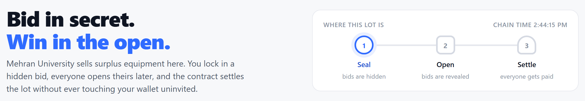
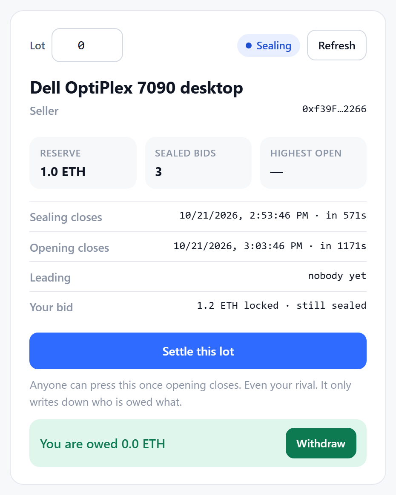
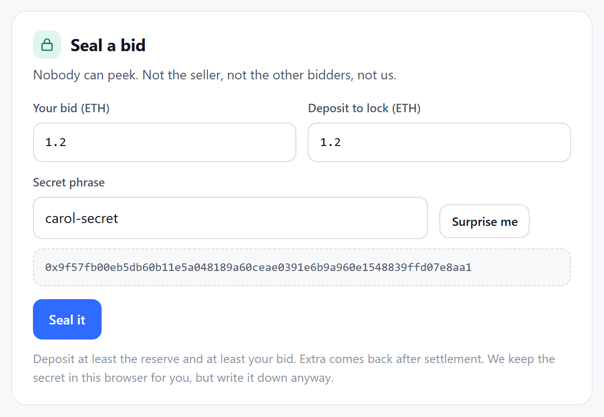
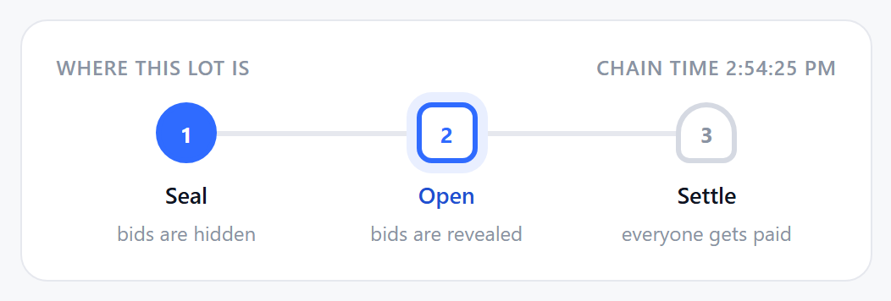
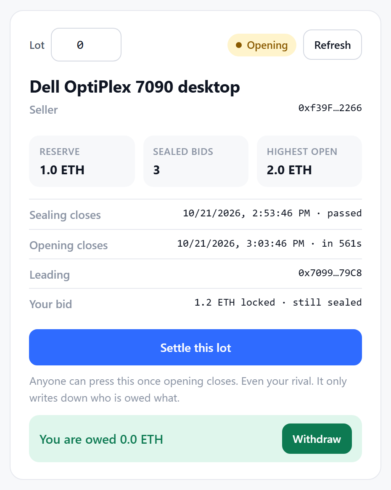
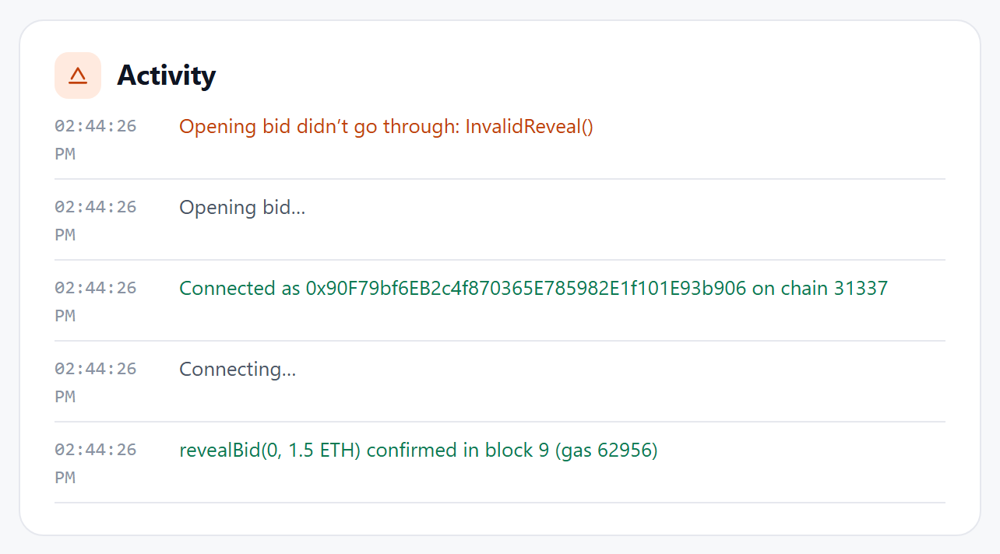
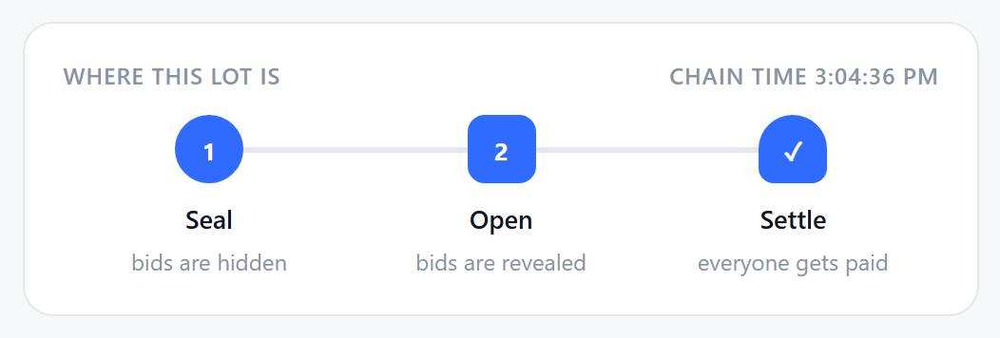
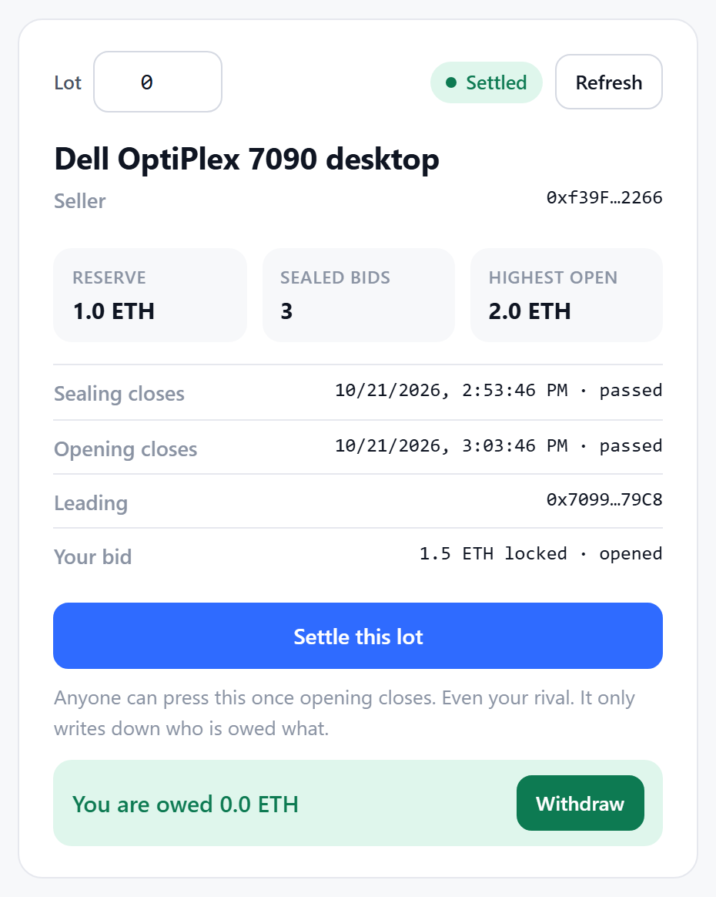

# Sealed-Bid Auction House

### Problem 3 · Team PhantomX

**Bid in secret. Win in the open.** An on-chain auction where nobody can see your bid until the reveal phase, and nobody can be cheated out of a refund.

| | |
|---|---|
| **The problem** | Mehran University sells surplus equipment on-chain. In an open auction, bidders watch each other and outbid at the last second. |
| **The solution** | Commit-reveal. Bidders lock a *hash* of their bid plus a deposit, then reveal the real amount after bidding closes. Settlement uses pull payments, so no bidder can block anyone else. |
| **Stack** | Solidity 0.8.20 · Foundry · plain-HTML demo UI with MetaMask |
| **Proof** | 80 tests, 0 failures · 100% line and branch coverage · 0 compiler warnings · browser end-to-end verified |
| **Where to look** | [`task-1/contracts/Auction.sol`](task-1/contracts/Auction.sol) · [`task-1/tests/Auction.t.sol`](task-1/tests/Auction.t.sol) · [`task-1/NOTES.md`](task-1/NOTES.md) · [`ui/index.html`](ui/index.html) |



---

## Try it in two minutes

```bash
cd submission/PhantomX/problem-3
forge build        # Compiler run successful!  (0 warnings)
forge test         # 80 tests passed, 0 failed
forge test --match-test test_Demo_FullFlow -vv   # narrated end-to-end run
```

The last command prints the whole story: create → commit → reveal → rank → forfeit → finalize → withdraw, with balances at every step, ending in `contract balance = 0 wei`.

Need Foundry? `curl -L https://foundry.paradigm.xyz | bash` then `foundryup`. On Windows PowerShell, add it to the current terminal with:
```powershell
$env:Path += ";$env:USERPROFILE\.foundry\bin"
```

---

## How it works

Three phases, decided purely by `block.timestamp`. No gaps, no overlaps.

```
 createAuction            biddingEnd              revealEnd
      |                       |                       |
      |  1. SEAL              |  2. OPEN              |  3. SETTLE
      |  commitBid()          |  revealBid()          |  finalize()  then  withdraw()
      |  hash + deposit       |  prove amount+secret  |  credit everyone, pull funds
      |  now <  biddingEnd    |  biddingEnd <= now    |  now >= revealEnd
      |                       |       < revealEnd     |
```

| Step | Who | What happens |
|---|---|---|
| **List** | Seller | Description, reserve price, two deadlines. Each lot gets the next id, so many auctions run at once. |
| **Seal** | Bidder | Sends `keccak256(abi.encode(amount, secret, msg.sender))` plus a deposit of at least the reserve. Only the hash is stored or logged. One bid per address per lot. |
| **Open** | Bidder | Sends the real `amount` and `secret`. The contract recomputes the hash and checks the deposit covers the amount. Highest valid amount leads; on a tie, the first to open keeps the lead. |
| **Settle** | Anyone | After `revealEnd`, once only. Seller is credited the winning bid plus every unopened deposit. Winner is credited deposit minus bid. Losers are credited their full deposit. **No ETH moves here.** |
| **Withdraw** | Each party | Pulls their own credit. Balance is zeroed before the transfer, so re-entrancy gets nothing. |

**One invariant ties it together:** every wei deposited is credited to exactly one party. Tests prove the sum of credits equals the sum of deposits, and that the contract drains to exactly zero after withdrawals.

---

## Milestone checklist for evaluators

| Milestone | Requirement | Where | Proof |
|---|---|---|---|
| 1 Creation | Description, reserve, two deadlines, `mapping(uint256 => …)`, phase validation | `createAuction`, `auctions`, `getPhase` | 15 tests, incl. exact deadline boundaries |
| 2 Commitments | Payable `commitBid`, deposit ≥ reserve, exact hash formula, bidding window only | `commitBid`, `computeCommitment` | 12 tests, incl. one second before and exactly at `biddingEnd` |
| 3 Reveal and ranking | Hash and deposit checks, strict `>` ranking, earliest-reveal ties, forfeiture of non-revealers | `revealBid`, loop in `finalize` | 21 tests, incl. three-way tie and copied-commitment attack |
| 4 Finalization | After `revealEnd` only, once only, seller/winner/loser credits, pull payments, no ETH in loops | `finalize`, `withdraw` | 27 tests, incl. re-entrancy and 200-bidder gas check |
| 5 Events, errors, tests | Event per state change, custom errors only, `block.timestamp` phases, the 7 named tests | 6 events, 19 custom errors | All 7 named tests pass, see below |

### The seven required tests

| Requirement | Test name |
|---|---|
| Valid reveal | `test_ValidReveal` |
| Wrong secret fails | `test_RevertWhen_WrongSecret` |
| Reveal outside window fails | `test_RevertWhen_RevealOutsideWindow` |
| Losing bidder withdraws refund | `test_LosingBidderCanWithdrawRefund` |
| No-reveal forfeiture to seller | `test_NoRevealForfeitsDepositToSeller` |
| Double finalization reverts | `test_RevertWhen_FinalizedTwice` |
| Two concurrent auctions | `test_TwoConcurrentAuctionsDoNotInterfere` |

Run just these seven:
```
forge test --match-test "test_ValidReveal|test_RevertWhen_|test_LosingBidder|test_NoReveal|test_TwoConcurrent"
```

### Beyond the requirements

- **Adversarial tests:** re-entrant `withdraw()` from a `receive()` hook, cross-function re-entry through `finalize`, plain ETH sent to the contract, a copied commitment hash, the seller bidding in their own lot, wrong reveals repeated until the deadline, 20 bidders, and 200 bidders at the cap.
- **Fuzz test:** random amounts, over-deposits, secrets, which bidders reveal, and reveal order. Checks credits equal deposits, `highestBid` is the max valid reveal, the winner is its earliest revealer, and the contract drains to zero. 256 runs.
- **Coverage:** `forge coverage --report summary` shows 100% lines, statements, branches and functions on `Auction.sol`.
- **Audit pass:** re-entrancy, accounting, tie-break, boundaries, loop gas, events, NatSpec and fund-loss paths were reviewed. Findings, severities and fixes are tabled in [`task-1/NOTES.md`](task-1/NOTES.md).

---

## Security properties, in plain words

- **Your address is inside your hash.** Copying someone else's commitment is accepted at commit time, but the copier can never open it and simply forfeits their own deposit.
- **Every bid is backed by ETH.** The deposit must be at least the reserve when sealing and must cover the amount when opening.
- **Ties are deterministic.** Strict `>` means an equal amount never replaces the leader; the first to open wins.
- **Finalize cannot run twice.** `finalized = true` is the very first write, before any balance changes.
- **The contract never pushes ETH.** The single transfer in the whole contract is in `withdraw`, after the balance is zeroed and the event is emitted.
- **No `receive()` or `fallback()`.** ETH can only enter through `commitBid`.
- **Nothing is deleted after settlement.** Anyone can audit who bid, who opened and who forfeited.

---

## Demo UI

One file, [`ui/index.html`](ui/index.html). Plain HTML and vanilla JavaScript, no build step, ethers.js vendored so it works offline. It talks to the contract through MetaMask on a local anvil chain and decodes every custom error by name.

### Screenshots

**Sealing.** Three bids locked. The lot card shows the count, but the highest bid stays hidden. The seal card shows the commitment hash computed in the browser before anything is sent.

<p align="center">
  
  
</p>

**Opening.** Alice opened 2.0 ETH and leads. Bob's lower open did not displace her. Carol tried the wrong secret and the feed shows `InvalidReveal()`, the contract's own error name.

<p align="center">
  
</p>
<p align="center">
  
  
</p>

**Settled.** Anyone pressed *Settle this lot*. Carol's unopened 1.2 ETH went to the seller, Alice won at 2.0 ETH, everyone withdrew, and the contract holds exactly zero.

<p align="center">
  
</p>
<p align="center">
  
</p>

Full pages: [sealing](docs/screenshots/01-sealed.png) · [opening](docs/screenshots/02-opened.png) · [settled](docs/screenshots/03-settled.png). All screenshots were captured by the automated browser test described under Verification.

### Run the UI

**1. Start a local chain** (terminal A, leave it running):
```
anvil
```

**2. Deploy** (terminal B, inside `problem-3/`):
```
forge create task-1/contracts/Auction.sol:Auction --rpc-url http://127.0.0.1:8545 --broadcast --private-key 0xac0974bec39a17e36ba4a6b4d238ff944bacb478cbed5efcae784d7bf4f2ff80
```
On a fresh anvil the address is always `0x5FbDB2315678afecb367f032d93F642f64180aa3`.

**3. MetaMask network:** *Add a custom network* with name `Anvil`, RPC `http://127.0.0.1:8545` (use `127.0.0.1`, not `localhost`), chain id `31337`, symbol `ETH`.

**4. MetaMask accounts:** *Import account* with anvil's public test keys. They hold no real value.

| Role | Private key |
|---|---|
| Seller | `0xac0974bec39a17e36ba4a6b4d238ff944bacb478cbed5efcae784d7bf4f2ff80` |
| Alice | `0x59c6995e998f97a5a0044966f0945389dc9e86dae88c7a8412f4603b6b78690d` |
| Bob | `0x5de4111afa1a4b94908f83103eb1f1706367c2e68ca870fc3fb9a804cdab365a` |
| Carol | `0x7c852118294e51e653712a81e05800f419141751be58f605c371e15141b007a6` |

**5. Open `ui/index.html`**, select Seller, click **Connect wallet**, paste the address, click **Load**.

### Demo script

After every MetaMask account switch the page reloads: click **Connect wallet**, then **Load**.

1. **Seller lists** the item with reserve `1` ETH and **60-minute** windows. Move between phases with the **Time machine** set to `3600` seconds rather than waiting.
2. **Seal** as Alice (`2` bid, `2.5` deposit, secret `alice-secret`), Bob (`1.5`, `1.5`, `bob-secret`), Carol (`1.2`, `1.2`, `carol-secret`). Seal twice to see `AlreadyCommitted()`.
3. **Jump ahead.** Phase becomes Opening.
4. **Open** as Alice and Bob with *Use saved secret*. Let Carol try `wrong-secret` for `InvalidReveal()`, then leave her unopened.
5. **Jump ahead.** Anyone clicks **Settle this lot**. The feed logs the forfeit and the winner.
6. **Withdraw:** Seller 3.2 ETH, Alice 0.5 ETH, Bob 1.5 ETH, Carol nothing. Contract balance: 0.

Only two wallets? The seller may bid in their own lot, so Seller can play the losing bidder while Alice wins.

| If you see | Do this |
|---|---|
| `forge` not recognised | Run the PowerShell PATH line above in that terminal |
| `BiddingClosed()` when sealing | The window elapsed in real time; list a new lot with 60-minute windows |
| MetaMask nonce error | Settings → Advanced → *Clear activity tab data* for that account |
| "No contract at that address" | Anvil was restarted; redeploy and paste the new address |

---

## Contract API

| Function | Phase | Purpose |
|---|---|---|
| `createAuction(description, reservePrice, biddingEnd, revealEnd) → id` | any | List an item. Rejects zero reserve, past bidding deadline, reveal not after bidding. |
| `commitBid(id, commitment)` payable | `now < biddingEnd` | Lock a sealed bid with a deposit ≥ reserve. One per address per lot. |
| `revealBid(id, amount, secret)` | `biddingEnd ≤ now < revealEnd` | Open a bid. Hash must match, deposit must cover amount, amount must meet reserve. |
| `finalize(id)` | `now ≥ revealEnd` | Settle once. Credits balances only. |
| `withdraw()` | any | Pull everything credited to the caller. |
| `getPhase(id)`, `getBidderCount(id)`, `computeCommitment(amount, secret, bidder)` | view / pure | Helpers. |
| `auctions`, `bids`, `pendingWithdrawals`, `nextAuctionId`, `MAX_BIDDERS` | view | Public storage. |

**Events:** `AuctionCreated`, `BidCommitted` (hash only), `BidRevealed`, `DepositForfeited`, `AuctionFinalized`, `Withdrawal`.
**Errors:** 19 custom errors and no `require` strings, for example `BiddingClosed`, `DepositTooLow(sent, required)`, `AlreadyCommitted`, `NotRevealPhase`, `InvalidReveal`, `DepositDoesNotCoverBid`, `BidBelowReserve`, `AuctionStillRunning`, `AlreadyFinalized`, `NothingToWithdraw`, `WithdrawFailed`, `TooManyBidders`.

---

## Assumptions and known limitations

| Item | Decision | Why |
|---|---|---|
| Reserve of zero | Rejected | "No bid" and "bid of zero" would be indistinguishable. |
| Revealed amount below reserve | Rejected, retry allowed until `revealEnd` | Such a bid can never win. |
| `MAX_BIDDERS = 200` | Added after the audit | `finalize` loops over bidders; without a cap it could exceed the block gas limit and lock deposits. 200 bidders settle in about 3.9M gas. |
| Struct named `AuctionData` | Not `Auction` | Solidity forbids a struct sharing the contract's name. Fields match the task exactly. |
| No minimum reveal window | Not enforced, recorded as accepted finding A-7 | The task fixes `createAuction`'s rules exactly. Deadlines are public before anyone commits. Hardening is one line: require `revealEnd - biddingEnd >= 1 hours`. |
| Seller bidding in own lot | Allowed | If they win, bid plus excess returns to them; losers are refunded normally. Tested. |

Deeper reasoning, the audit log and stretch goals: [`task-1/NOTES.md`](task-1/NOTES.md).

---

## Verification

- `forge build`: zero compiler and lint warnings. `forge test`: 80 of 80. `forge coverage`: 100% on `Auction.sol`.
- A fresh clone of the branch builds and passes with no network access, so `lib/` and every file are committed.
- The UI was driven end to end in headless Chrome against a deployed contract: 53 automated checks covering connect, list, three seals, decoded errors, phase jumps, opens, wrong secret, settlement by a non-seller, forfeiture, withdrawals, zero final balance, and two concurrent lots staying independent. The screenshots above are that run's output.

---

## Team and tasks

**Team PhantomX.** Problem 3 was designed, implemented, tested, audited and documented by **Ahmed Mustafa** ([ahmedmustafa28](https://github.com/ahmedmustafa28)): all five milestones, the audit pass, the demo UI, this README and NOTES, and the live demo.

## References and attribution

- Solidity documentation: commit-reveal pattern, custom errors, Checks-Effects-Interactions.
- Foundry Book: `forge test`, cheatcodes, fuzzing, coverage.
- forge-std (foundry-rs, MIT / Apache-2.0), vendored in `lib/` with its license files.
- ethers.js v6 (MIT), vendored in `ui/vendor/` for the demo page.
- Course notes on smart-contract security patterns.
- No code was copied from other teams. Every function and test is explained in `task-1/NOTES.md` and can be walked through line by line.

## Demo plan

Walk the milestones in order on the UI, then show the narrated contract-level run:
```
forge test --match-test test_Demo_FullFlow -vv
```
