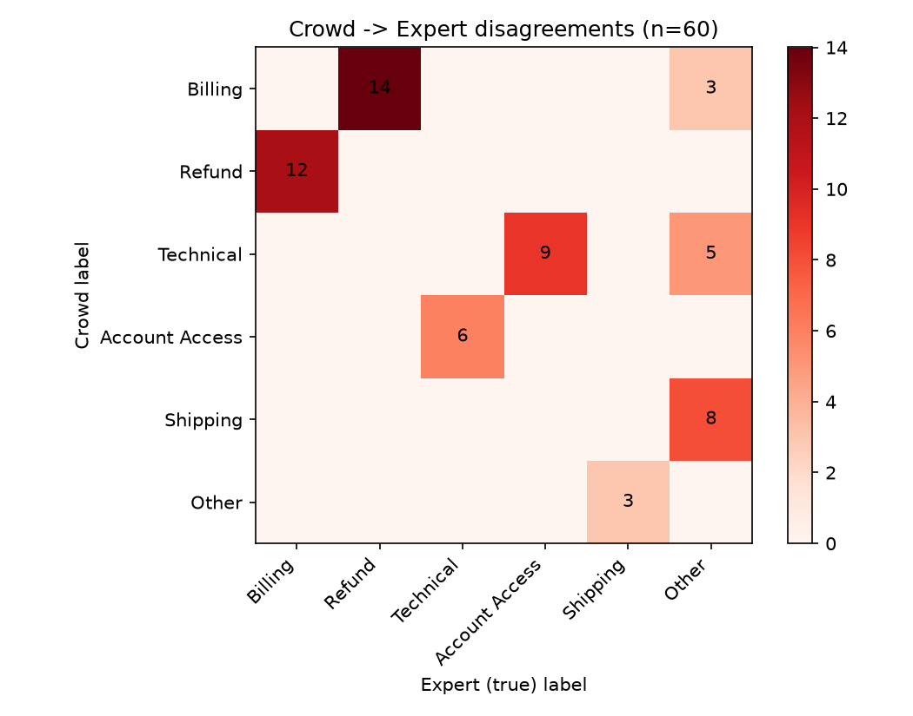

# Noisy Labels: HelpDeskNet-50K

**Team LappuCodes** | AWS Cloud Club MUET Hackathon | Issue #9
**Members:** [add names here]

## Overview

The brief describes a 50,000-ticket support dataset where a text classifier gets stuck at 82% accuracy no matter how long it trains or how big the model is. Our argument in this report is that the model is probably not the problem. The labels are. We measure how noisy they are, show that the mistakes follow a pattern, work out what the 82% really means, plan a limited expert review, and propose a way to train and test that doesn't depend on bad labels.

One thing to know before reading. The organisers gave us tables but no data file. Milestones 1 to 3 use only the numbers printed in the brief. For Milestones 4 and 5 we generated a fake HelpDeskNet-50K that follows the brief (same class shares, same 5,000 expert / 20,000 Tier A / 25,000 Tier B split, and label mistakes drawn from the audit table). Because we know the true label of every simulated ticket, we can check whether our methods actually work. The numbers from those two milestones show how the methods behave. They are not claims about the real dataset.

All code is in this repository. To reproduce everything: `pip install -r requirements.txt`, then run `step0_generate_data.py` followed by `m1_quantify_noise.py` through `m5_robust_training.py`. Printed results are saved in `outputs/`.

---

## Milestone 1: How noisy are the crowd labels?

**Overall rate.** The experts disagreed with the crowd on 60 of 400 audited tickets, so the estimate is 60/400 = 15.0%. A 95% Wilson interval for this is 11.8% to 18.8%.

The audit did not sample the two tiers in proportion to their size, so we also computed a weighted estimate. Tier A is 20,000 of the 45,000 crowd tickets (44.4%) and Tier B is 25,000 (55.6%):

0.444 × 6.67% + 0.556 × 21.82% = 15.1%

The standard error is sqrt(0.444² × 0.0667 × 0.933 / 180 + 0.556² × 0.218 × 0.782 / 220) = 1.75 points, which gives a 95% interval of **11.6% to 18.5%**. That is roughly 6,800 wrong labels out of 45,000 (between about 5,200 and 8,300). The 5,000 expert tickets are assumed clean, so across all 50,000 tickets the noise is about 13.6%.

**Tier A against Tier B.**

| | Audited | Disagreements | Rate |
|---|---|---|---|
| Tier A | 180 | 12 | 6.7% |
| Tier B | 220 | 48 | 21.8% |

The gap is 15.2 percentage points, so Tier B is wrong 3.3 times as often. For a two-proportion z-test we pool the rate (0.15), which gives a standard error of sqrt(0.15 × 0.85 × (1/180 + 1/220)) = 0.0359 and z = 0.1515 / 0.0359 = 4.22, p = 0.000024. The 95% interval for the gap is 8.6 to 21.7 points. A chi-square test (17.8) and Fisher's exact test (p = 0.000018) agree. A gap this large is not plausibly due to chance, so Tier B really is worse.

Two caveats. We treat the expert as the truth, and experts make mistakes too. And 400 tickets is a small sample, which is why the intervals are wide.

---

## Milestone 2: Is the noise random or systematic?

It is systematic. If annotators were just careless, errors would be spread over many class pairs. Instead all 60 disagreements fall into 8 of the 30 possible (crowd label, expert label) cells, and 22 cells are empty.

| Pattern | Count | Share |
|---|---|---|
| Billing and Refund mixed up (both directions: 14 and 12) | 26 | 43% |
| Technical and Account Access mixed up (9 and 6) | 15 | 25% |
| Tickets the experts call Other (8 from Shipping, 5 from Technical, 3 from Billing) plus Other to Shipping (3) | 19 | 32% |

We also tested this directly. We measured how concentrated the errors are (sum of squared cell counts) and compared it with 20,000 random simulations where the same 60 errors are spread uniformly over the 30 cells. Our observed value was 564, against an average of 178 for random errors, with p < 0.0001.

Two things stand out. The Billing and Refund mix-up goes both ways almost equally, which suggests the two class definitions overlap rather than that one class is hard. The "Other" errors go mostly one way: the experts labelled 16 tickets as Other that the crowd put in Shipping, Technical or Billing, while only 3 went the other direction. Since Other is about 5% of the data, a random sample of 400 should contain only around 20 of them, so 16 flagged ones suggests the crowd rarely uses Other correctly. With counts this small we treat this as a strong lead to investigate, not an exact rate.

**Most likely root cause.** The class definitions overlap and the guidelines give no rule for tickets that sit between two classes (a refund request about an unexpected charge, a login failure caused by an app error, a ticket that doesn't fit any class). Workers are forced to pick one and different workers pick differently. Tier B's much higher error rate suggests less experience or training makes this worse, but the clustering shows the guidelines are the main problem.

**What we would check or change**
- Add decision rules with examples for each confusing pair, plus a tie-breaker such as "label by the customer's main request".
- Measure agreement between workers (Cohen's or Fleiss' kappa) separately for each confusing pair.
- Score each worker against gold tickets, and look at individual Tier B workers, since a few may be causing most of the errors.
- Add a qualification test before new workers label real tickets.
- Have two or three workers label the tickets that are hard to classify and keep the majority label.
- Rethink "Other": allow "unsure", or merge Billing and Refund into one class with a sub-type.

---

## Milestone 3: What does 82% really mean?

Assume 15% of labels are flipped uniformly to one of the other five classes, and the model has true accuracy *a*. A ticket where the model is right is scored correct only if its label was not flipped, which happens with probability 0.85. A ticket where the model is wrong is scored correct only if the label was flipped to exactly the model's wrong guess, which happens with probability 0.15 / 5 = 0.03. So:

0.82 = 0.85a + 0.03(1 − a) = 0.03 + 0.82a

a = 0.79 / 0.82 ≈ **96.3%**

**Why we don't trust this number.**

1. The noise is not uniform. Our Milestone 2 result shows it follows specific class pairs. A model trained on these labels learns those same habits, and when it repeats the crowd's mistake the noisy test counts it as correct. That inflates measured accuracy and makes the uniform formula too optimistic.
2. The answer depends heavily on the noise rate, which we only know to within 11.6% to 18.5%:

| Noise rate | Estimated true accuracy |
|---|---|
| 10.0% | 90.9% |
| 11.6% | 92.6% |
| 13.0% | 94.1% |
| 15.0% | 96.3% |
| 17.0% | 98.7% |
| 18.5% | 100.6% |

At the top of the interval the formula gives more than 100%, which is impossible, so the assumption breaks down.

3. The test set may not have the same noise rate as the 400 audited tickets, because it can have a different mix of Tier A and Tier B.
4. Noise depends on the ticket and the class. Refund and Other are mislabeled far more often than Shipping.
5. With 15% noise, no model can score above about 85% on this test set. An 82% score is already close to that ceiling, so the plateau is partly caused by the measuring stick, not just by the model.

In our simulation we could check this. The baseline scored 81.7% on the noisy test set, close to the 82% in the brief. Using the uniform formula gives roughly 95 to 96%, but its accuracy against the true labels was 93.3%. So the formula was about 3 points too high, in the direction we expected.

---

## Milestone 4: Choosing the 2,000 tickets for expert review

**Method.**

1. Train a simple text classifier (TF-IDF with logistic regression) using 5-fold cross-validation. Every ticket then gets a prediction from a model that never saw it, so the model cannot just memorise its own label.
2. Score each ticket by how little the model believes the crowd's label (1 minus the probability given to the crowd label). A margin score is a close alternative.
3. Add prior knowledge: Tier B tickets and the confusing class pairs from Milestone 2 get extra weight.
4. Send about 1,700 top-ranked tickets to the experts, spread across classes so small classes are not ignored, and keep about 300 as a random sample. The random sample gives an unbiased noise estimate and a check on the ranking.
5. If possible, do it in rounds of around 500 and retrain between rounds.

**Does it work?** We compare each ranking against what we would get by picking tickets at random, and measure precision (how many chosen tickets really are wrong), recall and AUROC. In real use, the 400 audited tickets act as the test, since they have expert labels. In our simulation we also know every true label.

| Strategy | Wrong labels found in top 2,000 | Precision | Times better than random |
|---|---|---|---|
| Random | 318 | 15.9% | 1.0x |
| Self-confidence | 1,891 | 94.5% | 6.1x |
| Margin | 1,880 | 94.0% | 6.1x |
| Confidence + Tier B prior | 1,914 | 95.7% | 6.2x |

On the 400-ticket audit set the self-confidence score reached an AUROC of 0.982. Of the 2,000 most suspicious tickets, 1,577 came from Tier B and 423 from Tier A. By crowd label they were mostly Refund (674), Account Access (561) and Technical (333), with Shipping almost absent (15). That matches the Milestone 2 pattern.

These precision numbers are higher than we would expect on real data. In our simulation the noise follows the same text clues the model learns, which makes it easy to catch. We would expect a lower hit rate in practice, but the ranking should still beat random by a wide margin.

**Using the corrected labels.**

- Replace the wrong labels and retrain.
- Use the reviewed tickets, especially the random sample, to estimate the noise matrix (Milestone 5).
- Keep part of them as a small trusted set for validation and model selection.
- Do not treat them as typical tickets. They were picked because they looked suspicious, so the share of wrong labels among them is much higher than in the full data.

One result surprised us. After fixing the 2,000 labels and retraining, accuracy against the true labels went from 93.3% to 92.8%, essentially unchanged. About 7,000 labels are wrong and 2,000 is a small part of that, so the direct effect on training is small. The review budget is more valuable as trusted data for estimating noise and for building an evaluation set than as training data.

---

## Milestone 5: Training with noise and testing fairly

**Two training methods.**

1. **Filtering with confident learning.** Use the cross-validated predictions to find tickets where the model is confident in a different class than the crowd gave. Remove them and retrain on the rest. We removed 6,172 tickets (13.7% of the data), and 87.4% of them were really mislabeled.
2. **Forward loss correction.** Estimate a noise matrix T, where T[i, j] is the chance that a ticket with true class i gets crowd label j. During training, the model's predicted class probabilities are multiplied by T before comparing with the noisy label, so the model learns to predict the true class while the loss accounts for the noise. At test time we use the model's plain predictions. We estimated T from the cross-validated predictions.

The estimated matrix recovers the Milestone 2 pattern. About 30% of true Refund tickets are labelled Billing, about 13% of true Billing tickets are labelled Refund, 20% of true Account Access are labelled Technical, and only 47% of true Other tickets keep the label Other (31% become Shipping). Other approaches that could be used instead are generalized cross-entropy, co-teaching, and label smoothing.

**Results.** We evaluated each model on the noisy crowd test set and on a small expert-labelled test set of 1,500 tickets (250 per class).

| Model | Crowd test accuracy | Expert test accuracy |
|---|---|---|
| Baseline (raw crowd labels) | 81.7% | 89.9% ± 1.5 |
| Filter and retrain | 82.7% | 94.0% ± 1.2 |
| Forward loss correction | 83.5% | 96.2% ± 1.0 |

On the crowd test set, the best method looks only 1.8 points better than the baseline. On the expert test set the gap is 6.3 points. The noisy test set hides most of the improvement.

**Building a trustworthy test set.**

- Sample tickets randomly from the real incoming stream, keep them out of training, and keep them out of the review selection from Milestone 4.
- Have two or three experts label each one independently and settle disagreements. Report how often the experts agree with each other, since that is the real ceiling.
- Use about 1,500 tickets with an equal number per class, so small classes like Shipping and Other are measured properly. If an overall figure is needed, reweight by the real class shares.
- Report per-class recall and macro-F1 with confidence intervals, not just one accuracy number. At 90% accuracy and 1,500 tickets, the interval is about ±1.5 points.

**Why the current test set is a problem.** It was labelled by the same crowd process, so it carries the same 15% noise and the same systematic mix-ups as the training data. A model trained on those labels is rewarded for repeating the crowd's mistakes, so its errors and the test set's errors overlap. It also cannot show an improvement larger than its own noise allows, so it can't tell good models from better ones, and it favours models that imitate the crowd. This is likely a big part of why the model appears stuck at 82%.

---

## Limitations

- Milestones 4 and 5 use simulated data, so the exact numbers will differ on the real dataset.
- The expert labels are treated as ground truth, although experts can be wrong.
- The audit has only 400 tickets, so the Milestone 1 intervals are wide and the "Other" pattern in Milestone 2 rests on small counts.
- The noise matrix is estimated, not known, and an error there carries into forward loss correction.
- We used a simple TF-IDF and logistic regression model. A fine-tuned transformer would probably score higher, but the noise issues would be the same.

## Recommendations

1. Fix the labeling guidelines first, especially Billing vs Refund, Technical vs Account Access, and what counts as Other.
2. Train and screen Tier B workers, add a qualification test, and review per-worker error rates.
3. Spend the 2,000-ticket expert budget on the highest-suspicion tickets plus a random sample.
4. Build an expert-labelled test set and report results on it instead of the crowd test set.
5. Retrain with filtering or loss correction, then compare against the baseline on the expert test set.

## Files in this repository

| File | Purpose |
|---|---|
| `step0_generate_data.py` | Builds the simulated dataset |
| `m1_quantify_noise.py` | Milestone 1 calculations |
| `m2_noise_pattern.py` | Milestone 2 table and heat-map |
| `m3_accuracy_ceiling.py` | Milestone 3 calculation and sensitivity table |
| `m4_find_bad_labels.py` | Milestone 4 ranking and evaluation |
| `m5_robust_training.py` | Milestone 5 training methods and evaluation |
| `outputs/` | Saved results and the heat-map |
