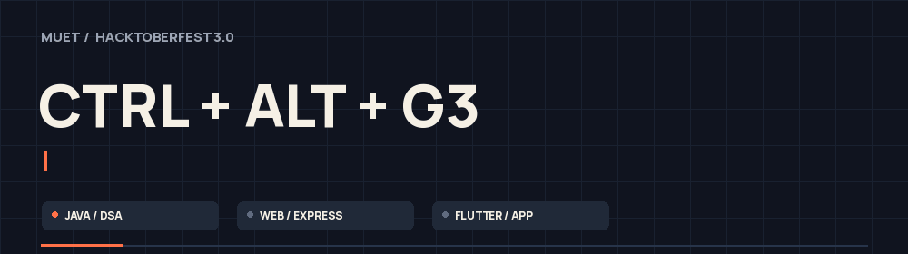
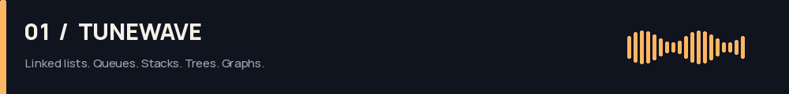
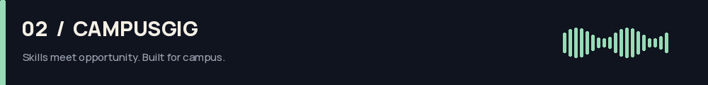
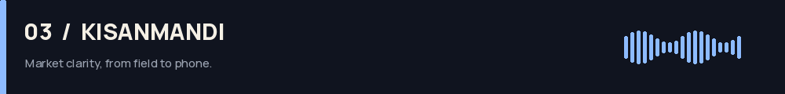
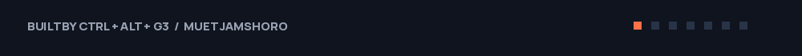

# CTRL + ALT + G3

**HacktoberFest 3.0 · MUET, Jamshoro · Three independent projects**

  

[Projects](#-the-builds) · [Run locally](#-launch-pad) · [Verification](#-checked-before-push) · [The team](#-the-three-behind-g3)

---

## ⚡ The builds

### TuneWave · Java / DSA

A music-player core with a Swing desktop interface. A doubly linked playlist and hash map handle navigation; an Up Next queue, bounded history stack, title BST and artist graph drive the rest.

 

**[Source & setup →](tunewave/README.md)** · [Challenge #13](https://github.com/AWSCloudClubMuet/HacktoberFest-3.0/issues/13)

<strong>Inside the player</strong>

- Add and remove songs; move forward/backward with repeat boundaries.
- Play queued songs before continuing through the playlist.
- Keep the latest 10 history entries and replay the popped top entry.
- Find exact titles or prefixes through an explicit BST.
- Recommend artists exactly two graph links away.
- Run the console demonstration with `--demo`; attach a supported local audio file for sound in the desktop player.

 

### CampusGig & SkillSwap · Web

A campus gig board where students offer skills, find help and manage applications. The uploaded frontend and Express backend are together here, with a persistent JSON database and demo user switching.

 

**[Source & setup →](campusgig/README.md)** · [Challenge #12](https://github.com/AWSCloudClubMuet/HacktoberFest-3.0/issues/12)

<strong>From posting to a completed gig</strong>

- Browse and filter Offering/Requesting gigs across four categories.
- Choose Paid, Free or SkillSwap, with budget and deadline validation.
- Apply, accept/reject applicants, complete work and review eligible participants.
- Enforce ownership rules and prevent self/duplicate applications.
- Calculate ratings from stored reviews; persist activity to JSON.

 

### KisanMandi · Flutter App

A crop-price companion and produce marketplace for Sindh. Indigo, saffron and ivory meet bundled Fraunces/Manrope typography, an Ajrak-inspired identity and a seeded HTTP mock API.

 

**[Source & setup →](kisanmandi/README.md)** · [Challenge #11](https://github.com/AWSCloudClubMuet/HacktoberFest-3.0/issues/11) · [Screenshots](kisanmandi/docs/screenshots/)

<strong>From market prices to the next sale</strong>

- Farmer/buyer profiles and role-based navigation.
- Crop prices, daily changes and a market pulse from the mock API.
- Fourteen-day charts and selling-market comparisons.
- Editable price alerts, produce listings and owner controls.
- Profit estimates with a ±20% price scenario slider.
- Fictional demo prices in PKR per 40 kg maund.

---

## 🚀 Launch pad

Run each project from its own folder. Full prerequisites and platform notes are in the linked READMEs.

| Project | Start here | Launch |
|---|---|---|
| **TuneWave** | `tunewave/` | Windows: `.\run.bat` · Linux/macOS: `./run.sh` |
| **CampusGig API** | `campusgig/backend/` | `npm ci`, then `npm start` |
| **CampusGig frontend** | `campusgig/` | `py -3 -m http.server 5173 --directory frontend`, then open `http://localhost:5173` |
| **KisanMandi API** | `kisanmandi/` | `python mock_api/server.py --host 0.0.0.0 --port 8080` |
| **KisanMandi app** | `kisanmandi/` | `flutter pub get`, then `flutter run` |

CampusGig's frontend command uses the Windows Python launcher; use `python3` on Linux/macOS. Keep each API terminal running while using its frontend/app.

## ✅ Checked before push

| Project | Recorded verification |
|---|---|
| **TuneWave** | All 13 uploaded Java sources compile for Java 17; console demo and shell launcher complete |
| **CampusGig** | **25 API flow checks pass**; frontend/backend JS syntax and frontend HTTP serving pass |
| **KisanMandi** | **13 Flutter tests + 8 HTTP API tests pass**; clean analysis and release web compilation |

Validation is documented in each project README. TuneWave's desktop window/audio, a full CampusGig browser walkthrough and KisanMandi native installers/device contact actions were not exercised in these checks.

## 👥 The three behind G3

| | Team member | Student ID | Role |
|---|---|---|---|
| **01** | Muhammad Kahaf | `25SW043` | Team Lead |
| **02** | Muhammad Haseeb | `25SW079` | Member |
| **03** | Muhammad Waris | `25SW141` | Member |

**Competitive Programming / DSA · Web Development · App Development**

Independent projects. Extracted source. Setup instructions included.

