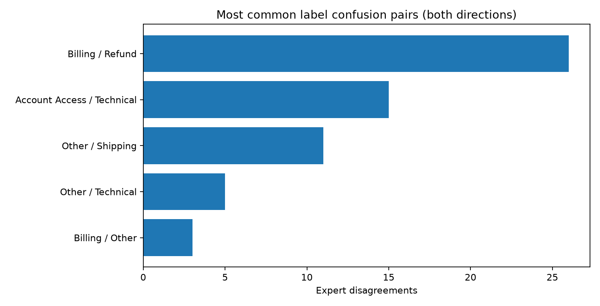

HelpDeskNet-50K — Noisy Label Analysis

 Milestone 1: Quantifying Label Noise

 Objective

The objective of this milestone is to estimate the amount of annotation noise in the HelpDeskNet-50K scenario and determine whether Tier A and Tier B annotators have significantly different disagreement rates.

 Methodology

The provided audit consists of 400 crowd-labeled support tickets independently reviewed by expert annotators. Out of these, 60 labels disagreed with expert judgments, resulting in an observed disagreement rate of 15%.

A 95% Wilson confidence interval was calculated to quantify uncertainty around the pooled disagreement estimate. It ranged from approximately 11.83% to 18.83%.

Because the full crowd-labeled population contains 20,000 Tier A tickets and 25,000 Tier B tickets, a population-weighted estimate was also calculated. The resulting estimated disagreement rate was 15.08%, with an approximate stratified 95% confidence interval of 11.65%–18.51%.

 Tier Comparison

Tier A had 12 disagreements among 180 audited tickets, resulting in a disagreement rate of 6.67%.

Tier B had 48 disagreements among 220 audited tickets, resulting in a disagreement rate of 21.82%.

A two-sided two-proportion z-test was performed to determine whether the difference was statistically significant.

The resulting z-statistic was approximately -4.222, with a p-value of 0.0000242.

 Results and Interpretation

The statistical test provides strong evidence that the underlying disagreement rates differ between the two annotator tiers. Tier B has a substantially higher observed disagreement rate than Tier A.

This suggests that Tier B annotations may benefit from increased quality monitoring, clearer guidelines, and targeted expert review.

However, these results do not establish the specific cause of the difference. Additionally, disagreement is treated as label error only under the assumption that expert judgments accurately represent ground truth.

 Conclusion

The findings indicate meaningful annotation-quality problems in the HelpDeskNet-50K scenario. Approximately 15% of audited crowd labels disagreed with experts, and the disagreement rate was significantly higher for Tier B.

These findings motivate further investigation into systematic label confusion and targeted annotation improvements in the following milestones. 

Milestone 2: Characterizing Label Noise

Objective:

The objective of this milestone is to identify systematic annotation errors in the HelpDeskNet-50K dataset and investigate why certain support-ticket categories are frequently confused.

Methodology:

The provided expert-audit results contain 60 disagreements between crowdworker labels and expert judgments. We analyzed the directed confusion counts and grouped related category pairs to identify recurring patterns.

The analysis was visualized using a horizontal bar chart generated with Python and Matplotlib.

Results:

| Confusion Pair | Disagreements | Percentage |
|---|---:|---:|
| Billing ↔ Refund | 26 | 43.33% |
| Technical ↔ Account Access | 15 | 25.00% |
| Shipping ↔ Other | 11 | 18.33% |
| Technical → Other | 5 | 8.33% |
| Billing → Other | 3 | 5.00% |
| Total | 60 | 100% |

The most frequent confusion occurs between Billing and Refund, accounting for 43.33% of all observed disagreements.

Technical and Account Access account for another 25%, while Shipping and Other account for 18.33%.

Together, these three confusion pairs account for approximately 86.67% of the audit disagreements.

Interpretation:
The concentration of errors within a few category pairs suggests that annotation mistakes are not uniformly distributed across all possible label combinations.

Some support-ticket categories have overlapping meanings. For example, a customer requesting reimbursement for an incorrect charge might be classified as either Billing or Refund, depending on how the labeling guidelines define the categories.

Similarly, a user unable to access an account because of a technical malfunction may be labeled Technical or Account Access.

These observations suggest possible systematic annotation noise. However, individual ticket records and annotation instructions would be required to confirm the underlying causes.

Recommendations:

1.Improve annotation guidelines: Define each ticket category clearly and provide examples of difficult cases.

2.Introduce decision rules: Explain how annotators should handle tickets involving multiple related categories.

3.Provide targeted annotator training:Focus additional training on frequently confused categories, especially Billing and Refund.

4.Use expert adjudication: Refer ambiguous or disputed tickets to experienced reviewers.

5.Monitor annotation quality: Track disagreements across annotator tiers and ticket categories.

6.Introduce double annotation: Use independent annotators for selected high-risk tickets and resolve disagreements through expert review.

Conclusion:

The analysis identified concentrated patterns of labeling disagreement, particularly between Billing and Refund, Technical and Account Access, and Shipping and Other.

These findings support improving the annotation process through clearer category definitions, targeted training, and expert review.

Reducing such disagreements could improve the reliability of training and evaluation labels used in future machine learning experiments.  

Milestone 3: Reasoning About the Accuracy Ceiling

 Objective

The objective of this milestone is to investigate how noisy evaluation labels can affect reported classifier accuracy and estimate the underlying true accuracy under a simplified label-noise assumption.

 Given Information

The HelpDeskNet-50K classifier reports 82% accuracy against crowd-labeled evaluation data.

The observed annotation disagreement rate is approximately 15%, and the dataset contains six ticket categories.

For this milestone, we assume that each true label has an independent 15% probability of being replaced uniformly by one of the other five classes.

 Methodology

Let:

- A_noisy = 0.82 represent observed accuracy.
- A_true represent actual accuracy against correct labels.
- η = 0.15 represent the assumed label-flipping probability.
- K = 6 represent the number of classes.

Under the uniform label-noise model:

A_noisy = (1 − η) × A_true + [η / (K − 1)] × (1 − A_true)

Rearranging:

A_true = [A_noisy − η / (K − 1)] / [1 − η − η / (K − 1)]

Substituting the supplied values:

A_true = (0.82 − 0.15/5) / (1 − 0.15 − 0.15/5)

A_true = 0.79 / 0.82

Estimated true accuracy = 96.34%.

 Implementation

The calculation was implemented in Python through the `corrected_accuracy()` function inside `src/analysis.py`.

The resulting estimate was saved in `outputs/results.json` under the field `noise_model_accuracy_estimate`.

 Interpretation

The calculation indicates that a classifier reporting 82% accuracy against noisy evaluation labels could have an estimated true accuracy of approximately 96.34% under the specified uniform-flipping model.

This illustrates how inaccurate evaluation labels can make a classifier appear less accurate than it actually is.

 Limitations:

The estimate is theoretical and has not been validated using a clean, expert-labeled test set.

The actual annotation process may violate the independence and uniform-noise assumptions.

For example, the audit shows concentrated confusion between Billing and Refund, while annotator tiers exhibit different disagreement rates.

These patterns suggest that the actual noise process may be class-dependent or annotator-dependent.

Therefore, 96.34% must not be presented as an experimentally verified model accuracy.

Conclusion:

Noisy evaluation labels can substantially distort reported classifier performance.

Although the uniform-noise model produces an estimated true accuracy of 96.34%, trustworthy evaluation requires a separate, representative expert-labeled test set.

This motivates the improved evaluation procedure proposed in Milestone 5.