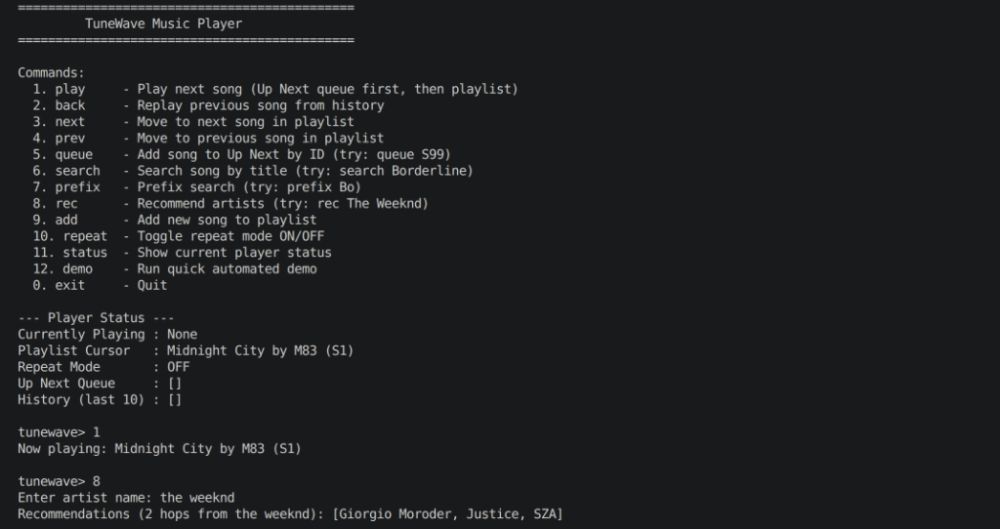

# Team Bhai Issue Hougya — Hackathon Submission

This folder contains our team's completed submissions for the hackathon. Each team member worked in their own dedicated directory so development, tests, and documentation proceeded independently without merge conflicts.

---

## Team Members & Contributions

| Member | Assigned Issue | Key Deliverables | Detailed Docs |
| :--- | :--- | :--- | :--- |
| **Hamza Ali** | **Issue #2:** Automated Security Vulnerability Scanning in a CI/CD Pipeline | End-to-end DevSecOps quality gate (Semgrep, npm audit, Gitleaks, Trivy) + **Bonus:** Azure ACR Cloud Delivery | [Issue #2 README](./issue2_Automated_Security_Vulnerability_Scanning/README.md) |
| **Syed Abdullah Ali** | **Issue #8:** ML Debugging, Attention Gradients & Evaluation | 7-bug training fix (95.4% val acc), analytical attention backward in NumPy (1.6e-8 grad error), fraud evaluation & drift framework | [Issue #8 README](./issue8_Debugging,%20Attention%20Gradients%20&%20Evaluation/README.md) |
| **Team Member** | **Issue #13:** TuneWave Music Player (DSA) | Pure Java audio streaming core: DLL + HashMap, Queue + Stack, BST + 2-hop Graph (49 passing tests) | [Issue #13 README](./issue-13-tunewave-music-player/README.md) |

---

## Issue #2 Summary: Automated Security Vulnerability Scanning

**Owner:** Hamza Ali
**Directory:** [`issue2_Automated_Security_Vulnerability_Scanning/`](./issue2_Automated_Security_Vulnerability_Scanning/)

### What was built
An automated DevSecOps pipeline running in GitHub Actions (`ubuntu-24.04`) that checks code, dependencies, secrets, and container images before deployment. If any Critical or High vulnerability is caught, the pipeline blocks the build.

### Milestones Covered
- **M1: Sample Application & Setup** — Express.js microservice with health checks, task endpoints, and a security-hardened `Dockerfile` (runs as non-root `USER node` on Alpine Linux).
- **M2: Static Analysis (SAST)** — Custom Semgrep rule pack (`semgrep-rules.yml`) targeting code execution (`eval`), path traversal, reflected XSS, and broken hashing.
- **M3: Dependency Scanning (SCA)** — `npm audit` integration checking third-party CVEs (tested with a prototype pollution CVE on `minimist`).
- **M4: Secret Detection** — Gitleaks rules catching exposed cloud keys, tokens, and private secrets.
- **M5: Container Scanning** — CIS Dockerfile benchmark audit and Trivy container layer scanning.
- **M6: CI/CD Security Quality Gate** — Automated gate enforcing a strict zero-tolerance policy on Critical and High risks (verified with both Failed ❌ and Passed ✅ runs).
- **M7: Consolidated Dashboard** — Real-time vulnerability summary matrix written directly into GitHub Actions step summaries.

### ⭐ Optional / Bonus Work (Milestone 8)
- **Microsoft Azure Cloud Delivery:** Integrated with Azure Container Registry (ACR) on our Azure for Students subscription.
- **Zero-Trust Gate Enforcement:** The deployment job only runs if the security gate passed with zero Critical/High findings (`needs: security-gate`, `if: success()`).
- **Registry:** `bhaiissuehougyasecscan.azurecr.io/vuln-scan-app`
- **Immutable Tag:** Images are tagged with the specific commit SHA, not just `latest`.

### Design Decision: Why We Skipped SARIF Uploads
A common question in GitHub security setups is whether to export results as SARIF files via `upload-sarif`. We looked into it and intentionally decided against it: GitHub's `upload-sarif` action requires GitHub Advanced Security (GHAS) or a public repository. On private repositories without an enterprise license, that upload fails.

Instead, we built our reporting around GitHub Actions Step Summaries (`$GITHUB_STEP_SUMMARY`) and archived JSON/Markdown artifacts. It gives everyone an immediate visual breakdown of every finding on the run summary page, works across all repository types (public, private, student accounts), and doesn't rely on paid add-ons.

### Verified Pipeline Proof
The screenshot below shows Run #5 on GitHub Actions (`cb6e5f3`): the security gate verified zero Critical/High vulnerabilities, approved the build, and pushed the container image to Azure Container Registry in 1m 29s.

---

## Issue #8 Summary: ML Debugging, Attention Gradients & Evaluation

**Owner:** Syed Abdullah Ali
**Directory:** [`issue8_Debugging, Attention Gradients & Evaluation/`](./issue8_Debugging,%20Attention%20Gradients%20&%20Evaluation/)

### What was built
A mathematically rigorous machine learning investigation solving four core problems in model training, attention mechanism calculus, production metric design, and learning curve diagnostics:
- **Milestone 1 — Training Debugging:** Diagnosed 7 distinct bugs causing a model to train on decoupled labels while validation stalled at 55%. The corrected implementation (`m1_train_fixed.py`) reaches **95.4%** validation accuracy with early stopping.
- **Milestone 2 — Attention Gradients in NumPy:** Derived and implemented analytical backward passes for scaled dot-product attention without auto-diff. Verified with central difference gradient checks in float64 (`gradcheck.py`) showing relative error of `1.6e-8` (passing the `1e-7` threshold). Implemented online softmax tiled attention matching FlashAttention to `1e-15` precision.
- **Milestone 3 — Production Fraud Evaluation:** Designed an evaluation framework for severe class imbalance (0.1% fraud rate) with delayed labels. Replaced naive accuracy with PR-AUC, cost-optimal decision thresholding (`p > 2.44%`), and drift monitoring via Population Stability Index (PSI).
- **Milestone 4 — Learning Curve Diagnostics:** Provided remediation protocols for underfitting, overfitting, and leakage, plus a concrete pooled re-split experiment to definitively separate distribution shift from label noise.

---

## Issue #13 Summary: TuneWave Music Player

**Directory:** [`issue-13-tunewave-music-player/`](./issue-13-tunewave-music-player/)

### What was built
A pure Java 17 core music streaming player built with zero external dependencies (no Maven, Gradle, or JUnit), implementing all operations across three DSA milestones:
- **Milestone 1 — Playlist**: Doubly Linked List (`SongNode`) + `HashMap<String, SongNode>` for O(1) operations (`addSong`, `removeSong`, `next`, `previous`, `toggleRepeat`).
- **Milestone 2 — Up Next & History**: FIFO Queue (`ArrayDeque`) + bounded 10-item LIFO Stack (`ArrayDeque`), enforcing cursor freezing during queue and back playback.
- **Milestone 3 — Search & Artist Recommendations**: Custom Binary Search Tree with alphabetical prefix pruning and duplicate title support + Undirected Graph for 2-hop recommendations (excluding direct collaborators and self).

Includes an interactive console player (`com.tunewave.Main`) and a standalone test runner verifying 49 unit and integration tests with a 100% pass rate.

### Verified Terminal Run

