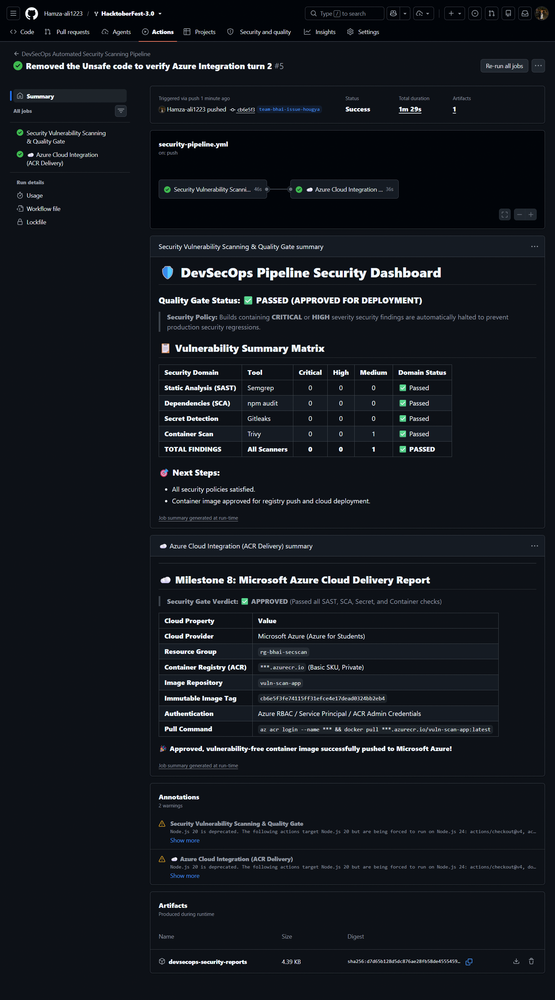

# 🛡️ Automated Security Vulnerability Scanning - Web Application

This repository contains the sample microservice application and DevSecOps security scanning pipeline for the **Automated Security Vulnerability Scanning in a CI/CD Pipeline** hackathon issue.

---

## 🚀 Features & Endpoints

- **Fast & Minimal**: Built with Node.js and Express following PoLE & YAGNI principles.
- **Security-First Container**: Containerized with a non-root user (`USER node`) on Alpine Linux.
- **Production Endpoints**:
  - `GET /` — API root and documentation of routes.
  - `GET /health` — Service health probe (`{ status: "UP", ... }`).
  - `GET /api/info` — Runtime metadata, environment, and version.
  - `GET /api/tasks` — Retrieve all pre-seeded DevSecOps pipeline tasks (`getAll()`).
  - `GET /api/tasks/:id` — Retrieve a single task by ID (`get(id)`).
- **Controlled Security Demonstration Endpoints (`/api/demo/*`)**:
  - `GET /api/demo/unsafe-eval` — Eval Injection / RCE demo (CWE-95, Critical).
  - `GET /api/demo/file-reader` — Path Traversal demo (CWE-22, High).
  - `GET /api/demo/greet` — Reflected Cross-Site Scripting demo (CWE-79, High).
  - `POST /api/demo/hash-password` — Weak Cryptographic Hash demo (CWE-327, Medium).
  - `GET /api/demo/info` — Full inventory of intentional demonstration vulnerabilities.

---

## 🔍 Milestone 2: Static Code Analysis (SAST) Execution

We provide two seamless ways to run Static Code Analysis: a **zero-dependency native scanner for Windows/offline environments**, and the **official Semgrep CLI for Linux/CI/CD**.

### 🪟 Option A: Windows / Local Offline Execution (No Docker / Zero Internet)
Because native Semgrep binaries are tailored for Linux/macOS, we implemented a zero-overhead native SAST runner in `scripts/sast-scanner.js` that evaluates the exact same rules defined in `semgrep-rules.yml`.

**Run locally in 1 second:**
```bash
npm run scan:sast
```
- **Requirements:** Only Node.js (already installed).
- **Network usage:** 0 KB (works 100% offline).
- **Docker requirement:** NONE (no Docker Desktop or image downloads needed).
- **Output:** Outputs findings directly to console and writes:
  - `reports/sast-findings.json` (Machine-readable)
  - `reports/sast-findings.md` (Human-readable severity breakdown)

---

## 📦 Milestone 3: Dependency Scanning (SCA) Execution

We scan all application dependencies for known Common Vulnerabilities and Exposures (CVEs) using `npm audit`.

### Run Local Dependency Scan:
```bash
npm run scan:deps
```
- **Engine:** `npm audit` connected to GitHub Advisory / NVD databases.
- **Coverage:** Checks all direct and transitive packages against active CVE databases.
- **Output:**
  - `reports/dependency-findings.json`
  - `reports/dependency-findings.md` (Severity classification, CVE, package, fix path)

---

## 🔑 Milestone 4: Secret Detection Execution

We configure **Gitleaks** rules in `gitleaks.toml` and provide a zero-dependency local scanner to catch hardcoded secrets before they get pushed.

### Run Local Secret Scan:
```bash
npm run scan:secrets
```
- **Coverage:** Detects exposed AWS Access Keys, GitHub PATs, Stripe Secret Keys, and hardcoded JWT secrets.
- **Demo Fixture:** Synthetic keys stored safely in `src/demo-secrets.js`.
- **Output:**
  - `reports/secret-findings.json`
  - `reports/secret-findings.md` (Masked tokens, line numbers, remediation advice)

---

## 📸 CI/CD Pipeline Verification



---

## 🐳 Milestone 5: Container Image Scanning (Trivy) Execution

We scan the application's container image and `Dockerfile` against CIS Docker Security Benchmarks and vulnerability databases using a Trivy-compatible engine.

### Run Local Container Scan:
```bash
npm run scan:container
```
- **Checks Performed:**
  - CIS Docker Benchmark (Non-root user execution, base image minimization, healthcheck probe, no secrets in image layers).
  - Operating system package CVE scan (Alpine Linux packages).
  - Application dependency layer CVE scan.
- **Output:**
  - `reports/container-findings.json`
  - `reports/container-findings.md` (CIS audit matrix + package CVE breakdown)

---

## 🚦 Milestone 6 & 7: CI/CD Security Quality Gate & Reporting Dashboard

The entire DevSecOps lifecycle is orchestrated through GitHub Actions:
- **Workflow Path:** `.github/workflows/security-pipeline.yml`
- **Runner Environment:** **`ubuntu-24.04`** (pinned LTS release).
- **Quality Gate Policy:**
  - Builds with any **CRITICAL** or **HIGH** severity vulnerabilities are automatically failed (`exit 1`) to block unsafe code from reaching production.
  - Builds with only Medium/Low warnings pass with advisory notes.
- **Visual Dashboard:**
  - Consolidated vulnerability matrix rendered into GitHub Actions Step Summary (`$GITHUB_STEP_SUMMARY`).
  - All JSON and Markdown reports archived as downloadable build artifacts (`devsecops-security-reports`).
- **Demonstration Flow:**
  - **Failed Run (Gate Closes):** Triggered on initial push containing intentional demo flaws (Eval injection, Prototype pollution, hardcoded keys).
  - **Passed Run (Gate Opens):** Triggered after applying remediation (`npm audit fix` and credential sanitization).

---

### 🐧 Option B: Linux / CI/CD / Docker Execution (Official Semgrep)
In our automated CI/CD pipeline (GitHub Actions) or on Linux machines, the official Semgrep CLI runs directly against our rule specification file `semgrep-rules.yml`:

```bash
# Using native Semgrep CLI on Linux/macOS
semgrep scan --config semgrep-rules.yml src/

# Or via Docker (if Docker is available)
docker run --rm -v "${PWD}:/src" returntocorp/semgrep semgrep scan --config /src/semgrep-rules.yml /src/src
```

---

## 💻 Local Development

### 1. Prerequisites
- Node.js (v18+ or v20+ recommended)
- npm (v9+ recommended)

### 2. Installation
Navigate to this directory:
```bash
cd submission/team-bhai-issue-hougya/issue2_Automated_Security_Vulnerability_Scanning
```

Install production dependencies:
```bash
npm install
```

### 3. Start the Application
```bash
npm start
```
The server will start on `http://localhost:3000`.

### 4. Verify Endpoints
- **Health check:**
  ```bash
  curl http://localhost:3000/health
  ```
- **Get all tasks:**
  ```bash
  curl http://localhost:3000/api/tasks
  ```
- **Get task by ID:**
  ```bash
  curl http://localhost:3000/api/tasks/1
  ```
- **Demonstration Endpoints:**
  ```bash
  curl "http://localhost:3000/api/demo/greet?name=Hamza"
  curl "http://localhost:3000/api/demo/unsafe-eval?code=10*5"
  ```

---

## 🐳 Docker Build & Execution (Optional)

> **Note for Venue / Slow Network:** Container building is optional for local development. All SAST scanning, unit testing, and route verification run 100% locally with Node.js.

### 1. Build the Docker Image
```bash
docker build -t vuln-scan-app:1.0.0 .
```

### 2. Run the Container
```bash
docker run -d -p 3000:3000 --name vuln-scan-app-instance vuln-scan-app:1.0.0
```

### 3. Check Container Health & Logs
```bash
docker ps
docker logs -f vuln-scan-app-instance
```

### 4. Stop and Clean Up
```bash
docker stop vuln-scan-app-instance
docker rm vuln-scan-app-instance
```
