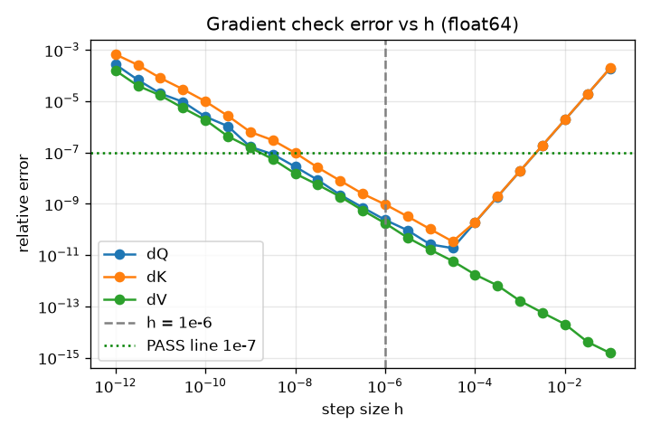

# Technical Analysis: Debugging, Attention Gradients and Evaluation

This document covers all four milestones of the challenge:

1. [Debugging a silently failing training run](#milestone-1-debugging-a-silently-failing-training-run)
2. [Deriving and implementing attention gradients](#milestone-2-deriving-and-implementing-attention-gradients)
3. [Designing an evaluation strategy for fraud detection](#milestone-3-evaluation-strategy-for-a-fraud-detector)
4. [Diagnosing learning curves](#milestone-4-diagnosing-learning-curves)

For a short overview of every problem and solution, see [SUMMARY.md](SUMMARY.md).

**Code in this submission**

| File | Contents |
|------|----------|
| `m1_train_fixed.py` | Corrected training script for Milestone 1 |
| `attention.py` | NumPy attention forward and backward pass with causal mask, plus a tiled forward pass |
| `gradcheck.py` | Numerical gradient checks, property checks and the step-size sweep |
| `experiments.py` | Softmax stability, 1/√d scaling, causal mask checks, memory table, tiled forward pass |
| `h_sweep.png` | Gradient-check error vs step size |

---

# Milestone 1: Debugging a Silently Failing Training Run

The setup is a binary classifier on 10,000 rows of tabular data with 40 features. Training loss keeps going down, but validation accuracy stays around 55% and jumps around from epoch to epoch.

I went through the code line by line and found seven problems. Three of them are serious enough to explain the symptoms on their own, one would crash the script, and the other three are leakage or design issues that make the results harder to trust.

| # | Problem | Line | Effect |
|---|---------|------|--------|
| 1 | Features shuffled without labels | `np.random.shuffle(X_tr)` | Train loss falls, val stays at chance |
| 2 | Validation run in training mode | `val_logits = model(...)` | Val accuracy fluctuates |
| 3 | Scheduler steps every batch | `scheduler.step()` | Learning rate hits ~0 after epoch 1 |
| 4 | Validation tensor is float64 | `torch.tensor(X_val)` | Dtype error |
| 5 | Scaler fit before the split | `StandardScaler().fit_transform(X)` | Small leakage into validation |
| 6 | Split takes the first 8,000 rows | `X[:8000], X[8000:]` | Distribution shift if the data is ordered |
| 7 | Dropout before BatchNorm | model definition | Train/eval variance mismatch |

## 1.1 The shuffle breaks the feature-label pairing

This is the main reason the model learns nothing useful.

`np.random.shuffle(X_tr)` shuffles the rows of `X_tr` in place, but `y_tr` is left alone. After that line, row i of X no longer goes with label i, so from the model's point of view the training labels are random.

That fits both halves of the symptom. A network with about 5.8k parameters can still partly memorise 8,000 random pairs, so training loss goes down. None of that carries over to the validation set, where the pairs are correct, so validation accuracy stays at chance. I'd expect the 55% to be the majority-class rate, which is easy to check with `y_val.mean()`.

One detail depends on code we can't see. If `train_loader` was built with `torch.from_numpy(X_tr)`, it shares memory with the array, so the shuffle corrupts it even if the loader was created first. With `torch.tensor(X_tr)`, which makes a copy, it only breaks if the loader is built after the shuffle.

The fix is to shuffle indices instead of the array, or let the DataLoader handle it:

```python
idx = np.random.permutation(len(X_tr))
X_tr, y_tr = X_tr[idx], y_tr[idx]

# or simply
train_loader = DataLoader(dataset, batch_size=64, shuffle=True)
```

## 1.2 Validation is run in training mode

`model.train()` is called at the start of each epoch, and nothing switches it back before the validation forward pass. So during validation:

- Dropout is still on. Half the hidden units are zeroed at random, so the same weights give a different answer each time.
- BatchNorm normalises the 2,000 validation rows using their own mean and variance instead of the running statistics from training.
- Since it's in train mode, BatchNorm also updates its running statistics with the validation data, so a bit of the validation set leaks into the model every epoch.

This is what causes the fluctuation. Part of the epoch-to-epoch noise comes from the evaluation itself, not from the model changing. There's also no `torch.no_grad()`, so autograd builds a graph that's never used. That wastes memory but doesn't change the results.

```python
model.eval()
with torch.no_grad():
    val_logits = model(X_val_t)
model.train()
```

## 1.3 The scheduler steps after every batch

`StepLR(step_size=1, gamma=0.9)` is supposed to shrink the learning rate once per epoch, but `scheduler.step()` sits inside the batch loop, so it shrinks it after every batch. After k batches the learning rate is 1e-3 × 0.9^k. The batch size isn't given, so here's what that looks like for a few common values:

| Batch size | Batches per epoch | LR after epoch 1 |
|-----------:|------------------:|-----------------:|
| 32 | 250 | about 3.6e-15 |
| 64 | 125 | about 1.9e-9 |
| 256 | 32 | about 3.4e-5 |

In every case the learning rate is basically zero by the second or third epoch, and training stalls.

This doesn't quite match the reported symptom. If the learning rate dies that early, training loss can't keep falling steadily for 50 epochs unless there are only a few batches per epoch. My guess is that the loss drops during the first epoch and then flattens out, and the description simplifies that. Logging the learning rate and the per-epoch loss would settle it.

The fix is to move `scheduler.step()` out of the batch loop so it runs once per epoch.

## 1.4 The validation tensor is float64

StandardScaler returns float64 arrays, so `torch.tensor(X_val)` produces a float64 tensor, while the weights of `nn.Linear` are float32. PyTorch raises a dtype error on the forward pass. The same would happen with the training tensors if the loader was built the same way. Passing `dtype=torch.float32` fixes it, along with `torch.long` for the labels since `CrossEntropyLoss` expects integer class indices.

## 1.5 The scaler is fit before the split

`StandardScaler().fit_transform(X)` computes the mean and standard deviation over all 10,000 rows, including the 2,000 that end up in validation. It's a small leak. On its own it would only make validation numbers slightly optimistic, but it matters more when train and validation come from different distributions, which problem 6 makes possible. The fix is to split first, fit the scaler on the training set only, and then transform both sets.

## 1.6 The split takes the first 8,000 rows

`X[:8000]` and `X[8000:]` only give a fair split if the rows are already in random order. If the file is sorted by date, label, ID or source, the validation set comes from a different distribution than the training set, and accuracy drops for reasons that have nothing to do with the model.

I'm treating this as conditional because we can't see the data. If the rows are independent, a stratified random split is the right choice. If they're time-ordered, the contiguous split is actually correct, since it gives a temporal validation, but that should be a deliberate decision rather than an accident.

## 1.7 Dropout comes before BatchNorm

The model applies Dropout and then BatchNorm. During training, BatchNorm learns its running variance from activations that have already been through dropout. At eval time dropout is turned off, so the activations reaching BatchNorm have a different variance from the one it learned. This mismatch is known as "variance shift", and it hurts test performance. It won't stop training from working, but the standard order is Linear, BatchNorm, ReLU, Dropout.

## 1.8 Things that aren't defined

`loss_fn`, `train_loader` and `accuracy` never appear in the snippet, `y_val` is passed in as a NumPy array, and there's no random seed. I haven't counted these as bugs because the snippet is just incomplete, but the corrected version below defines all of them.

## 1.9 Corrected code

```python
"""Corrected Milestone 1 training script with all 7 bugs fixed."""
import copy

import torch
from sklearn.datasets import make_classification
from sklearn.model_selection import train_test_split
from sklearn.preprocessing import StandardScaler
from torch import nn
from torch.utils.data import DataLoader, TensorDataset

torch.manual_seed(0)

# Stand-in data so the script runs; the real X, y replace this line.
X, y = make_classification(10000, 40, n_informative=10, weights=[0.55], random_state=0)

# Bug 6: shuffled, stratified split, done first so nothing else sees the validation rows.
X_tr, X_val, y_tr, y_val = train_test_split(X, y, test_size=0.2, stratify=y, random_state=0)

# Bug 5: fit the scaler on the training rows only, then apply it to both sets.
scaler = StandardScaler().fit(X_tr)
X_tr, X_val = scaler.transform(X_tr), scaler.transform(X_val)

# Bug 4: float32 features to match the model weights, int64 labels for CrossEntropyLoss.
X_tr = torch.tensor(X_tr, dtype=torch.float32)
X_val = torch.tensor(X_val, dtype=torch.float32)
y_tr = torch.tensor(y_tr, dtype=torch.long)
y_val = torch.tensor(y_val, dtype=torch.long)

# Bug 1: the DataLoader shuffles (x, y) pairs together, so features never lose their labels.
train_loader = DataLoader(TensorDataset(X_tr, y_tr), batch_size=64, shuffle=True)

# Bug 7: BatchNorm comes before ReLU and Dropout, so BN never sees dropout noise.
model = nn.Sequential(
    nn.Linear(40, 128), nn.BatchNorm1d(128), nn.ReLU(), nn.Dropout(0.5),
    nn.Linear(128, 2),
)
loss_fn = nn.CrossEntropyLoss()
opt = torch.optim.Adam(model.parameters(), lr=1e-3)
scheduler = torch.optim.lr_scheduler.StepLR(opt, step_size=1, gamma=0.9)

# Early stopping: keep the weights with the lowest val loss, stop after 10 epochs without improvement.
patience = 10
best_val_loss = float("inf")
best_state = None
best_epoch = 0
epochs_without_improvement = 0
val_accs = []

for epoch in range(1, 51):
    model.train()
    for xb, yb in train_loader:
        loss = loss_fn(model(xb), yb)
        opt.zero_grad()
        loss.backward()
        opt.step()
    lr = scheduler.get_last_lr()[0]  # the LR used during this epoch
    scheduler.step()  # Bug 3: once per epoch, not once per batch

    # Bug 2: eval mode turns dropout off and makes BN use its running stats;
    # no_grad skips building a graph we never use.
    model.eval()
    with torch.no_grad():
        val_logits = model(X_val)
        val_loss = loss_fn(val_logits, y_val).item()
        val_acc = (val_logits.argmax(dim=1) == y_val).float().mean().item()
    val_accs.append(val_acc)
    print(f"epoch {epoch:2d}  lr {lr:.2e}  val loss {val_loss:.4f}  val acc {val_acc:.4f}")

    if val_loss < best_val_loss:
        best_val_loss = val_loss
        best_state = copy.deepcopy(model.state_dict())
        best_epoch = epoch
        epochs_without_improvement = 0
    else:
        epochs_without_improvement += 1
        if epochs_without_improvement >= patience:
            print(f"Stopping early: no val-loss improvement for {patience} epochs")
            break

model.load_state_dict(best_state)
best_acc = max(val_accs)
print(f"final val acc {val_accs[-1]:.4f} (epoch {len(val_accs)})")
print(f"best val acc  {best_acc:.4f} (epoch {val_accs.index(best_acc) + 1})")
print(f"restored checkpoint from epoch {best_epoch}: "
      f"val loss {best_val_loss:.4f}, val acc {val_accs[best_epoch - 1]:.4f}")
```

I kept the original scheduler settings and only moved the call. Stepping once per epoch, the learning rate would end at 1e-3 × 0.9^50, about 5.2e-6, which is a reasonable decay over 50 epochs. I also added early stopping on validation loss (patience 10) so the final model is the best checkpoint rather than the last one. On the stand-in data, early stopping fired after epoch 48. The final epoch reached 95.5% validation accuracy, and the best epoch reached 95.75% (epoch 39). The restored checkpoint is the one with the lowest validation loss (0.1469, epoch 38), and it scores 95.4%.

## 1.10 Finding these problems without the code

If I only had access to the training runs and not the source, these are the checks I'd try, roughly in this order:

1. Overfit one small batch. Train on about 32 rows for a few hundred steps and the loss should get close to zero. If it doesn't, something is wrong with the optimiser or the learning rate, which is how problem 3 would show up.
2. Evaluate the same checkpoint on the validation set twice in a row. If the two accuracies differ, the evaluation itself is random (problem 2).
3. Retrain with the labels deliberately shuffled. If the loss and accuracy curves look the same as the original run, the labels were already disconnected from the features (problem 1).
4. Compare against simple baselines: always predicting the majority class, and a logistic regression on the same split. If logistic regression does much better than the network, the problem is in the pipeline and not the model's capacity. If the network sits exactly at the majority rate, it hasn't learned anything.
5. Evaluate the model on the original training data in eval mode. Low training loss combined with near-chance training accuracy means the model was trained on mismatched pairs (problem 1).
6. Train a classifier to tell training rows apart from validation rows. If it gets an AUC well above 0.5, the two sets come from different distributions (problem 6).
7. Compare validation accuracy with the model in `train()` mode and in `eval()` mode. A large gap points at dropout and BatchNorm behaving differently between the two (problems 2 and 7).
8. Log the learning rate at every step. If it collapses within the first epoch, the scheduler is being stepped too often (problem 3).

---

# Milestone 2: Deriving and Implementing Attention Gradients

Single-head attention:

```
S = Q Kᵀ / √d        raw scores,          shape n × m
P = softmax(S)       row-wise softmax,    shape n × m
O = P V              output,              shape n × d_v
```

with Q of shape n × d, K of shape m × d and V of shape m × d_v. S holds the raw scores; P is the softmax output, where each row adds up to 1. The loss is a function of O, so the whole computation is L(O(P(S(Q, K)), V)).

Throughout, dX means ∂L/∂X: how much the loss changes if X is nudged. It always has the same shape as X. We're given dO and walk backward: dO → dP → dS → dQ, dK, with dV coming straight off O.

## 2.1 Derivation

### The matrix-multiplication rule

For any product Y = A B, if we know dY:

```
dA = dY · Bᵀ
dB = Aᵀ · dY
```

A gradient has the same shape as its matrix, so if I'm ever unsure where a transpose goes, only one option makes the shapes fit.

### dV and dP, through O = P V

With Y = O, A = P and B = V:

```
dP = dO Vᵀ        (n × d_v)(d_v × m) = n × m
dV = Pᵀ dO        (m × n)(n × d_v)   = m × d_v
```

In index form, O_ij = Σ_k P_ik V_kj, so ∂L/∂V_kj = Σ_i dO_ij P_ik and ∂L/∂P_ik = Σ_j dO_ij V_kj. Each value vector V_k was used by every query i with weight P_ik, so its gradient collects a contribution from every query, weighted by how much attention that query paid to it.

### dS, through the softmax

This is the step that needs real thought. Softmax works on each row on its own, so I look at one row of scores s with percentages p_j = e^(s_j) / Z, where Z = Σ_k e^(s_k). Every percentage shares the same Z, so nudging one score moves all of them.

**The two derivatives.** For the same position, s_j appears in both the numerator and Z, and the quotient rule gives

```
∂p_j/∂s_j = (e^(s_j)·Z − e^(s_j)·e^(s_j)) / Z² = p_j(1 − p_j)
```

For a different position, s_k only appears in Z, so

```
∂p_j/∂s_k = −e^(s_j)·e^(s_k) / Z² = −p_j p_k
```

Raising your own score raises your percentage; raising someone else's lowers it.

**The Jacobian.** Putting all of these in a table (row = which p moves, column = which s is nudged) gives the Jacobian:

```
J = diag(p) − p pᵀ
```

On the diagonal that's p_j − p_j² = p_j(1 − p_j), and off the diagonal it's −p_j p_k. J is symmetric.

**Backprop through it.** Going backward through a step multiplies by the transpose of its Jacobian. Since J is symmetric:

```
ds = J dp = p ⊙ dp − p (pᵀ dp)
```

The matrix product adds up every path from a score to the loss automatically. Writing D = pᵀ dp = Σ_j p_j dp_j, which is a single number per row:

```
ds = p ⊙ (dp − D)
```

D is the attention-weighted average of the incoming gradient. Each score gets its probability times (its own push minus the average push). Softmax only cares about differences between scores, so if every score got the same push the gradient would be zero. It also follows that every row of dS sums to zero, since Σ_k p_k(dp_k − D) = D − D = 0.

**A 2-score sanity check.** With two scores, p₁ = sigmoid(s₁ − s₂) and p₂ = 1 − p₁, so the output is o = v₂ + p₁(v₁ − v₂). The chain is a straight line, s₁ → p₁ → o → L, and multiplying the three links gives ds₁ = g · p₁(1 − p₁) · (v₁ − v₂), where g = dO. The general formula gives the same: D = g(p₁v₁ + p₂v₂), and p₁(g v₁ − D) = g p₁ p₂ (v₁ − v₂). With s = [1, 0], v = [3, 1] and g = 1, this is 0.731 × 0.269 × 2 = 0.393. Nudging s₁ by 0.01 moves o from 2.4621 to 2.4660, which also gives 0.39.

**A 3-score numeric check.** With p = [0.665, 0.245, 0.090] and dp = [1, 2, 0]:

```
D   = 0.665×1 + 0.245×2 + 0.090×0 = 1.155
ds  = [0.665×(1 − 1.155), 0.245×(2 − 1.155), 0.090×(0 − 1.155)]
    = [−0.1031, +0.2070, −0.1040]
```

Multiplying the full Jacobian by dp gives the same values, and the row sums to about zero.

**All rows at once:**

```
D  = rowsum(P ⊙ dP)          shape n × 1
dS = P ⊙ (dP − D)
```

### The D identity

D can be computed without P:

```
D_i = Σ_j P_ij dP_ij
    = Σ_j P_ij Σ_l dO_il V_jl
    = Σ_l dO_il (Σ_j P_ij V_jl)
    = Σ_l dO_il O_il
```

So D = rowsum(dO ⊙ O). This is what lets FlashAttention run the backward pass without storing P (Section 2.7).

### dQ and dK, through S = Q Kᵀ / √d

This is a matrix product again, with A = Q, B = Kᵀ and a constant 1/√d:

```
dQ = dS K / √d         (n × m)(m × d) = n × d
dK = dSᵀ Q / √d        (m × n)(n × d) = m × d
```

In index form, S_ik = Σ_l Q_il K_kl / √d. Query i appears in every score of row i, so ∂L/∂Q_il = Σ_k dS_ik K_kl / √d. Key k appears in every score of column k, so ∂L/∂K_kl = Σ_i dS_ik Q_il / √d.

### Summary

```
dV = Pᵀ dO
dP = dO Vᵀ
D  = rowsum(P ⊙ dP) = rowsum(dO ⊙ O)
dS = P ⊙ (dP − D)
dQ = dS K / √d
dK = dSᵀ Q / √d
```

## 2.2 Implementation

`attention.py` implements single-head scaled dot-product attention:

- `softmax` subtracts the row max before exp.
- `forward(Q, K, V, causal=False)` returns O and a cache holding Q, K, V, P and the scale. The scale is a plain Python float, so float32 inputs stay float32.
- `backward(dO, cache)` returns dQ, dK and dV using the formulas above.
- `tiled_forward(Q, K, V, block)` is the online-softmax version described in Section 2.7.
- Causal masking sets S[i, j] = −inf for j > i before the softmax.

A fully masked row would compute (−inf) − (−inf) = NaN. I guard against this by replacing a −inf row max with 0 and a zero denominator with 1, so such a row comes out as all zeros (it attends to nothing). The backward pass is safe there too: P is zero across that row, so it contributes nothing to dV, dS, dQ or dK.

I used n ≠ m in the main tests so that a missing transpose fails with a shape error instead of passing silently.

## 2.3 Gradient check

**Loss.** L = sum(O ⊙ G) for a fixed random G, so dL/dO = G exactly. I pass G as dO and compare the result against central differences of L, taken element by element on Q, K and V.

**Precision.** Everything runs in float64. Case f shows what happens in float32.

**Step size.** I use h = 1e-6. A central difference has two error sources:

- truncation error, which shrinks like h²;
- round-off error, which grows like ε/h, because I subtract two nearly equal numbers and then divide by h.

The total is smallest near h ≈ ε^(1/3). For float64 (ε ≈ 2.2e-16) that is about 6e-6.

**Metric.** Relative error = ‖a − n‖ / max(‖a‖ + ‖n‖, 1e-12). The floor keeps the ratio defined when both gradients are zero.

**Acceptance threshold.** PASS below 1e-7, WARN from 1e-7 to 1e-4, FAIL above 1e-4.

Output of `python3 gradcheck.py`:

```
Gradient check (h = 1e-06, PASS < 1e-07, FAIL > 1e-04)
case                     tensor  rel. error  verdict
a) random n=4 m=6        Q       2.341e-10   PASS
a) random n=4 m=6        K       9.407e-10   PASS
a) random n=4 m=6        V       1.731e-10   PASS
b) large logits Qx30     Q       1.597e-08   PASS
b) large logits Qx30     K       1.001e-09   PASS
b) large logits Qx30     V       5.163e-11   PASS
c) causal n=m=5          Q       5.835e-10   PASS
c) causal n=m=5          K       1.258e-09   PASS
c) causal n=m=5          V       1.377e-10   PASS
d) rowsum(dS) = 0        dS      1.665e-16   PASS
e) D identity            D       3.331e-16   PASS
f) float32 (case a)      Q       1.842e-01   FAIL (demo)
f) float32 (case a)      K       4.457e-01   FAIL (demo)
f) float32 (case a)      V       1.332e-01   FAIL (demo)
(d and e are max absolute deviations, not relative errors)
```

Every float64 check passes.

- Case b (Q scaled ×30) has the largest error, at 1.6e-8. That is still well under the PASS line.
- Case d confirms that each row of dS sums to zero, as derived above.
- Case e confirms that the two ways of computing D agree to round-off.
- Case f runs the same test with everything in float32. The errors are 0.13 to 0.45, more than 1,000 times over the FAIL line. In float32, ε ≈ 1.2e-7, so an h of 1e-6 is barely larger than the spacing between neighbouring numbers, and the finite difference is mostly noise. That is why the checker has to run in float64.

### Step-size sweep



Selected rows from the sweep (case a):

```
h          dQ          dK          dV
1.0e-01    1.885e-04   1.922e-04   1.524e-15
1.0e-03    1.886e-08   1.923e-08   1.627e-13
1.0e-04    1.881e-10   1.943e-10   1.727e-12
3.2e-05    1.862e-11   3.374e-11   5.832e-12
1.0e-05    2.601e-11   1.026e-10   1.623e-11
1.0e-06    2.341e-10   9.407e-10   1.731e-10
1.0e-08    2.766e-08   9.584e-08   1.491e-08
1.0e-10    2.497e-06   9.838e-06   1.862e-06
1.0e-12    2.694e-04   6.683e-04   1.569e-04
best h: dQ 3.2e-05, dK 3.2e-05, dV 1.0e-01
```

dQ and dK show the expected V shape. On the right, the slope is about 2 per decade, which is truncation error. On the left, the slope is about −1 per decade, which is round-off. The minimum landed at h ≈ 3e-5, a bit larger than the 1e-5 to 1e-6 I predicted. The ε^(1/3) rule ignores constants such as the size of the third derivative and of L, and this example has a fairly flat third derivative.

dV has no V shape. L is linear in V, so the central difference has zero truncation error and the error only grows as h shrinks. At h = 1e-6, the three errors are between 1.7e-10 and 9.4e-10, more than 100 times below the PASS line, so the choice is safe.

## 2.4 Softmax stability

With logits of 1000 or more, exp overflows to inf, and inf / inf = NaN. Softmax gives the same result if I subtract any constant from a row. Subtracting the row max makes the largest exponent exp(0) = 1, so nothing can overflow. Output of `experiments.py`:

```
naive softmax  : [nan nan nan]
stable softmax : [0.66524096 0.24472847 0.09003057]
softmax([2,1,0]): [0.66524096 0.24472847 0.09003057]
exp overflows above 11.09 in float16
exp overflows above 88.72 in float32
exp overflows above 709.78 in float64
```

The stable result matches softmax([2, 1, 0]), as it should. In float16, any logit above 11.09 already overflows, so mixed-precision kernels need this fix too.

## 2.5 Why scale by 1/√d

If q and k have d independent entries with mean 0 and variance 1, then q·k is a sum of d products, each with variance 1. So Var(q·k) = d, and the logits spread out like √d as d grows. With large logits:

- the softmax saturates: one entry of p goes to 1 and the rest go to 0;
- the softmax Jacobian, diag(p) − ppᵀ, goes to the zero matrix;
- dS = P ⊙ (dP − D) shrinks, and the gradients reaching Q and K vanish.

Dividing by √d brings the logit variance back to 1, whatever d is.

Output (n = m = 128, d_v = 64, a fresh random dO for each d):

```
    d | scaled: std   maxP    ||dS|| | unscaled: std   maxP    ||dS||
   16 |       0.994  0.067 1.286e+01 |         3.975  0.550 2.898e+01
   64 |       1.007  0.073 1.235e+01 |         8.059  0.774 2.528e+01
  256 |       1.007  0.069 1.248e+01 |        16.118  0.899 2.036e+01
 1024 |       1.001  0.067 1.249e+01 |        32.020  0.950 8.459e+00
```

- The scaled logit std stays at 1.0. The unscaled std is close to √d (4, 8, 16, 32).
- The unscaled mean of max(P) climbs from 0.55 to 0.95, so rows are close to one-hot. The scaled value stays near 0.07.
- The scaled ‖dS‖ is flat, at about 12.5. The unscaled ‖dS‖ shrinks with d (29, 25, 20, 8.5), with the biggest drop between d = 256 and d = 1024.

One thing differed from what I expected. At small d, unscaled ‖dS‖ is larger than scaled. Moderately larger logits make P less uniform, and that can increase dS at first. The vanishing only takes over once the rows are close to one-hot. At d = 1024, max(P) is 0.95, not yet 1, so ‖dS‖ is clearly falling but has not reached 0.

## 2.6 Causal mask

The mask is applied before the softmax. Masked logits become −inf, then exactly 0 after exp, and the remaining weights in each row still sum to 1. Backward needs no new math. P is 0 at masked positions, so dS = P ⊙ (dP − D) is 0 there automatically. Real kernels go further and skip blocks that are fully masked, which saves about half the work for long sequences.

Output (n = 6):

```
dQ[0] exactly zero           : True
O[i<j] unchanged by K[j], V[j]: True  (max change 0.0e+00)
dS == 0 at masked positions  : True  (15 entries)
```

dQ[0] is exactly 0 because query 0 can only see key 0. That gives P[0, 0] = 1 and D[0] = dP[0, 0], so dS[0, 0] = 1 · (dP[0, 0] − dP[0, 0]) = 0. Perturbing any K[j] or V[j] changes none of the outputs O[i] for i < j, not even in the last bit. The gradient check in case c passed as well.

## 2.7 Memory, and how FlashAttention avoids it

The logits S and the weights P are n × n per head. For one head, a single such matrix takes (n = 1024, 4096, 16384 and 65536):

```
      n       fp16       fp32
     1k      2 MiB      4 MiB
     4k     32 MiB     64 MiB
    16k    512 MiB   1.00 GiB
    64k   8.00 GiB  16.00 GiB
```

That figure is multiplied by batch × heads × layers, and the standard backward pass keeps P around until backward runs. Long sequences run out of memory long before they run out of compute.

FlashAttention never writes the full matrix:

- It splits Q, K and V into tiles small enough for fast on-chip memory (SRAM).
- It uses an online softmax to combine tiles. For each row it keeps a running max m, a running sum ℓ and an unnormalised output. When a new tile raises the max, it multiplies the old ℓ and the old output by exp(m_old − m_new).
- It stores only O and one logsumexp value per row, which is O(n).
- In backward, it rebuilds P one tile at a time from that logsumexp, and it gets D from rowsum(dO ⊙ O), which needs no P at all. This is the identity derived in Section 2.1 and checked in case e.

The FLOPs stay O(n²d), and some work is even repeated. Memory for the attention matrix drops from O(n²) to O(n), and much less data moves through slow GPU memory.

I implemented the forward recurrence in `tiled_forward`. Each step only builds an n × B tile. Compared with the naive forward (n = 37, m = 53, so the last tile is partial for most block sizes):

```
block  max |O diff|  max |lse diff|  < 1e-12
    1      8.88e-16        8.88e-16     True
    3      2.78e-16        8.88e-16     True
    7      4.44e-16        8.88e-16     True
   16      4.44e-16        8.88e-16     True
   53      4.44e-16        0.00e+00     True
```

Every block size matches to within 1e-15, well inside the 1e-12 target.

---

# Milestone 3: Evaluation Strategy for a Fraud Detector

The scenario is a card fraud detector. Only 0.1% of transactions are fraud (1 in 1,000), the fraud labels (chargebacks) arrive 30 to 60 days late, and fraud patterns keep changing. Each of these three facts shapes the evaluation, so they come up again and again below.

## 3.0 The model setup

The main model is a supervised one, gradient-boosted trees (XGBoost or LightGBM), trained on chargeback labels. It outputs a probability of fraud for each transaction, and we block anything above a cutoff. I'd also train a logistic regression as a simple baseline, so we know the bigger model is actually adding something. Features come from the transaction log itself (amount, time, merchant, country, and per-card history computed only from earlier transactions), so no customer profile data is assumed.

I considered using anomaly detection as the main model, but decided against it. Anomaly detection flags transactions that are unusual, and unusual is not the same as fraud. Eid shopping or a trip abroad is unusual but innocent, while a lot of fraud is designed to look like normal shopping. We also do have labels, they just arrive late, and throwing them away would waste the most useful information we have.

Anomaly detection still has two useful jobs:

1. **An extra feature.** Its "how unusual is this" score goes into the supervised model as one more input. This helps with new fraud tricks that no chargeback has labelled yet.
2. **An early-warning monitor.** It needs no labels, so it can watch live traffic during the 60 days we're waiting for chargebacks.

## 3.1 Which metrics to use and which to avoid

Throughout this section I'll use one example: 1,000,000 transactions, of which 1,000 are fraud.

**Avoid accuracy.** A model that predicts "not fraud" for every transaction is right 999,000 times out of 1,000,000, so it scores 99.9% while catching no fraud at all.

**Don't rely on ROC-AUC.** ROC-AUC uses the false positive rate, which divides false alarms by all 999,000 normal transactions. Because that number is so large, even thousands of false alarms look tiny. Say a model catches 800 of the 1,000 frauds and wrongly blocks 9,990 innocent customers. Its false positive rate is only 1%, which looks excellent on a ROC curve. But out of 10,790 blocked transactions only 800 were fraud, so 93 out of every 100 blocks hit an innocent customer. ROC-AUC hides this. It also averages over cutoffs that no bank would ever use.

**Use these instead:**

- **Precision and recall, summarised by PR-AUC.** Recall asks "of all frauds, how many did we catch?" (800/1,000 = 80%). Precision asks "of everything we blocked, how many were really fraud?" (800/10,790 = 7.4%). Precision shows the false alarm problem that ROC-AUC hid. PR-AUC combines both across all cutoffs into one number and is the main metric for comparing models. A random model scores about 0.001 here, so even 0.4 is a good result.
- **Recall at a fixed alert budget.** If the fraud team can review 0.5% of transactions, compare models by how much fraud each catches in its top 0.5%. This matches how the bank will actually use the model.
- **Expected cost in dollars.** Missed frauds × $200 plus false alarms × $5. In the example above that's $40,000 + $49,950 = $89,950, compared with $200,000 if we caught nothing. The model with the lowest cost wins.
- **Confidence intervals.** With only about 1,000 frauds in a test set, the numbers are noisy. Bootstrapping (resampling the test set many times, keeping each card's transactions together) gives a range, so we can tell whether a difference between two models is real.

## 3.2 The train / validation / test split

**Split by time, not randomly.** In real life the model is trained on the past and used on the future, so the evaluation should do the same. A random split lets the model cheat in two ways. First, it sees future fraud tricks during training: if a new scam started in June, a random split puts some June fraud into training. Second, transactions from the same stolen card end up in both train and test, so the model recognises the card instead of actually detecting fraud.

**Leave a 60-day gap between train and validation.** If the training data ends on 31 December, the bank can't actually build that model on 1 January, because December's fraud won't be reported until late February. The earliest the model could exist is around 1 March, so that's where evaluation should start. The gap months are not used for the supervised model.

**Only use data whose labels are complete.** Anything from the last 60 days still has frauds that haven't been reported. Testing on it would count those frauds as normal and make the model look better than it is.

With data from January 2025 to June 2026, the split looks like this:

```
Jan 2025 ─── Dec 2025 │ Jan ─ Feb 2026 │ Mar ─ Apr 2026 │ May ─ Jun 2026
       TRAIN          │      GAP       │   VALIDATION   │      TEST
```

Training is for learning. Validation is for comparing models, tuning, fixing calibration and choosing the cutoff. Test is used once at the end for the final honest score.

A few more rules go with this:

- **Rolling backtest.** One test window might be an unusual month, so I'd slide the whole split forward a month at a time, repeat it three or four times, and report the average and the spread.
- **Features only use the past.** For a transaction on 5 March, a feature like "this card's average spend" can only use transactions before 5 March.
- **Downsampling only in training.** To make training faster and give the model more fraud to look at, we can keep only 10% of normal transactions in training. Validation and test must keep the real 0.1% fraud rate.

The gap is still useful for the anomaly detector. During those 60 days the transactions themselves are available, only the fraud labels are missing. The anomaly detector doesn't need labels, so it can be trained on this most recent data.

## 3.3 Evaluating despite label delays

If we ignore the delay and grade the model on recent data, frauds that haven't been reported yet look like normal transactions. The model's missed frauds disappear from the count, and it looks better than it is. Switching to an unsupervised model doesn't avoid this: anomaly detection removes the need for labels during training, but grading any model still needs to know which transactions were really fraud. So:

- **Official metrics only on data at least 60 days old**, when labels are complete. These numbers are correct but always about two months behind.
- **Faster signals for recent weeks**: customer complaints ("I didn't make this purchase"), fraud analysts reviewing flagged transactions, and failed OTP checks. They're incomplete but arrive within days, so they're good for spotting problems early.
- **Using early labels with the anomaly detector.** Analyst-confirmed frauds and customer disputes arrive within days. They are too few and too biased to train the main model on, but they are enough to tune the anomaly detector's threshold and to check how it performs on recent data, including on new fraud patterns that have no chargebacks yet. These labels only cover fraud that was flagged or noticed, so the numbers are biased in a known direction. Recall looks better than it really is, because frauds that nobody noticed never show up as misses. Precision looks worse, because a flagged transaction that hasn't been confirmed yet counts as a false alarm. Both are treated as early estimates and confirmed later with mature chargebacks.
- **Estimating the missing labels.** From past months we can measure how quickly chargebacks usually arrive, for example about 70% within 30 days. If a 30-day-old batch shows 140 chargebacks, we can expect around 140 / 0.7 = 200 in total.
- **Label-free monitoring.** The alert rate, the model's score distribution and the anomaly detector all work on today's data and can warn us that something changed.
- **Checking blocked transactions.** A blocked transaction never gets a chargeback, because the money never moved, so we never learn whether it was really fraud. Fraud analysts should review a sample of blocked transactions to fill this gap.

## 3.4 Cost-based threshold and calibration

For a transaction with fraud probability p:

- If we **approve** it, the expected loss is p × $200.
- If we **block** it, the expected loss is (1 − p) × $5.

We should block when blocking is cheaper:

```
p × 200 > (1 − p) × 5
205p > 5
p > 0.0244
```

So we **block anything above a 2.44% fraud probability**. That seems low, but a missed fraud costs 40 times more than a false alarm, so it's worth blocking even when fraud is unlikely. For example, at p = 10% approving costs $20 on average and blocking costs $4.50, so we block.

This rule only works if the model's probabilities are honest, which is what calibration checks. If we take all the transactions the model scored at about 2.5%, roughly 2.5% of them should really be fraud. To check this, I'd sort the validation transactions by score, split them into groups of equal size, and compare the average predicted probability with the actual fraud rate in each group. Plotting predicted against actual gives a reliability diagram. If the model is honest, the points sit on the diagonal. Equal-size groups matter here, because with so little fraud, fixed score ranges would leave most groups almost empty. The Brier score and a comparison of the average predicted probability with the overall fraud rate are useful summary numbers, and the most important region to check is around 2.44%, since that's where decisions are made.

If the probabilities are off, they can be corrected with isotonic regression or Platt scaling fitted on the validation data. Downsampling also needs a correction: if we kept only 10% of normal transactions in training, the model thinks fraud is about 10 times more common than it really is, and its probabilities have to be scaled back down before applying the 2.44% cutoff.

## 3.5 Detecting drift and deciding when to retrain

Drift means the data or the fraud patterns have changed since training. I'd track it in three ways:

| Signal | What it tells us | Speed |
|--------|------------------|-------|
| Anomaly detector, score distribution (PSI), alert rate | The data looks different | Immediate |
| Precision and recall on matured data | The model has actually got worse | About 2 months late |
| A fixed schedule | Fraud changes slowly all the time | Regular |

The first signal is fast but shouldn't trigger retraining on its own. Data can change without hurting the model. Eid shopping looks very different, but the model has seen Eid in past years. The opposite can also happen: fraudsters can make fraud look like normal shopping, so the data looks the same while the model gets worse. So the anomaly detector works like a smoke alarm. It tells us to go and investigate, and the chargeback-based performance confirms whether there's really a problem.

So retraining happens:

- **Every month on a schedule**, using the latest data with complete labels.
- **Earlier**, if matured recall or precision drops below the range we saw in the backtests.

Before a new model replaces the old one, it runs in **shadow mode**: it scores live transactions without making any decisions, so the two models can be compared safely. We only switch if the new one is clearly better.

## 3.6 Summary

| Question | Answer |
|----------|--------|
| Metrics | PR-AUC, recall at a fixed alert budget and expected cost, with confidence intervals. Avoid accuracy and don't rely on ROC-AUC. |
| Split | By time, with a 60-day gap, only on data with complete labels, repeated as a rolling backtest. |
| Label delays | Official grading on data 60+ days old; early signals and label-free monitoring in the meantime; review a sample of blocked transactions. |
| Threshold | Block when p > 2.44%, after checking calibration with a reliability diagram. |
| Drift | Anomaly detector and score monitoring as early warnings; retrain monthly or when matured performance drops; shadow mode before switching. |

---

# Milestone 4: Diagnosing Learning Curves

There are two things to look at in each case. The first is the gap between train and validation accuracy, which tells us whether the model is memorising instead of learning. The second is what happens as we add more data, which tells us whether more data is the fix or not.

| Case | Train | Validation | As data grows | Diagnosis |
|------|-------|------------|---------------|-----------|
| A | 62% | 60% | Both flat | Underfitting |
| B | 99% | 78% | Val rises slowly, gap shrinks slowly | Overfitting |
| C | 85% | 91% | Both rise slightly | Val > train, which needs checking |
| D | 88% | 70% | Gap stays even with 4× data | Train and val differ in some way |

## 4.1 Case A: Underfitting

The model scores about 60% on both training and validation data. It hasn't even learned the data it was trained on, so the model is too simple for the problem (high bias). Both curves staying flat as the data grows confirms this: if the model can't learn from the data it already has, giving it more of the same won't change anything.

**What I'd do:**
- Use a more powerful model (more layers, more trees, more parameters).
- Add better features.
- Reduce regularization, for example less dropout or lower weight decay.
- Train for longer.

If none of these help, the problem may be the data rather than the model. Noisy labels or a task that is simply hard could cap accuracy around 60%, so it's worth comparing against a simple baseline or human performance to see what's realistic.

## 4.2 Case B: Overfitting

99% on training but only 78% on validation is a 21-point gap. The model has basically memorised the training data and doesn't generalise well (high variance). Validation does improve as data grows, so the model is still learning, and more data does help. But the gap shrinks slowly, which means relying on more data alone would be expensive.

**What I'd do:**
- Add regularization, such as dropout and weight decay.
- Use data augmentation, which acts like getting more data for free.
- Use early stopping, so training ends when validation accuracy stops improving.
- Try a smaller or simpler model.
- Keep collecting data, since the curve shows it helps, but alongside the other fixes rather than instead of them.

## 4.3 Case C: Validation higher than training

Normally a model does better on data it has seen, so validation being 6 points higher than training is unusual. Before calling this a good result, I'd check for reasons the numbers might be misleading:

1. **Train accuracy measured in training mode.** If dropout or augmentation is switched on while measuring train accuracy but off for validation, the model is graded under harder conditions on the training set. (This is the same `model.eval()` problem as in Milestone 1.) Train accuracy averaged over an epoch, while the model is still improving, has a similar effect.
2. **An easier validation set.** Validation may come from a cleaner or simpler part of the data.
3. **Leakage.** Duplicates or near-duplicates of training rows may have ended up in validation.
4. **A small validation set.** With few validation examples, 91% may partly be luck.

**What I'd do:** re-measure train accuracy with the model in eval mode, check validation for duplicates of training rows, and look at the size and makeup of the validation set. If validation still holds at 91% after that, the model is slightly underfit (85% on train, with both curves rising only a little), so I'd give it more capacity or better features.

## 4.4 Case D: A gap that more data doesn't close

The important clue is the 4× data. In normal overfitting, like Case B, more data makes the gap smaller. Here it stays the same, so the problem isn't "the model needs more data." Something else is going on.

### Explanation 1: Distribution shift

Train and validation come from different places. For example, a disease model trained on scans from Hospital A and validated on scans from Hospital B, which uses different machines and sees different patients. The model learns Hospital A well (88%) but does worse on Hospital B (70%). Adding four times more Hospital A data doesn't help, because the model is still only learning Hospital A.

A different class balance between the two sets is one form of this. If training is 50% positive and validation is 20% positive, the model's habits from training won't match validation. So does a shortcut that only exists in training, such as a clinic logo that appears on many positive training scans but not on validation scans.

### Explanation 2: Noisy labels

A good share of the labels are wrong or ambiguous, for example because different annotators disagreed. The model is powerful enough to memorise the training data, wrong labels included, which pushes train accuracy up to 88%. On validation those wrong labels can't be predicted, so accuracy is capped at around 70% no matter how much data we add. More data just brings more noise with it, so the gap never closes.

### Experiment: mix and re-split

Combine the training and validation sets into one pool, shuffle it randomly, split it again into new train and validation sets, and retrain the model.

| Result | Meaning |
|--------|---------|
| The gap closes | **Explanation 1.** The original validation set was different from training. After mixing, both sets contain the same kind of data. |
| The gap stays | **Explanation 2.** The problem is in the data itself (the noisy labels are everywhere), so it follows the model into any split. |

To follow up, for Explanation 1 we could train a classifier to guess whether a row came from train or validation: if it can tell them apart easily, the sets really are different. For Explanation 2 we could have a small sample of examples relabelled by an expert and see how often the original labels were wrong.
