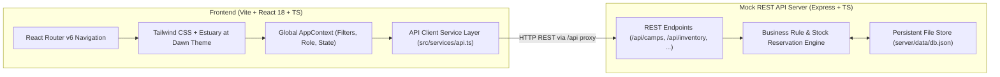

# ReliefHub — ReliefGrid Operations Console
### Sindh Flood Response Operations | Hackathon Implementation

[](https://reactjs.org/)
[](https://www.typescriptlang.org/)
[](https://vitejs.dev/)
[](https://tailwindcss.com/)
[](https://expressjs.com/)

---

## 1. Executive Summary & Product Thesis

**ReliefHub** is a mobile-first, high-density humanitarian logistics application built to coordinate flood-relief camps across upper and lower Sindh, Pakistan.

### Non-Negotiable Core Principle
> **“A camp is not helped just because a delivery has been assigned.”**

Standard SaaS dashboards prematurely count dispatched goods as delivered fulfilment, giving relief coordinators a false sense of security while families wait empty-handed. ReliefHub strictly distinguishes three quantities for every tracked need:

1. **Delivered:** Supplies physically received and verified at the camp. Counts toward true fulfilment.
2. **Committed:** Supplies reserved in *Pending* or *In Transit* dispatches. **Does not count as delivered.**
3. **Unallocated:** Required quantity not yet delivered or reserved. The critical operational gap.

$$\text{unallocated} = \max(0, \text{required\_quantity} - \text{fulfilled\_quantity} - \text{reserved\_quantity})$$
$$\text{reserved\_quantity} = \sum (\text{Pending} + \text{In Transit dispatches for that need})$$

---

## 2. Visual Identity: *Estuary at Dawn*

Inspired by a contemporary humanitarian field atlas, ReliefHub avoids generic corporate SaaS templates:
- **Canvas (`#F3EFE6`):** Warm ecru canvas texture.
- **Surface (`#FFFCF5`):** Restrained ivory cards with subtle borders (`#DCD4C7`).
- **Ink (`#292331`):** Deep plum-slate for high-contrast, accessible typography.
- **Copper (`#A6533D`):** Primary action terracotta accent.
- **Teal (`#276660`):** Delivered physical fulfilment indicator.
- **Saffron (`#D5A441`):** Committed (in-transit/pending) supplies indicator.
- **Critical (`#A73752`):** Unmet critical gaps and low-stock alerts.
- **Tabular Numerals:** Strict numerical column alignment for all metrics.

---

## 3. Architecture & Tech Stack



- **Frontend:** React 18, TypeScript, Vite, Tailwind CSS, Lucide React icons, Recharts.
- **Backend API:** Dedicated Express HTTP server with JSON file persistence (`server/data/db.json`). State is preserved across page refreshes.
- **Seed Dataset:** Seeded with 9 verified camps across 5 Sindh districts (Sukkur, Khairpur, Ghotki, SBA, Dadu), 13 inventory items with low-stock states, 21 camp needs, 12 dispatches, 10 donations (cash vs in-kind), and 15 volunteers.

---

## 4. Local Installation & Startup Commands

### Prerequisites
- Node.js (v18+ or v20+)
- npm (v9+)

### Installation
```powershell
# Navigate to the project directory
cd "c:\Users\EURO COMPUTERS\Desktop\hackathon project\Team-CodeCrafters\submission\team_CodeCrafters\ReliefHub"

# Install dependencies (already executed)
npm install
```

### Starting the Application
To run both the Mock API Server (Port 3001) and Vite Frontend (Port 5173) concurrently:
```powershell
npm run dev
```

Alternatively, run in separate terminals:
```powershell
# Terminal 1: Backend API (Port 3001)
npm run server

# Terminal 2: Vite Frontend (Port 5173)
npm run vite
```

### Verified Live Endpoints
- **Frontend Console:** [http://localhost:5173](http://localhost:5173)
- **API Server & Health:** [http://localhost:3001/api/health](http://localhost:3001/api/health)
- **Aggregated Stats:** [http://localhost:3001/api/stats](http://localhost:3001/api/stats)

---

## 5. Signature Features & Differentiators

### 1. Response Gap Strip
A multi-segment proportional progress bar providing physical unit clarity across water ($L$), tents, food packs, and medical kits. It cleanly depicts Delivered (Teal), Committed (Saffron), and Unallocated (Neutral/Critical).

### 2. Allocation Preview & Double-Allocation Prevention
Before confirming any warehouse reservation, coordinators review a real-time **Before $\to$ After** matrix:
- Warehouse Stock: $120 \to 80$
- Committed to this need: $10 \to 50$
- Unallocated need: $70 \to 30$
- Delivered fulfilment: **Unchanged**
- Advisory warnings if stock drops below reorder levels.
- Contextual competing camp demand inspection.

### 3. Priority Action Queue
Filters High-priority needs with delivered fulfilment below 40%, automatically sorting them from lowest fulfilment first, coupled with explainable recommended actions:
- *“Dispatch from warehouse”* when stock exists.
- *“Reserve stock”* for partial coverage.
- *“Follow up on dispatch”* when committed supplies are awaiting transit.
- *“Source with suppliers”* when warehouse stock is exhausted.

### 4. Right Inspection Drawer
Clicking any camp or need smoothly opens a slide-over drawer featuring:
- Live Response Gap Strip.
- Four contextual tabs: **Needs**, **Supplies**, **Dispatches**, **Volunteers**.
- Chronological confirmed activity log.
- Quick reservation actions.

### 5. Verified Data Integrity Lifecycle
- **Dispatch Creation:** Deducts warehouse stock immediately and records committed quantity. Delivered fulfilment remains unchanged.
- **In Transit:** Status moves without double-deducting stock.
- **Delivery Confirmation:** Fulfilled quantity increases once. Warehouse stock is **not** subtracted again.
- **Cancellation:** Undelivered stock is restored to warehouse inventory exactly once. Terminal statuses (Delivered/Cancelled) are protected against invalid transitions.
- **In-Kind Donations:** Automatically replenish the associated inventory item stock upon recording.

### 6. CSV Data Export
One-click CSV exports available on Camps, Warehouse, Dispatches, Donations, and Volunteers tables.

---

## 6. Judge & Evaluator Walkthrough Script (5-Minute Demo)

1. **Open the Operations Console:** Navigate to [http://localhost:5173](http://localhost:5173).
2. **Review the Estuary at Dawn Theme & KPI Band:**
   - Observe the 5 compact cards: Active camps, Families sheltered, Avg. need fulfilment, Low-stock items, Volunteers deployed.
   - Click the question mark next to **Avg. need fulfilment** to inspect the mathematical integrity tooltip.
3. **Inspect the Priority Action Queue:**
   - Notice *Basti Noor Shah* (Water containers, 30% delivered, 20% committed, 50% unallocated gap).
   - Click the row to open the **Right Inspection Drawer**.
   - Review the **Response Gap Strip**, **Need Details**, and **Recent Activity**.
4. **Demonstrate Allocation Preview & Reservation:**
   - Click **“Create dispatch request”** or **“Reserve stock”**.
   - Notice the **Allocation Preview Modal** displaying the Before $\to$ After matrix.
   - Try entering a quantity greater than available warehouse stock or unallocated gap — notice strict client and server validation.
   - Click **“Confirm reservation”**.
   - Notice the warehouse stock decreases, committed increases, and a success toast appears.
5. **Demonstrate Dispatch Lifecycle & Cancellation Stock Restoration:**
   - Navigate to **Dispatches** (`/dispatches`).
   - Locate the newly created Pending dispatch. Click **“Mark In Transit”** $\to$ status updates smoothly.
   - Click **“Cancel”** $\to$ observe that the stock is instantly restored to the warehouse.
6. **Demonstrate In-Kind Aid Replenishment:**
   - Navigate to **Donations** (`/donations`).
   - Notice the total cash received (PKR) is strictly separated from physical consignments.
   - Click **“Record Contribution”**, select **In-Kind**, choose an item, and submit $\to$ verify warehouse stock increases.
7. **Demonstrate Volunteer Deployment Rules:**
   - Navigate to **Volunteers** (`/volunteers`).
   - Assign an available volunteer to an active camp.
   - Notice closed camps (e.g., *Mehar High Camp*) are blocked from receiving deployments.
8. **Reset to Clean Seed Dataset:**
   - Click the **Demo Guide** button in the header or the reset button $\to$ choose **“Reset to Clean Demo State”** to return the database to initial seed conditions.
