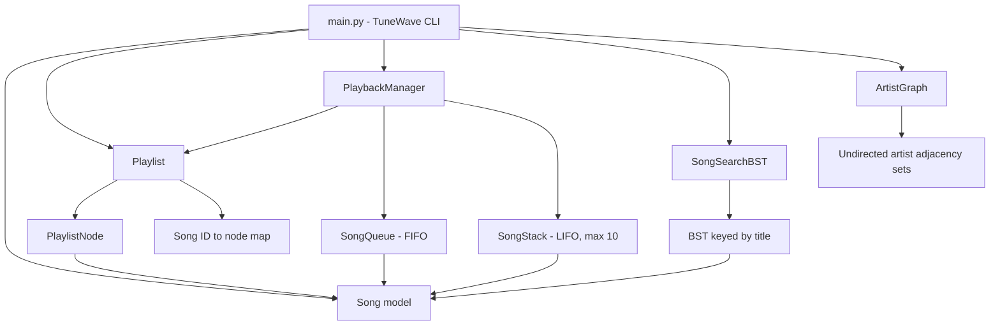

# TuneWave Music Player

TuneWave is a music-player core that demonstrates six data structures across
three features: playlist navigation, playback queue/history, and song search
with artist recommendations.

## Project layout

| File | Responsibility |
| --- | --- |
| `models.py` | main class for song with title , ID and artist attributes. |
| `playlist.py` | Defines doubly linked list for playlist and playlist nodes. |
| `playback.py` | Defines `SongQueue`, `SongStack`, and `PlaybackManager` for Up Next, play history, and playback state. |
| `search_recommendations.py` | Defines `SongSearchBST` for title search in aplhabatical order to minimize searching in other sub trees and `ArtistGraph` for related-artist recommendations that are 2 relations away. |
| `main.py` | Runnable command-line application. Its `TuneWave` class brings the features together and provides the cli menu. |
| `test/test-playlist.py` | Tests playlist behavior. |
| `test/test-playback.py` | Tests the queue, history, and playback manager. |
| `test/test-search-recommendations.py` | Tests title search and artist recommendations. |

## Run the application

From the `tunewave` directory, start the interactive command-line player with:

```powershell
py main.py
```

The application starts with sample songs and artist relationships. Use the
numbered menu to manage the playlist, control playback, search titles, and get
artist recommendations.

## Architecture



## Features and APIs

### 1. Playlist — doubly linked list and hash map

`PlaylistNode` stores a `Song` and optional `previous` and `next` node links.
`Playlist` keeps `head`, `tail`, and `current` pointers, plus `song_map`, which
maps each song ID to its node.

- `add_song(song)` appends a song and returns `False` if its ID is already in
  the playlist.
- `remove_song(song_id)` finds and unlinks a song by ID. If the current song is
  removed, playback selects its successor, or the new head when there is no
  successor.
- `next_song()` and `previous_song()` move the playlist pointer. At an end,
  they return `None` without moving when repeat is off; with repeat on, they
  wrap to the other end.
- `toggle_repeat()` switches repeat mode and returns its new state.
- `get_current_song()`, `get_songs()`, and `len(playlist)` provide the current
  song, playlist order, and song count.

### 2. Up Next and history — queue and stack

`SongQueue` is FIFO: songs are enqueued at the back and `dequeue()` returns the
oldest queued song. `SongStack` is LIFO: `pop()` returns the most recently
stored song. It retains at most 10 songs, discarding the oldest when full.

`PlaybackManager` coordinates those structures with a `Playlist`:

- `add_to_up_next(song_id)` queues a song found in the playlist and returns
  `False` for an unknown ID.
- `play_next()` plays a queued song first. When the queue is empty, it advances
  the playlist. Songs played from the queue do not change the playlist
  pointer.
- `back()` restores and removes the most recent history entry. It does not
  change the playlist pointer and returns `None` if history is empty.
- `get_currently_playing()` returns the current playback song.

When playback switches songs, the song being left is added to history.

### 3. Song search and related artists — BST and graph

`SongSearchBST` stores songs in a binary search tree keyed by title,
case-insensitively. Multiple songs may share a title, while a duplicate song
ID is rejected.

- `add_song(title, song_id, artist="Unknown Artist")` inserts a song and
  returns whether it was added.
- `find_song(title)` returns all songs with an exact title match, or an empty
  list.
- `prefix_search(prefix)` returns matching `Song` objects in alphabetical
  title order. It is case-insensitive and prunes tree branches that cannot
  match the prefix.

`ArtistGraph` represents relationships as an undirected graph.

- `add_relation(artist_a, artist_b)` adds a relationship in both directions.
- `recommend_artists(artist)` returns artists exactly two links away, excluding
  the requested artist and its direct connections. Results are sorted
  alphabetically; an unknown artist returns an empty list.

## Running the tests

Run these commands from the `tunewave` directory. The test filenames contain
hyphens, so invoke each test file directly:

```powershell
py test/test-playlist.py -v
py test/test-playback.py -v
py test/test-search-recommendations.py -v
```

Each test adds the project root to Python's module search path, so these
commands work when launched from the `tunewave` directory.

`tunewave.py` is an outdated duplicate facade and should not be used to launch
the application. Use `main.py` instead.
